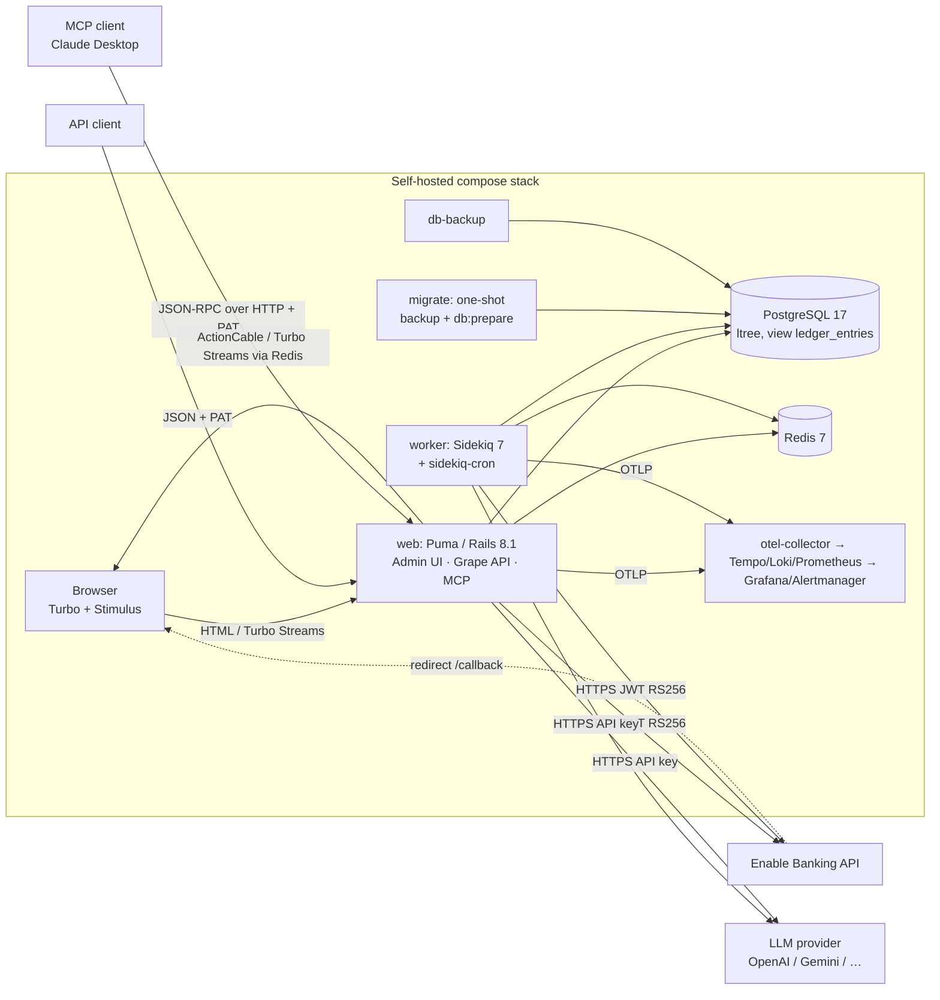

# 00 — Overview: open-banking-rails

> Functional specification for the Ruby → Kotlin rebuild. Source: https://github.com/softberries/open-banking-rails at commit
> `cd3bf6054b54e7eb84fd4405919c70e41dfa2794` (2026-06-02). Evidence convention: `path:line` is relative to the repo root at that commit;
> **[V]** = verified (observed in the runtime oracle or asserted by a passing spec), **[I]** = inferred from reading code.
> Inventory: `../inventory/` (machine-generated). Runtime oracle: `../oracle/`. Decisions: [decisions.md](decisions.md). Open questions: [unknowns.md](unknowns.md).

## Document map

| Doc | Content |
|---|---|
| [10-domain-model.md](10-domain-model.md) | Models/aggregates, associations, invariants, validations, callbacks, state machines |
| [20-business-rules.md](20-business-rules.md) | Numbered rules BR-001… (identity/banking/sync 001–199, classification/LLM 200–299, cash/ledger/analytics 300–399) + service catalogue |
| [30-http-api.md](30-http-api.md) | Every HTTP route (Rails router, Grape REST API v1, MCP) with oracle samples |
| [40-ui.md](40-ui.md) | Every page, layout, partial and Stimulus controller, with screenshots |
| [50-data.md](50-data.md) | Tables, view, indexes, constraints, migrations, seeds |
| [60-async-and-integrations.md](60-async-and-integrations.md) | Jobs, cron, retries, mailers, external APIs, Redis, ActionCable, rake tasks |
| [70-security-and-config.md](70-security-and-config.md) | Authn/authz, CSRF/CORS/CSP, encryption, secrets, every ENV var and initializer |
| [80-tests.md](80-tests.md) | Spec inventory mapped to rules/routes/pages; gaps |
| [coverage.json](coverage.json) | Machine-checked map: every inventory entry → doc section |

## Purpose

A **self-hosted personal-finance tracker** [I — README.md:1-60, wiki `open-banking-rails.md`]:

- Pulls bank accounts, balances and transactions **read-only** from PSD2 banks through the **Enable Banking** AISP aggregator
  (the app acts as a Third-Party Provider with the operator's own Enable Banking application credentials — `TppCredential`).
  It never initiates payments [I — README.md "What you get"; `app/services/enable_banking/`].
- Lets the user record **cash** transactions in manual "cash wallets" (opt-in per user, `users.track_cash`) and links ATM
  withdrawals to cash top-ups [I — docs/adr/0006-cash-tracking-opt-in.md; `app/services/cash/`].
- **Categorises** every transaction with a hybrid engine: user/system/LLM **merchant rules** first, then an **LLM** (per-user API key,
  OpenAI `gpt-5-mini` default) with confidence gating (auto-apply high confidence, queue the rest for review)
  [I — docs/adr/0005-llm-confidence-gating.md, docs/adr/0012-per-user-llm-credentials.md].
- Unifies bank + cash rows into one **ledger** (Postgres view `ledger_entries`) feeding an **analytics dashboard** (spend by category,
  cash flow, top merchants, drill-downs) and an **AI insight** card that only narrates numbers computed in code
  [I — docs/adr/0003-postgres-view-for-analytics.md, docs/adr/0008-ai-insight-architecture.md].
- Exposes the same capabilities as a **REST API** (`/api/v1`, Swagger UI at `/api/v1/docs`) and an **MCP server** (`/mcp`) for AI clients,
  both authenticated with personal access tokens [V — oracle `../oracle/http/POST_mcp.json`, `../oracle/http/GET_api__version_merchants.json`].
- Ships a privacy filter that blurs/masks amounts, IBANs and names for screen-sharing [I — app/helpers/admin/privacy_helper.rb; see 40-ui.md].

It is MIT-licensed, designed to run with `docker-compose.prod.yml` on the user's own host (ENV-only configuration; secrets
self-bootstrapped on first boot) [I — docs/adr/0014-self-hosted-deployment.md, bin/docker-entrypoint:1-45].

## Users and roles

| Actor | How they authenticate | What they can do | Evidence |
|---|---|---|---|
| **First-run visitor** | none — only while the `users` table is empty | Create the first user at `/setup`; every other HTML route redirects to `/setup` while no user exists | [V] `app/controllers/application_controller.rb:7-13`, `app/controllers/setup_controller.rb:6-25`; oracle `../oracle/http/GET_setup.json` cases `users_exist → 302`, `no_users → 200`; `../oracle/http/GET_admin_analytics.json` case `no_users_redirects_to_setup → 302` |
| **User (tenant owner)** | Devise e-mail + password session (`/admin/sign_in`) | Everything under `/admin/**`, `/sidekiq`, for **their own data only** (records are looked up through `current_user` associations). There is **one role**: every user is the administrator of their own tenant; there is no public sign-up (`skip: [:registrations]`) | [V] `config/routes.rb:4-10`, `app/controllers/admin/base_controller.rb:9`; oracle cases `other_tenant_id → 404` (e.g. `../oracle/http/GET_admin_merchants_id.json`). Exceptions (audit log, Sidekiq UI) are global — see 70-security-and-config.md |
| **API / MCP client** | `Authorization: Bearer obrl_…` personal access token issued in Settings → API Tokens | Same capabilities as the user, scoped to the token owner | [V] `lib/api/helpers/auth_helper.rb:7-22`, `app/controllers/mcp_controller.rb:18-26`; oracle `GET_api__version_merchants.json` cases `no_token/invalid_token/revoked_token → 401` |
| **Operator** | shell / compose | Configures ENV, runs rake tasks (`banking:*`, `cash:*`), backups/restore | [I] `lib/tasks/*.rake`, `bin/restore`, `docker-compose.prod.yml` |
| **External: Enable Banking** | the app signs RS256 JWTs with the TPP private key; the bank redirects the user back to `/callback` | AIS data source | [I] `app/services/enable_banking/client.rb`, `app/controllers/oauth_callbacks_controller.rb` |
| **External: LLM provider** | per-user API key | Merchant/category suggestion, AI insight narration, connection test | [I] `app/services/llm/` |

The schema is multi-tenant (every user-owned row carries `user_id` directly or via its parent) but the product is
"single-user shaped": one household per instance is the expected deployment [I — docs/adr/0011-first-run-setup.md].

## Architecture

- **One deployable codebase, three process types** (web, worker, migrate) plus infra containers [I — docker-compose.prod.yml:35-170, Procfile.dev:1-3].
  The context-fabric service catalogue lists the same 11 compose services (app, worker, migrate, db-backup, otel-collector, tempo, loki,
  prometheus, grafana, alertmanager, plus the app itself).
- **Web layer**: server-rendered ERB admin UI (Hotwire Turbo + Stimulus, Tailwind, Propshaft, Importmap with CDN pins for Chart.js),
  a Grape REST API mounted at `/` with prefix `/api` and path versioning `v1`, a Swagger UI page, and an MCP endpoint
  (`mcp` gem, Streamable HTTP transport, stateless, JSON responses) [I — config/routes.rb:23-31, lib/api/api.rb:3-6, app/controllers/mcp_controller.rb:6-15].
- **Domain layer**: thin controllers → verb-named service objects (`Domain::Verb.call(...)` with `Input`/`Result` structs) → ActiveRecord models.
  External APIs are wrapped by adapters (`EnableBanking::Client/Api/Operations`, `Llm::Client` + provider registry) that are swapped by in-memory
  fakes in tests [I — repo AGENTS.md "Controllers & service objects", docs/adr/0013].
- **Async**: Sidekiq via ActiveJob (`config.active_job.queue_adapter = :sidekiq`, config/application.rb:45); one queue `default`, concurrency 5
  (config/sidekiq.yml); cron `AutoSync::DispatcherJob` every minute (config/schedule.yml). Long operations are tracked as `OperationRun`
  rows and streamed to the browser as Turbo Streams (docs/adr/0009) [I; V for completion — `../oracle/operation_runs_after_capture.jsonl`].
- **Data**: PostgreSQL 17 with `ltree` (category paths, GiST), a `scenic`-versioned view `ledger_entries` (v04) that UNIONs
  `bank_transactions` and `manual_transactions`, `paper_trail` audit table `versions`, AR encryption for secrets and selected PII
  [I — inventory/schema.rb, db/views/ledger_entries_v04.sql, docs/adr/0004].
- **Time zone**: no `config.time_zone` is set, so Rails runs in **UTC** (config/application.rb has no override) [I]; see BR rules on
  "today"/periods in 20-business-rules.md Part C.

## Request flow (typical)

1. **Browser page** `GET /admin/bank_transactions` → Rack (Rack::Cors, Lograge, Warden) → `ApplicationController#require_first_run_setup`
   (redirect to `/setup` if no user) → `allow_browser versions: :modern` (406 for legacy UAs, oracle `GET_admin_analytics.json` case
   `legacy_browser_ua → 406`) → `Admin::BaseController#authenticate_user!` (302 to `/admin/sign_in` if anonymous) → controller loads data
   through `current_user` scopes, Ransack filters, Pagy offset pagination → ERB with admin layout [V — oracle `GET_admin_bank_transactions.json`].
2. **Form submit** (CSRF token required, oracle `POST_admin_categories.json` case `missing_csrf_token → 422`) → controller builds the service
   `Input` → service runs inside a DB transaction → `redirect_to … notice:` (302/303) or `render :new/:edit, status: 422` with `flash.now[:alert]`.
3. **Long operation** (e.g. "Sync now") → service creates `OperationRun(queued)` + enqueues a Sidekiq job → redirect to the run page that
   subscribes to a Turbo Stream → job updates progress and broadcasts → `OperationRunFinalizer` sets the final status.
4. **API** `GET /api/v1/transactions` with Bearer PAT → Grape → `Auth::PersonalAccessTokenAuthenticator` (SHA-256 digest lookup, updates
   `last_used_at`) → same services/scopes → Grape entity JSON with pagination envelope [V — `../oracle/http/GET_api__version_transactions.json`].
5. **MCP** `POST /mcp` JSON-RPC `tools/call` → `McpController` (PAT) → `Mcp::ServerBuilder` registers 27 tools for that user → tool calls the
   same services → JSON text content [V — `../oracle/http/POST_mcp.json`].

## Technology stack (as built)

| Concern | Ruby implementation (locked version) | Evidence |
|---|---|---|
| Language/runtime | Ruby 3.4.8 | `.ruby-version` |
| Web framework | Rails 8.1.3 (`load_defaults 8.1`), Puma 8.0.1 | Gemfile.lock, config/application.rb:31 |
| Front-end | Turbo 2.0.23, Stimulus 1.3.4, Importmap 2.2.3, Tailwind 4 (tailwindcss-rails 4.4.0), Propshaft 1.3.2, Chart.js 4.5.1 via CDN | Gemfile.lock, config/importmap.rb |
| REST API | Grape 3.2.1 + grape-entity 1.0.4 + grape-swagger 2.1.4 | lib/api/ |
| MCP | `mcp` 0.15.0 (Streamable HTTP, stateless) | app/controllers/mcp_controller.rb |
| Auth | Devise 5.0.4 (session); custom PAT (SHA-256 digest) | config/initializers/devise.rb, app/models/personal_access_token.rb |
| DB | PostgreSQL 17 (`pg` 1.6.3), ltree, scenic 1.9.0 views | inventory/schema.rb |
| Audit | paper_trail 17.0.0 | config/initializers/paper_trail_ransack.rb |
| Money | money-rails 3.0.0 (integer cents + ISO currency) | config/initializers/money.rb |
| Search / paging | Ransack 4.4.1, Pagy 43.5.3 | config/initializers/ransack.rb, pagy.rb |
| Tags | gutentag 3.0.1 (tables exist, 0 rows in oracle) | inventory/schema.rb |
| Background jobs | Sidekiq 7.3.10, sidekiq-cron 2.4.0, Redis 7 (redis 5.4.1) | config/sidekiq.yml, config/schedule.yml |
| Realtime | ActionCable (Redis adapter in dev/prod) + Turbo Streams | config/cable.yml |
| HTTP client | Faraday 2.14.1; JWT 2.10.2 (RS256) | app/services/enable_banking/client.rb |
| LLM | ruby_llm 1.15.0 behind `Llm::Client` registry | app/services/llm/ |
| Logging / observability | Lograge 0.14.0; OpenTelemetry SDK 1.11 + instrumentation-all + OTLP exporters for traces/logs/metrics | config/initializers/lograge.rb, opentelemetry.rb |
| Tests | RSpec 8 (rspec-rails 8.0.4), FactoryBot, shoulda-matchers, WebMock, Capybara, rspec-sidekiq, SimpleCov — 825 examples, 0 failures, 92.05 % line coverage | inventory/specs_run.json, inventory/coverage_last_run.json |
| Security tooling | Brakeman 8.0.4, bundler-audit 0.9.3, AR encryption | config/bundler-audit.yml |

## Gem → JVM library mapping

The target stack is **fixed** by the migration's shared rules (`CLAUDE.md` → "Target stack", added after the first investigation run; recorded as
ID-7 in [decisions.md](decisions.md#inherited-decisions)): Kotlin on JVM 21, Spring Boot 3.x, Spring Web MVC, Spring Data JPA (Hibernate), Flyway,
Jackson Kotlin module, Spring Security, JTE templates reusing the Ruby CSS/JS and Hotwire/Stimulus behaviour, JUnit 5 + Kotest assertions + MockK,
Testcontainers (PostgreSQL, Redis), Gradle Kotlin DSL + version catalog + wrapper, ktlint, package-by-feature. It agrees with the Phase 4 decisions
**D-001** (JPA + Flyway + Spring Security; adds JobRunr for jobs, which the fixed stack leaves open) and **D-004** (server-rendered UI keeping Hotwire),
and framework scope per **D-006**. "target stack" = fixed by CLAUDE.md; "proposed" = recommended library within that stack, not yet confirmed;
"needs decision" = the fixed stack does not name a library and no decision exists yet.

| Gem (runtime) | Role in this app | Kotlin / JVM equivalent | Status |
|---|---|---|---|
| rails (actionpack, activerecord, activejob, actionmailer, actioncable, activestorage, actionmailbox, actiontext) | web framework, ORM, jobs, mail, websockets; ActiveStorage/ActionMailbox/ActionText are loaded but **unused** (no tables) | Spring Boot 3 (Spring MVC); ActionMailbox/ActiveStorage/ActionText not ported | **decided (D-001, D-006)** |
| puma | HTTP server | embedded Tomcat (Spring Boot / Spring Web MVC default) | **target stack** |
| pg | Postgres driver | PostgreSQL JDBC (`org.postgresql:postgresql`) | **target stack** (PostgreSQL) |
| ActiveRecord models + scopes | ORM | Spring Data JPA/Hibernate; `ledger_entries` as `@Immutable` entity, ltree via custom type/native queries, jsonb via `@JdbcTypeCode(SqlTypes.JSON)` | **target stack**, D-001 |
| schema.rb / migrations / scenic | schema + versioned view | Flyway, `V1__baseline` from final schema.rb + view v04, `baselineOnMigrate` for existing DBs | **decided (D-001, D-005)** |
| devise | session auth, password reset e-mails, bcrypt | Spring Security (form login, `BCryptPasswordEncoder` compatible with Devise bcrypt hashes, remember-me 2 weeks) | **decided (D-001, D-005)** |
| (custom PAT) | Bearer tokens, SHA-256 digest | Spring Security bearer-token filter (custom `AuthenticationProvider`, SHA-256 digest lookup) | **target stack** (Spring Security) |
| grape, grape-entity | REST API + DTOs | Spring Web MVC `@RestController` + Kotlin data classes (Jackson Kotlin module) | **target stack** |
| grape-swagger, grape-swagger-entity | OpenAPI 2 doc + Swagger UI | springdoc-openapi (OpenAPI 3) + Swagger UI at `/api/v1/docs` | **decided (D-006)** |
| mcp | MCP server over Streamable HTTP | hand-written JSON-RPC 2.0 endpoint in a Spring Web MVC controller (no MCP library) | **decided (D-019)** |
| turbo-rails, stimulus-rails, importmap-rails, tailwindcss-rails, propshaft | server-rendered UI with Hotwire | **JTE** templates; Hotwire Turbo/Stimulus JS, Tailwind CSS, importmap pins reused verbatim | **target stack**, D-004 |
| money-rails | money type, cents + currency, formatting | JavaMoney (Moneta) or `Long` cents + `java.util.Currency` value class | proposed |
| ransack | search/sort params on index pages | Spring Data JPA `Specification`s built from the same `q[...]` / `q[s]` params (D-004 keeps URLs and form field names, so the param contract stays) | **target stack** + D-004 (param whitelist per page in 40-ui.md) |
| pagy | offset pagination | Spring Data `Pageable` / manual limit-offset | proposed |
| paper_trail | audit log table `versions` | Hibernate Envers or explicit audit table writes | proposed |
| gutentag | tagging (unused at runtime, 0 rows) | not ported | **decided (D-006)** |
| sidekiq, sidekiq-cron, connection_pool, redis | job queue, retries, cron, Sidekiq Web UI | JobRunr (Postgres-backed: retries, recurring jobs, dashboard behind auth) — the fixed stack names no job library, D-001 chose JobRunr. Redis is in the fixed stack (Testcontainers Redis) but JobRunr does not need it; the Ruby app's only Redis uses are Sidekiq and the ActionCable adapter (no application code calls `Rails.cache`, production cache store unset — `config/environments/production.rb:50`, 60-async-and-integrations.md), so Redis is only needed for multi-instance Turbo Stream fan-out [I] | **decided (D-001, D-006)** |
| ActionCable + Turbo Streams | live progress | Turbo Stream HTML fragments over SSE (`<turbo-stream-source>`) or Spring WebSocket | **decided (D-004)** |
| faraday | HTTP client | Spring `RestClient` | decided (D-001) |
| jwt | RS256 JWT for Enable Banking | Nimbus JOSE + JWT or jjwt | proposed |
| ruby_llm | multi-provider LLM client with structured output | own thin per-provider adapters (OpenAI/Gemini/Anthropic) over Spring `RestClient` behind an `LlmClient` interface + in-memory fake | **decided (D-020)** |
| rack-cors | CORS | framework CORS config | proposed |
| lograge | single-line JSON request logs | Logback + logstash-logback-encoder | proposed (standard: structured request logging) |
| opentelemetry-* | traces, logs, metrics via OTLP | OpenTelemetry Java agent / Spring Boot OTel starter, OTLP exporters | proposed (project standard) |
| image_processing | ActiveStorage variants (unused) | not ported | **decided (D-006)** |
| bootsnap, tzinfo-data | boot cache, tz data | n/a (JVM has tzdb) | n/a |
| dotenv-rails (dev/test) | `.env` loading | Spring profiles / env | n/a |
| rspec-rails, factory_bot, faker, shoulda-matchers, webmock, capybara, rspec-sidekiq, database_cleaner, simplecov | tests | **JUnit 5 + Kotest assertions + MockK + Testcontainers (PostgreSQL, Redis)** (target stack); WireMock, Playwright for Java, kotlin-faker, Kover (proposed); oracle samples as parity fixtures | target stack / proposed |
| brakeman, bundler-audit, rubocop | static analysis | **ktlint** (target stack); detekt, OWASP dependency-check / Dependabot (proposed) | target stack / proposed |
| bullet, web-console, annotaterb, debug | dev tooling | n/a | n/a |
| bundler / Gemfile | build + dependency management | Gradle Kotlin DSL with a version catalog (`gradle/libs.versions.toml`) and the Gradle wrapper | **target stack** |

The full resolved gem list is in `../inventory/gems.txt`.

## Key risks for the migration (summary — details in the linked docs and [unknowns.md](unknowns.md))

1. **Cross-tenant data issues** found during the investigation (bank account uid takeover, global audit log, Sidekiq UI for every user, category tree) — **fix (D-003)**; requires a schema change (per-credential uid uniqueness, audit ownership).
2. **Encrypted data at rest** uses Rails' ActiveRecord Encryption format (AES-256-GCM, key derivation from three ENV secrets); **D-005 requires
   in-place compatibility**, so the Kotlin service must implement that format byte-for-byte (golden tests) (see 70-security-and-config.md, 50-data.md).
3. **Data-exchange bundles** (`.obrbundle`) are a passphrase-encrypted, versioned file format users may hold; v1 import must keep working (D-005, D-013).
4. **Hotwire UI** (48 pages, 5 layouts, 114 partials, 21 Stimulus controllers) is the largest surface; ported as server-rendered templates (D-004) — Rails form/Turbo conventions must be reproduced exactly.
6. **Time zone change** (D-007): Kotlin evaluates "today"/periods/schedules in `APP_TIME_ZONE` (default Europe/Warsaw) while Ruby uses UTC — parity tests must pin `APP_TIME_ZONE=UTC`.
7. **Recorded deviations** (D-002, D-003, D-008, D-011, D-018) mean some oracle samples are intentionally *not* the Kotlin expectation — see the deviation list in [decisions.md](decisions.md).
5. **Enable Banking** flows can only be verified with fakes here (no sandbox credentials) — real-API parity needs sandbox testing.
