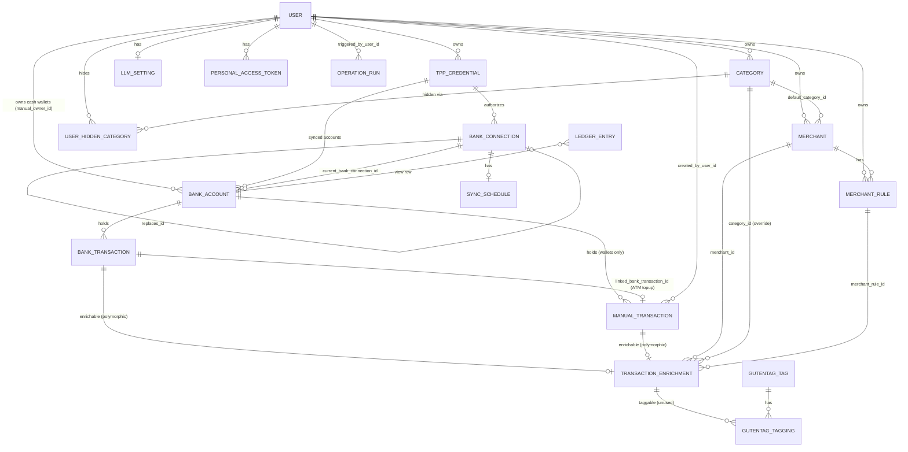
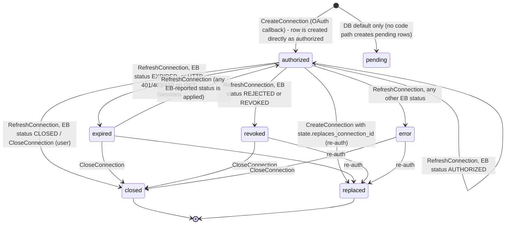
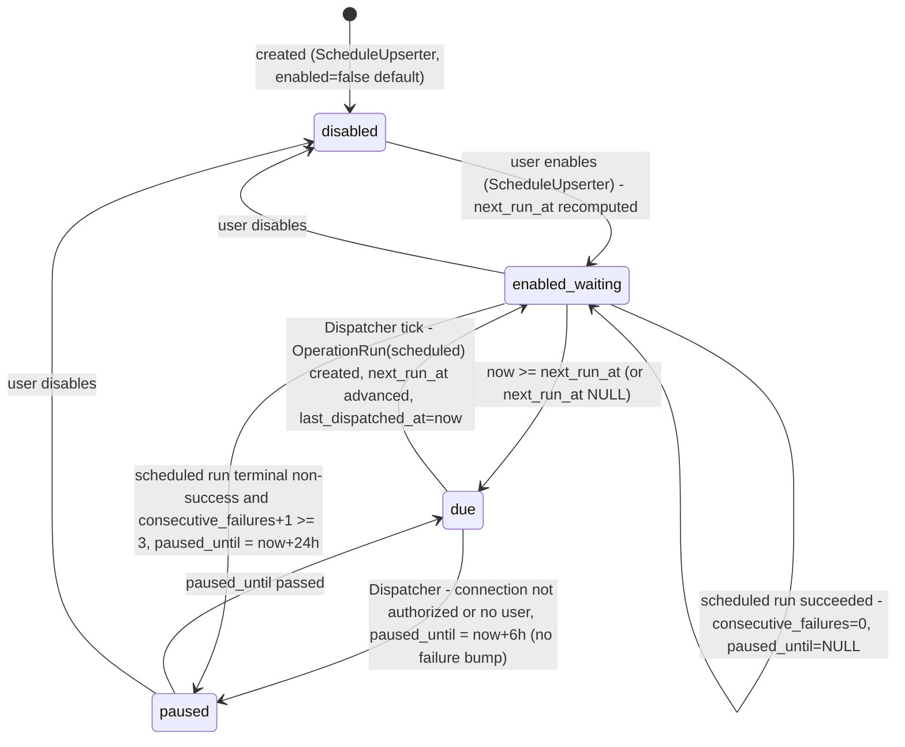

# 10 - Domain model


> **Decisions apply.** Where Phase-4 decisions change behaviour for Kotlin, the [deviation register](decisions.md#deviation-register--where-the-kotlin-expectation-differs-from-the-ruby-oracle) (X-01…X-27) overrides the Ruby behaviour described here; unknowns carry a **Resolution** line ([unknowns.md](unknowns.md)).

Scope: every model/aggregate of **open-banking-rails** (commit `cd3bf605`): the 17 application classes in `app/models`
(16 ActiveRecord models + the non-AR `StyleguideDemo`), the `LedgerEntryConcern` mixin, and the framework models that are
loaded but mostly unused (PaperTrail, ActiveStorage, ActionMailbox, ActionText, Gutentag). Physical table details
(SQL types, indexes, FKs, view SQL, migrations, seeds) are in [50-data.md](50-data.md); this document covers behaviour.

Legend: **[V]** = verified (passing spec cited, or seen in the oracle run); **[I]** = inferred from reading code only.
All source paths are relative to the source checkout `src/`. The whole spec suite passed (825 examples, 0 failures,
`inventory/specs_run.json`), so a cited spec counts as **[V]**.

## 0. Cross-cutting conventions

| Topic | Rule | Evidence |
|---|---|---|
| Tenant | The tenant is `User`. Every row belongs to exactly one user, either directly (`user_id`) or through a chain of FKs (see the ownership table below). The schema is "single-user-shaped multi-tenant": in practice one or two users per self-hosted install, and additional users are created from the Rails console, never through public sign-up. | ADR `docs/adr/0011-first-run-setup.md:3-8,18-24,29-30` [I] |
| Tenant isolation | Isolation is enforced only in application code ("authorize through scoped associations", `current_user.merchants.find(...)`). There is no row-level security, and polymorphic links have no DB FK. | `AGENTS.md:252-253`; ADR 0002 `docs/adr/0002-polymorphic-enrichment.md:24-25` [I] |
| Money | Integer minor units in a `bigint *_cents` column, with the ISO 4217 code in a sibling `currency` column (`varchar(3)` on ledger tables). Read as `Money` via money-rails `monetize ... with_model_currency: :currency`. The default currency is PLN. Bank amounts are stored as **magnitudes** (absolute values) and the sign comes from `direction`. | `config/initializers/money.rb:1-10`; `db/migrate/20260428214128_create_bank_transactions.rb:17-23`; `app/services/enable_banking/transaction_normalizer.rb:100-107` [I]; `spec/models/bank_transaction_spec.rb:45` [V] |
| Rounding | Bank decimal strings are converted with `Money.from_amount(BigDecimal(abs), currency).cents`. money gem rounding is left at its default (banker's rounding, ROUND_HALF_EVEN) because the initializer does not set it. | `app/services/enable_banking/transaction_normalizer.rb:103-107`, `config/initializers/money.rb` [I] |
| Time | `config.time_zone` is not set, so the app zone is **UTC**, and all `datetime` columns hold UTC timestamps. `Date` columns (`booking_date` etc.) are bank-local calendar dates with no zone. The showcase seeder runs inside `Time.use_zone("Europe/Warsaw")`. | `config/application.rb:32-46` (no `time_zone`) [I]; oracle `server.log.txt` version rows stamped `Etc/UTC` [V]; `app/services/seeders/showcase.rb:52` |
| Encryption at rest | Rails ActiveRecord encryption, **non-deterministic** (no `deterministic: true` anywhere), on 8 columns. Ciphertext is stored as a JSON envelope string `{"p":"<base64>","h":{"iv":"…","at":"…"[,"c":true]}}` in a `text` column. Keys come from `ACTIVE_RECORD_ENCRYPTION_*` env vars. | ADR `docs/adr/0004-encryption-at-rest.md:15-23`; `config/initializers/active_record_encryption.rb:15-32`; envelope observed in oracle `server.log.txt` [V] |
| Audit | `paper_trail` 17 is enabled on `TppCredential`, `BankConnection`, `BankAccount`, `ManualTransaction`. `whodunnit` is **never set**, so it is always NULL (see U-105). | models (below); oracle `server.log.txt` INSERT INTO "versions" … `whodunnit` = NULL [V] |
| Ransack allowlists | Every app model declares `ransackable_attributes` / `ransackable_associations`. These are the only columns that admin/API filters and sorts may touch. Encrypted columns are always excluded. | per model below; ADR 0004 `:20-21` |
| Callbacks policy | AR callbacks are allowed only for same-row hygiene. Cross-aggregate side effects live in services. | `AGENTS.md:357-373` |
| Validation messages | Where no custom message is given, Rails default English messages apply (e.g. "can't be blank", "is not included in the list", "has already been taken"). They are rendered as full messages "<Attribute> <message>". | Rails defaults [I] |

### Ownership: how each row reaches its owning user

| Model | Path to `User` | Code helper |
|---|---|---|
| TppCredential, Category, Merchant, MerchantRule, LlmSetting, PersonalAccessToken, UserHiddenCategory | `user_id` directly | `for_user` scopes where defined |
| BankConnection | `tpp_credential.user_id` | `BankConnection.for_user` `app/models/bank_connection.rb:77` |
| BankAccount (synced, `manual=false`) | `tpp_credential.user_id` | `BankAccount#owner` `app/models/bank_account.rb:93-95` |
| BankAccount (cash wallet, `manual=true`) | `manual_owner_id` | same |
| BankTransaction | `bank_account → tpp_credential.user_id`. Wallets never hold bank transactions. | `BankTransaction.for_user` `app/models/bank_transaction.rb:82` |
| ManualTransaction | `bank_account.manual_owner_id`. It also has `created_by_user_id`, which can differ. | `ManualTransaction.for_user`, `#user` `app/models/manual_transaction.rb:86-88,107-109`; `spec/models/manual_transaction_spec.rb:100` [V] |
| TransactionEnrichment | `enrichable` (BankTransaction or ManualTransaction) → as above | `TransactionEnrichment.for_user` `app/models/transaction_enrichment.rb:61-68`; `spec/models/transaction_enrichment_spec.rb:93` [V] |
| SyncSchedule | `bank_connection → tpp_credential.user_id` | via BankConnection |
| OperationRun | `triggered_by_user_id` (NOT NULL). `subject` is polymorphic and optional. | `app/models/operation_run.rb:56-57` |
| LedgerEntry (view row) | `bank_account_id IN user.all_bank_account_ids` | `app/models/ledger_entry.rb:80`; `app/models/user.rb:74-78` |
| PaperTrail::Version | **none.** There is no user column, and the item is polymorphic. | see U-121 |

## 1. ER overview



Aggregates (consistency boundaries as the services treat them) [I]:

1. **Banking access**: `TppCredential` (root) → `BankConnection` → `SyncSchedule`. Accounts reference the connection but outlive it.
2. **Account ledger**: `BankAccount` (root) → `BankTransaction` / `ManualTransaction`, each with its 0..1 `TransactionEnrichment`. The LedgerEntryConcern makes the enrichment an owned child (`dependent: :destroy`).
3. **Taxonomy** (per user): `Category` tree; `Merchant` (root) → `MerchantRule`; `UserHiddenCategory`.
4. **User settings**: `LlmSetting`, `PersonalAccessToken`, the `User` flags.
5. **Operation tracking**: `OperationRun`, standalone and linked to a subject.

---

<a id="model-user"></a>
## User

**Purpose.** The account and tenant. Devise authentication (`database_authenticatable, recoverable, rememberable,
validatable`), with no registrations (first user via `/setup`, others via console). Owns the per-user taxonomy, banking
credentials, cash wallets, LLM settings, API tokens and operation runs. `app/models/user.rb:22-45`; ADR 0011.

**Attributes** (table `users`)

| Attribute | Type | Meaning |
|---|---|---|
| `email` | string, NOT NULL, default `""`, unique | Login. Devise lower-cases it and strips whitespace (`case_insensitive_keys`, `strip_whitespace_keys` = `[:email]`), `config/initializers/devise.rb:61,66` [I] |
| `encrypted_password` | string, NOT NULL | bcrypt hash; cost 12 (1 in test) `config/initializers/devise.rb:126` [I] |
| `reset_password_token` / `reset_password_sent_at` | string (unique) / datetime | Devise recoverable. Tokens are valid for 6 hours `devise.rb:230` [I] |
| `remember_created_at` | datetime | Devise rememberable. `expire_all_remember_me_on_sign_out = true` `devise.rb:173` [I] |
| `name` | string | Display name. **Required** by the model `user.rb:25` |
| `track_cash` | boolean NOT NULL default false | Opt-in cash tracking (ADR `0006-cash-tracking-opt-in.md:14-18`) |
| `reveal_hidden_categories` | boolean NOT NULL default false | When true, `hides_category?` always returns false (privacy override) `user.rb:49-50` |
| `created_at`, `updated_at` | datetime | timestamps |

**Validations** [I] unless noted: `name` presence (custom code). The Devise `validatable` set: email presence; email uniqueness
(case-sensitive compare after downcasing); email format `/\A[^@\s]+@[^@\s]+\z/` (`devise.rb:189`); password
presence on create, confirmation, length 6..128 (`devise.rb:184`). Source: `inventory/models.json` User validations.
`spec/system/first_run_setup_spec.rb:67,82` [V] covers mismatched confirmation and blank email.

**Callbacks** (Devise only) [I]: before validation, email is downcased and whitespace is stripped. Before update,
`clear_reset_password_token` runs (when email or password changes). After update, `send_password_change_notification` /
`send_email_changed_notification` run (these send mail only when Devise config enables them; the defaults are false and they
are not enabled here).

**Associations** (`user.rb:27-45`)

| Association | Kind | dependent |
|---|---|---|
| `tpp_credentials` | has_many | `:destroy` |
| `bank_connections`, `bank_accounts` | has_many through tpp_credentials | (only synced accounts) |
| `cash_wallets` | has_many BankAccount where `manual = true`, FK `manual_owner_id` | `:destroy` |
| `manual_transactions` | has_many through cash_wallets | - |
| `user_hidden_categories` / `hidden_categories` | has_many / through (source `category`) | `:destroy` / - |
| `categories`, `merchants`, `merchant_rules` | has_many | `:destroy` |
| `llm_setting` | has_one | `:destroy` |
| `personal_access_tokens` | has_many | `:destroy` (`spec/models/personal_access_token_spec.rb:120` [V]) |
| `operation_runs` | has_many, FK `triggered_by_user_id` | `:destroy` (ADR `0009-operation-run-tracker.md:32`) |

User deletion has no UI or API path. Through the cascade above it would fail as soon as a credential still has
connections or accounts (`TppCredential … dependent: :restrict_with_error`) (see U-110). [I]

**Domain methods** (all [V] unless noted)

| Method | Behaviour | Evidence |
|---|---|---|
| `hides_category?(category_or_id)` | False if `reveal_hidden_categories`, or if the argument is blank. Otherwise true when the id is in `hidden_subtree_ids`. | `user.rb:49-54`; `spec/models/user_spec.rb:27` |
| `hidden_subtree_ids` | Takes the `path`s of the user's own categories that are explicitly hidden, then returns the ids of **this user's** categories whose path is `<@` (descendant-or-self of) any hidden path. Memoised per instance. Empty set when nothing is hidden. | `user.rb:56-66`; `spec/models/user_spec.rb:43` |
| `primary_tpp_credential` | `tpp_credentials.find_by(primary: true)` | `user.rb:68-70` [I] |
| `all_bank_account_ids` | ids of synced accounts (via the user's credentials) UNION the user's wallets (`manual_owner_id`). | `user.rb:74-78`; `spec/models/user_spec.rb:51` |
| `owned_bank_accounts` | `BankAccount.where(id: all_bank_account_ids)` | `user.rb:80-82` |
| `own_holder_names` | Distinct, stripped, upper-cased non-blank `name` values of the owned accounts. | `user.rb:86-88`; `spec/models/user_spec.rb:78` |
| `own_ibans` | Owned accounts' `iban` plus every alternate IBAN, with whitespace removed, upper-cased and deduplicated. | `user.rb:90-94`; `spec/models/user_spec.rb:65` |
| `initials` | `"?"` if name is blank. Otherwise the upper-cased first letter of the first two whitespace-separated parts. | `user.rb:96-100`; `spec/models/user_spec.rb:88` |
| `display_name` | `name`, or `email` when name is blank | `user.rb:102-104`; `spec/models/user_spec.rb:96` |

No paper_trail, no encryption, no ransack allowlist (`inventory/models.json`).

---

<a id="model-tppcredential"></a>
## TppCredential

**Purpose.** A TPP (Third-Party Provider) application registration at the Open Banking aggregator **Enable Banking**:
the application id, the RSA private key used to sign API JWTs, the public certificate and the OAuth redirect URL. A user may have
several, and at most one is `primary`. `app/models/tpp_credential.rb:36-130`; ADR `0013-enable-banking-adapter-shape.md`.

**Attributes**

| Attribute | Type | Meaning |
|---|---|---|
| `user_id` | bigint NOT NULL | owner |
| `name` | string NOT NULL | label, also used as the breadcrumb (`to_breadcrumb`) |
| `provider` | string NOT NULL default `enable_banking` | `PROVIDERS = %w[enable_banking]` |
| `environment` | string | `ENVIRONMENTS = %w[PRODUCTION SANDBOX]`, blank allowed |
| `status` | string NOT NULL default `pending` | `STATUSES = %w[pending active error]` (lifecycle below) |
| `primary` | boolean NOT NULL default false | one primary per user |
| `application_id` | text, **encrypted** | Enable Banking application id (required) |
| `private_key_pem` | text, **encrypted** | RSA private key PEM (required) |
| `public_cert_pem` | text (clear) | certificate; public material, kept in clear on purpose (`db/migrate/20260428185911_create_tpp_credentials.rb:16-18`) |
| `cert_expires_at` | datetime | derived from the cert on every save |
| `redirect_url` | string | OAuth callback (required); may be overwritten by verification (below) |
| `last_verified_at` / `last_verification_error` | datetime / text | outcome of "test connection" |
| `metadata` | jsonb NOT NULL default `{}` | last `GET /application` response from Enable Banking (includes `redirect_urls`) `app/services/enable_banking/operations/verify_credential.rb:189-197` |

**Validations** (`tpp_credential.rb:47-53,73`): `name` presence; `provider` presence + inclusion; `status` presence +
inclusion; `environment` inclusion (allow blank); `application_id`, `private_key_pem`, `redirect_url` presence;
custom `only_one_primary_per_user` (only when `primary`): if another row of the same user is primary, it adds the error on
`primary` **"another credential is already primary for this user"** (full message "Primary another credential is already
primary for this user"). `spec/models/tpp_credential_spec.rb:116` [V]. The DB partial unique index is the final guard.

**Callbacks**: `before_save :extract_cert_metadata` sets `cert_expires_at = cert.not_after`, or NULL when the PEM is blank
or unparsable (no exception). `tpp_credential.rb:55,118-121`; specs `:53,:62,:70` [V].

**Associations**: `belongs_to :user`. `has_many :bank_connections, dependent: :restrict_with_error`.
`has_many :bank_accounts, dependent: :restrict_with_error`. A credential with connections or accounts cannot be destroyed: `destroy`
returns false with base error "Cannot delete record because dependent bank connections exist" (Rails default text) [I].

**Encryption**: `encrypts :application_id, :private_key_pem` (non-deterministic). Round-trip is verified and the raw column ≠
plaintext: `spec/models/tpp_credential_spec.rb:126` [V].
**Audit**: `has_paper_trail skip: %i[application_id private_key_pem]`. The secrets never enter versions:
`spec/models/tpp_credential_spec.rb:137` [V].
**Scopes**: `primary_for(user)` = `where(user:, primary: true)`.
**Ransack**: `id name provider environment status primary redirect_url cert_expires_at last_verified_at user_id
created_at updated_at`; associations `user bank_connections`.

**Domain methods**: `cert_info` parses the PEM and returns `{subject, issuer, not_before, not_after, days_remaining
(integer days, truncated), serial, signature_algorithm, key_size (RSA bits or nil)}`, or nil on blank or garbage (spec `:77` [V]).
`cert_expired?` = `cert_expires_at < now` (spec `:92` [V]). `cert_expiring_soon?(within: 30.days)` (spec `:98` [V]).
`make_primary!` clears `primary` on every other credential of the user, then sets it on this one, in one transaction
(spec `:104` [V]).

**Status lifecycle** [I]

| From | To | Trigger |
|---|---|---|
| (new) | `pending` | DB default on create |
| any | `active` | `EnableBanking::Operations::VerifyCredential` success: also sets `last_verified_at`, clears the error, stores `metadata`. If Enable Banking has exactly one registered redirect URL and it differs from ours, `redirect_url` is overwritten with it (`verify_credential.rb:184-211`) |
| any | `error` | VerifyCredential when the HTTP call fails (`last_verification_error = "HTTP <status>: <error>"`) or raises `EnableBanking::Error` (message stored) (`verify_credential.rb:168-179`) |

The status is informational. No code path blocks use of an `error` credential [I].

---

<a id="model-bankconnection"></a>
## BankConnection

**Purpose.** One PSD2 consent session at one bank (an ASPSP), created through a credential. Holds the encrypted session id
and the consent window (`valid_until`). Re-authorising creates a **new** connection that `replaces` the old one (audit
trail is kept). `app/models/bank_connection.rb:42-108`.

**Attributes**

| Attribute | Type | Meaning |
|---|---|---|
| `tpp_credential_id` | bigint NOT NULL | owning credential (→ user) |
| `replaces_id` | bigint, self-FK | the previous connection this one superseded |
| `bank_slug` | string NOT NULL | `aspsp_name.parameterize(separator: "_")`, e.g. `pko_bp` (`create_connection.rb:35`) |
| `bank_country` | string default `PL` | ASPSP country |
| `bank_name` | string | human-readable ASPSP name |
| `status` | string NOT NULL default `pending` | `STATUSES = %w[pending authorized expired revoked replaced error closed]` |
| `psu_type` | string default `personal` | `PSU_TYPES = %w[personal business]`, blank allowed |
| `session_id` | text, **encrypted** | Enable Banking session id |
| `psu_id_hash` | text, **encrypted** | PSU identifier hash returned by Enable Banking |
| `raw_session_payload` | text, **encrypted** | full `POST /sessions` response as a JSON string (source of truth) |
| `access_balances`, `access_transactions` | boolean NOT NULL default true | granted scopes |
| `authorized_at`, `valid_until`, `last_refreshed_at`, `last_synced_at`, `closed_at` | datetime | lifecycle stamps |
| `last_error` | text | last refresh error, `"HTTP <status>: <error>"` |

**Validations**: `bank_slug` presence; `status` presence + inclusion; `psu_type` inclusion (allow blank).
**Associations**: `belongs_to :tpp_credential`. `belongs_to :replaces` (optional). `has_one :user, through: :tpp_credential`.
`has_many :current_bank_accounts` (BankAccount via `current_bank_connection_id`, **`dependent: :nullify`**).
`has_one :sync_schedule, dependent: :destroy`.
**Encryption**: `encrypts :session_id, :psu_id_hash, :raw_session_payload` (`spec/models/bank_connection_spec.rb:105` [V]).
**Audit**: `has_paper_trail skip: %i[session_id psu_id_hash raw_session_payload]`.
**Ransack**: `id bank_slug bank_country bank_name status psu_type valid_until authorized_at last_refreshed_at
last_synced_at closed_at access_balances access_transactions tpp_credential_id replaces_id created_at updated_at`;
associations `tpp_credential replaces`.

**Scopes** (`bank_connection.rb:74-79`)

| Scope | Semantics |
|---|---|
| `active` | `status = 'authorized'` |
| `inactive` | `status <> 'authorized'` |
| `for_bank(slug)` | `bank_slug = slug` |
| `for_user(user)` | join credential, `tpp_credentials.user_id = user.id` (`spec/models/bank_connection_spec.rb:83` [V]) |
| `expiring_within(d)` | `active` AND `valid_until <= now + d` (also includes already-past dates) (spec `:95` [V]) |
| `expired` | `valid_until < now`, **regardless of status** |

**Derived values** [V] (`spec/models/bank_connection_spec.rb:45,51,57,73`): `expired?` = `valid_until` present and `< now`.
`expiring_soon?(within: 7.days)` = `valid_until < now + within`. `days_until_expiry` = integer days (truncated toward 0),
nil if `valid_until` is blank. `status_tone`: authorized → `warning` if expiring soon, else `success`; pending → `info`;
expired/revoked/error → `danger`; replaced and anything else → `muted`. `to_breadcrumb` = `bank_name`, or `bank_slug` when bank_name is blank.

**State machine** [I] (code references per transition)



| Transition | Side effects | Evidence |
|---|---|---|
| create (`authorized`) | Stores the session payload. `access_*` and `valid_until` come from `payload.access`. `authorized_at = payload.authorized` or now. Upserts accounts (see BankAccount). If `state[:replaces_connection_id]` points to one of the credential's connections, that one becomes `replaced` with `closed_at = now`, all in one transaction. | `app/services/enable_banking/operations/create_connection.rb:16-49,98-106` |
| refresh success | `status = EB_STATUS_MAP[data.status]` (`AUTHORIZED→authorized, CLOSED→closed, EXPIRED→expired, REJECTED→revoked, REVOKED→revoked`, anything else → `error`). Also updates `last_refreshed_at = now`, `access_*`, `valid_until`, `closed_at = data.closed`, `last_error = NULL`. | `refresh_connection.rb:10-16,37-46` |
| refresh failure | `last_error = "HTTP <status>: <error>"`. Status becomes `expired` only for HTTP 401/403/410. Raises `Failed`. | `refresh_connection.rb:22,30-35` |
| sync auth failure | An account sync that gets 401/403/410 probes the session through RefreshConnection (above). | `sync_account_transactions.rb:100-114` |
| close | Remote `CloseSession` is called only when `authorized` and `session_id` is present. Remote errors are swallowed. Locally: `status = closed`, `closed_at = now`, `last_error = NULL`. | `close_connection.rb:12-28` |
| sync | `SyncConnectionTransactions` stamps `last_synced_at = now`. | `sync_connection_transactions.rb:26` |

Re-authorisation does **not** move accounts that the new session no longer returns. They keep pointing to the old
connection and appear stale (`create_connection.rb:95-97`) [I].

---

<a id="model-bankaccount"></a>
## BankAccount

**Purpose.** Either a **synced bank account** (returned by an Enable Banking session; `manual = false`, owned through a
credential) or a **cash wallet** (`manual = true`, owned directly by a user, one per user and currency). Both shapes share one
table, which a DB check constraint enforces. `app/models/bank_account.rb:49-142`;
`db/migrate/20260430120000_allow_manual_bank_accounts.rb:1-21`.

**Attributes**

| Attribute | Type | Meaning |
|---|---|---|
| `uid` | string NOT NULL, **globally unique** | Enable Banking account UID. For wallets, `cash_<user_id>_<currency lower>` (`app/services/cash/wallet_resolver.rb:35-37`) |
| `manual` | boolean NOT NULL default false | wallet flag |
| `tpp_credential_id` | bigint | owner path for synced accounts |
| `manual_owner_id` | bigint → users | owner for wallets |
| `current_bank_connection_id` | bigint → bank_connections | the session that last returned this account |
| `iban`, `bban` | string | primary identification. `bban` is taken from `account_id.other` when `scheme_name == "BBAN"` (`BankAccount.bban_from`, spec `:131` [V]) |
| `all_account_ids` | jsonb NOT NULL default `[]` | array of `{"scheme_name": "IBAN"|…, "identification": "…"}` |
| `currency` | string | ISO code (wallet currency, used by the ManualTransaction currency check) |
| `name` | string | holder name (case differs per bank) |
| `product`, `details` | string | bank product name / secondary description |
| `cash_account_type` | string | `CASH_ACCOUNT_TYPES = %w[CACC CARD CASH LOAN OTHR SVGS]`, blank allowed; wallets use `CASH` |
| `usage` | string | `PRIV` / `COMM` (comment only, not validated) |
| `status` | string NOT NULL default `active` | `STATUSES = %w[active inactive revoked]` |
| `account_servicer` | jsonb | e.g. `{"bic_fi":"…"}`; `bic` reads `bic_fi` |
| `raw_account_resource`, `raw_details` | jsonb | account resource from `POST /sessions` / `GET /accounts/{uid}/details` |
| `raw_balances` | text, **encrypted** | JSON string of the `GET /accounts/{uid}/balances` response `{"balances":[{"balance_type","balance_amount":{"amount","currency"},"reference_date"}]}` |
| `details_fetched_at`, `balances_synced_at`, `transactions_synced_at` | datetime | refresh stamps |

**Validations** (`bank_account.rb:66-69`): `uid` presence + uniqueness (global); `status` presence + inclusion;
`cash_account_type` inclusion (allow blank); `ownership_consistency` with exact messages [V]:

| Shape | Condition | Error (attribute → message) | Spec |
|---|---|---|---|
| wallet (`manual`) | `tpp_credential_id` present | `tpp_credential_id` → "must be blank for a cash wallet" | `spec/models/bank_account_spec.rb:52` |
| wallet | `manual_owner_id` blank | `manual_owner_id` → "is required for a cash wallet" | `:61` |
| synced | `manual_owner_id` present | `manual_owner_id` → "must be blank for a synced account" | `:68` |
| synced | `tpp_credential_id` blank | `tpp_credential_id` → "is required for a synced account" | `:77` |

When validation is bypassed, the DB check constraint `bank_accounts_ownership_xor` rejects the row (`:84` [V]).

**Associations**: `belongs_to :tpp_credential` / `:manual_owner` (User) / `:current_bank_connection`, all optional.
`has_one :synced_user, through: :tpp_credential`. `has_many :bank_transactions, dependent: :destroy`.
`has_many :manual_transactions, dependent: :destroy`.
**Encryption**: `encrypts :raw_balances` (`spec/models/bank_account_spec.rb:165` [V]).
**Audit**: `has_paper_trail` with **no skip list**, so the `raw_balances` *ciphertext envelope* is copied into
`versions.object`/`object_changes` (observed in oracle `server.log.txt`, BankAccount update versions [V]). ADR 0004 says
PaperTrail skips encrypted fields, which is not literally true here (see U-106).
**Scopes**: `active` (`status='active'`), `synced` (`manual=false`), `wallets` (`manual=true`).
**Ransack**: `id uid iban bban currency name product details cash_account_type usage status manual details_fetched_at
balances_synced_at transactions_synced_at tpp_credential_id manual_owner_id current_bank_connection_id created_at
updated_at`; associations `tpp_credential current_bank_connection manual_owner`.

**Domain methods** [V] (`spec/models/bank_account_spec.rb`): `display_name` = first present of name → product → details →
iban → uid (`:92`). `owner` = manual_owner for wallets, else tpp_credential.user (`:106`). `alternate_ibans` =
`all_account_ids` entries with `scheme_name == "IBAN"` whose identification ≠ `iban` (`:117`). `needs_details_refresh?` =
`details_fetched_at` blank or older than 7 days (`:152`). `parsed_balances` = the `balances` array of the decrypted JSON,
`[]` on blank or invalid JSON (`:138`). `cash_wallet?` = `manual?`.

**Lifecycle** [I]: synced accounts are created or updated **only** by `CreateConnection#upsert_accounts`. Lookup is by `uid`
(**global, not scoped to the user/credential**), falling back to `(iban, currency)` among the credential's synced accounts.
The update then sets `tpp_credential`, `current_bank_connection`, identifiers and `status = 'active'`, and runs
`OwnAccountMerchantSyncer` (`create_connection.rb:51-93`). A uid returned for another tenant therefore re-parents the
existing row to the new credential (see U-101). `RefreshAccountDetails` updates identification fields and `raw_details`
(`refresh_account_details.rb:12-40`). `RefreshAccountBalances` writes `raw_balances` + `balances_synced_at`
(`refresh_account_balances.rb:12-24`). No code sets `inactive` or `revoked` (U-103). Wallets are created by
`Cash::WalletResolver` with `find_or_create_by!(uid:)`: `manual=true`, `cash_account_type='CASH'`, `name="Cash wallet (<CUR>)"`,
`status='active'` (`wallet_resolver.rb:17-41`).

---

<a id="model-banktransaction"></a>
## BankTransaction

**Purpose.** An immutable-once-booked ledger row synced from the bank. It is idempotent on `(bank_account_id, external_id)`, and the
raw bank payload is kept encrypted. One of the two ledger sources (ADR `0001-separate-ledger-source-tables.md:4-21`).
`app/models/bank_transaction.rb:42-105`.

**Attributes**

| Attribute | Type | Meaning |
|---|---|---|
| `bank_account_id` | bigint NOT NULL | account (synced) |
| `external_id` | string NOT NULL | `transaction_id`, or `entry_reference` when it is blank (Revolut) (`transaction_normalizer.rb:68-72`) |
| `booking_date` | date NOT NULL | bank booking date |
| `value_date`, `transaction_date` | date | optional bank dates |
| `amount_cents` | bigint NOT NULL | **magnitude** (always ≥ 0, abs of bank amount) in minor units of `currency` |
| `currency` | varchar(3) NOT NULL | ISO 4217, must be a known money-gem code |
| `direction` | string NOT NULL | `DIRECTIONS = %w[credit debit]` (`CRDT→credit`, `DBIT→debit`) |
| `status` | string NOT NULL default `booked` | `STATUSES = %w[booked pending]` (`BOOK→booked`, `PDNG→pending`; unknown → booked) |
| `title` | text | `remittance_information[0]` |
| `type_hint` | string | `remittance_information[1]` (bank-specific raw) |
| `counterparty_name` | string | debtor name (credits) / creditor name (debits) |
| `counterparty_iban` | string | IBAN, or for a BBAN under `other`: `"PL" + bban` (PL only) |
| `counterparty_kind` | string NOT NULL default `unknown` | `COUNTERPARTY_KINDS = %w[self external unknown]`, set by `Banking::CounterpartyResolver` at sync |
| `bank_transaction_code` | string | Berlin Group code (Revolut only) |
| `payment_method` | string | normalised by `EnableBanking::PaymentMethodInferer`. `PAYMENT_METHODS = %w[card card_authorization blik_pos blik_p2p blik_atm transfer internal_transfer topup fee other]`, nil allowed |
| `raw_payload` | text NOT NULL, **encrypted** | the bank transaction JSON as a string |
| `fetched_at` | datetime NOT NULL | sync time |

**Validations** (`bank_transaction.rb:69-75`): `external_id` presence + uniqueness scoped to `bank_account_id`
(`spec/models/bank_transaction_spec.rb:68` [V]); `booking_date`, `amount_cents`, `currency` presence; `currency` inclusion
in all money-gem ISO codes; `direction`, `status`, `counterparty_kind` inclusion (`:120` [V]); `payment_method` inclusion,
allow nil. There is **no** positivity check on `amount_cents` (zero is possible) [I].

**Associations**: `belongs_to :bank_account`. `has_one :tpp_credential` / `:user` (through). From LedgerEntryConcern:
`has_one :enrichment` (polymorphic, `dependent: :destroy`).
**Money**: `monetize :amount_cents, with_model_currency: :currency`. `signed_amount` = `+amount` for credit, `-amount` for
debit (`:45` [V]).
**Encryption**: `encrypts :raw_payload` (`:109` [V]); `parsed_raw_payload` returns the Hash, or nil on blank or invalid JSON (`:55` [V]).
**Audit**: none.
**Scopes**: `booked`, `pending`, `credits`, `debits`, `in_range(from, to)` (`booking_date BETWEEN from AND to`,
**inclusive** both ends), `for_user(user)` (via account → credential) (`:83` [V]), `without_enrichment` (left join, no
enrichment row) (`:97` [V]).
**Ransack**: `id external_id booking_date value_date transaction_date amount_cents currency direction status title type_hint
counterparty_name counterparty_iban counterparty_kind payment_method bank_transaction_code bank_account_id created_at
updated_at`; associations `bank_account enrichment`.

**Lifecycle** [I] (`app/services/enable_banking/operations/sync_account_transactions.rb:48-88`): for each fetched payload,
find by `(account, external_id)`. If new, insert (counted `inserted`). If existing with `status = 'pending'`, overwrite every
normalised attribute (counted `updated`; this is how pending becomes booked). If existing and booked, skip (`skipped`). Rows
are never deleted by sync. A pending row whose bank id changes on booking would remain as a stale pending row (U-115).

---

<a id="model-manualtransaction"></a>
## ManualTransaction

**Purpose.** A user-entered (or auto-generated) **cash** ledger row in a cash wallet. It is mutable and audited, and its currency must
match the wallet. The second ledger source (ADR 0001). `app/models/manual_transaction.rb:43-123`.

**Attributes**

| Attribute | Type | Meaning |
|---|---|---|
| `bank_account_id` | bigint NOT NULL | must be a wallet (`manual = true`) |
| `amount_cents` | bigint NOT NULL | magnitude, **> 0** |
| `currency` | varchar(3) NOT NULL | must equal the wallet currency |
| `direction` | string NOT NULL | `credit` / `debit` |
| `status` | string NOT NULL default `booked` | `booked` / `pending` |
| `booking_date` | date NOT NULL; `transaction_date` date | dates |
| `title`, `note` | text | description / free note |
| `counterparty_name` | string | free text |
| `counterparty_kind` | string NOT NULL default `unknown` | `self external unknown` |
| `payment_method` | string | `PAYMENT_METHODS = %w[cash cash_atm_topup cash_deposit cash_fx_conversion cash_adjustment]`, nil allowed |
| `source` | string NOT NULL default `manual` | `SOURCES = %w[manual atm_link csv_import recurring]` (`csv_import`/`recurring` are reserved and unused) |
| `linked_bank_transaction_id` | bigint, unique when not null | ATM withdrawal this cash top-up mirrors |
| `created_by_user_id` | bigint NOT NULL | author (may differ from the wallet owner) |

**Validations** (`manual_transaction.rb:63-72`): presence of `amount_cents`, `currency`, `booking_date`; `amount_cents`
numericality `> 0` (`spec/models/manual_transaction_spec.rb:46` [V]); `currency` in money-gem ISO codes; inclusion of
`direction`, `status`, `payment_method` (allow nil), `source`, `counterparty_kind`; custom:

| Rule | Error (attribute → message) | Spec |
|---|---|---|
| `bank_account_must_be_a_wallet` | `bank_account` → "must be a manual cash wallet" | `:61` [V] |
| `currency_matches_wallet` (skipped when either currency is blank) | `currency` → "must match wallet currency (<WALLET_CUR>)" | `:72` [V] |

**Associations**: `belongs_to :bank_account`, `:linked_bank_transaction` (optional), `:created_by_user`. Enrichment via
the concern. `delegate :merchant_id, :category_id, to: :enrichment, allow_nil: true` (`:135` [V]).
**Money**: `monetize :amount_cents`. `signed_amount` as for BankTransaction (`:90` [V]).
**Audit**: `has_paper_trail` (create/update/destroy versions; observed in oracle log [V]).
**Scopes**: `booked pending credits debits in_range` (inclusive), `for_user(user)` = join wallet where
`manual_owner_id = user.id AND manual = true` (`:110` [V]), `without_enrichment`.
**Ransack**: `id booking_date transaction_date amount_cents currency direction status title counterparty_name
counterparty_kind payment_method source bank_account_id linked_bank_transaction_id created_at updated_at`; associations
`bank_account enrichment linked_bank_transaction`.
**Invariant**: at most one manual transaction per linked bank transaction (DB partial unique index; `:122` [V]).

**Lifecycle** [I]: created by `Cash::TransactionCreator` (source `manual`) or `Cash::AtmWithdrawalLinker` (source
`atm_link`: credit, `payment_method = cash_atm_topup`, `status = booked`, title `"ATM withdrawal (<bank name | credential
name | Bank>)"`, plus an enrichment with source `system_fallback`, see U-104) (`app/services/cash/atm_withdrawal_linker.rb:19-74`).
Updated by `Cash::TransactionUpdater`, destroyed by the controller/API/MCP (`destroy!`), which also destroys the enrichment through the concern.

---

<a id="model-transactionenrichment"></a>
## TransactionEnrichment

**Purpose.** The classification of one ledger row: merchant, optional category override, decision source and confidence.
It is polymorphic over both ledger sources (ADR 0002) and rebuildable from rules, except for user decisions.
`app/models/transaction_enrichment.rb:37-85`; `db/migrate/20260429185631_create_transaction_enrichments.rb:3-13`.

**Attributes**

| Attribute | Type | Meaning |
|---|---|---|
| `enrichable_type`, `enrichable_id` | string / bigint NOT NULL | `BankTransaction` or `ManualTransaction`. Unique pair, so the relation is 1:1 |
| `merchant_id` | bigint | matched merchant |
| `category_id` | bigint | **explicit override**. NULL means "use `merchant.default_category`" at read time |
| `category_overridden` | boolean NOT NULL default false | user locked the category |
| `source` | string NOT NULL | `SOURCES = %w[unmatched system_rule user_rule llm_rule llm_pending manual system_fallback]` |
| `merchant_rule_id` | bigint | the rule that fired |
| `confidence` | decimal(4,3) | 0.000..1.000, copied from an LLM rule |
| `model` | string | LLM model name for LLM rules |
| `notes` | text | free text |
| `enriched_at` | datetime | last (re)classification time |

**Validations**: `source` inclusion; `confidence` numericality in `0.0..1.0`, allow nil; `enrichable` required
(belongs_to default).
**Associations**: `belongs_to :enrichable` (polymorphic), `:merchant`, `:category`, `:merchant_rule` (all optional).
Gutentag: `Gutentag::ActiveRecord.call self` adds `tags`, `taggings`, `tag_names` and the callbacks `persist_tags` (after save)
and `reset_tag_names` (after commit). **No code writes tags** (gutentag tables have 0 rows in the oracle, `oracle/fixture.json` counts) [I].
**Scopes** [V] (`spec/models/transaction_enrichment_spec.rb`): `rebuildable` = `source <> 'manual' AND category_overridden =
false` (`:61`); `unmatched`; `pending` (`source = 'llm_pending'`); `merchantless` = `merchant_id IS NULL` (covers
`unmatched` + `system_fallback`, `:76`); `for_user(user)` over both enrichable types (`:93`).
**Ransack**: `id source merchant_id category_id`; associations `merchant category tags`.
**Domain methods**: `effective_category` = `category || merchant&.default_category` (`:40` [V]). `manual?`, `unmatched?`,
`llm?` (`llm_rule` or `llm_pending`) (`:125` [V]).
**Invariant**: unique `(enrichable_type, enrichable_id)` at DB level (`:114` [V]).

**Source state machine** [I] (who writes each value)

| `source` | Written by | Category / merchant | Survives rebuild? |
|---|---|---|---|
| `unmatched` | `Enrichment::TransactionEnricher#enrich`: no enabled rule matched and no fallback path | merchant nil, category nil | rebuilt |
| `system_fallback` | Enricher, when `(direction, payment_method[, counterparty_kind])` maps to a fallback category path; also `AtmWithdrawalLinker` | merchant nil, category = fallback | rebuilt |
| `system_rule` / `user_rule` / `llm_rule` | Enricher, when the first matching rule has source system / user / llm (sort: source rank DESC, priority DESC, id ASC). `user_rule` is also written by ClassificationApplier "all for merchant" | merchant = rule.merchant, category nil (merchant default applies) | rebuilt |
| `manual` | `Enrichment::ClassificationApplier` "only this transaction" mode, cash updater | user choice | **preserved** |
| `llm_pending` | **never written** (only labelled in UI helpers) | - | (U-103) |

Evidence: `app/services/enrichment/transaction_enricher.rb:4-11,96-130`; `app/services/enrichment/classification_applier.rb:60-80`;
`spec/services/enrichment/transaction_enricher_spec.rb:14,30,67,89,100,113,128` [V]. Rows with
`category_overridden = true` are skipped by the enricher regardless of source (`:113` [V]).

---

<a id="model-category"></a>
## Category

**Purpose.** Layer 1 of the three-layer category model (ADR `0010-three-layer-category-model.md:18-29`): a per-user,
soft-deletable hierarchy stored as a PostgreSQL `ltree` path (`food.cooking.supermarket`), with an analytics `kind`
and the `essential` (needs vs wants) facet. `app/models/category.rb:33-141`.

**Attributes**

| Attribute | Type | Meaning |
|---|---|---|
| `user_id` | bigint NOT NULL | owner |
| `name` | string NOT NULL | display name (user language; seeded names are Polish) |
| `slug` | string NOT NULL | per-user unique identifier, format `[a-z0-9_-]+`. The model comment says it is the "leaf segment", but **seeded** slugs are the full path with `.`→`_` (e.g. `food_cooking_supermarket`), while user-created slugs are derived from the name (see U-118) |
| `path` | ltree (nullable in DB, required by model) | canonical position in the tree, labels `[a-z0-9_]`, `.`-separated, per-user unique |
| `kind` | string NOT NULL default `expense` | `KINDS = %w[expense income transfer savings ignored]` (the sign-convention partition analytics scopes use) |
| `essential` | boolean NOT NULL default false | needs (true) vs wants |
| `color`, `icon` | string | UI hints (seeded colour per top-level domain, e.g. `food → emerald`) |
| `position` | integer NOT NULL default 0 | ordering hint (seeded = definition index) |
| `archived_at` | datetime | soft delete |

**Validations** (`category.rb:52-58`), exact custom messages:

| Attribute | Rule | Message |
|---|---|---|
| `name` | presence | default |
| `slug` | presence; uniqueness scoped to `user_id`; format `/\A[a-z0-9_\-]+\z/` | "must be lowercase letters, digits, underscores, dashes" |
| `kind` | inclusion in KINDS | default (`spec/models/category_spec.rb:135` [V]) |
| `path` | presence; format `/\A[a-z0-9_]+(\.[a-z0-9_]+)*\z/` | "must be lowercase letters, digits, underscores, dot-separated" |
| `path` | uniqueness scoped to `user_id`, **only when the format matches** (avoids a PG ltree cast error turning into a 500) | default (`:63` [V]) |

Slug uniqueness per user: `:52` [V]. Slug format: `:36` [V].

**Callback**: `before_validation :ensure_path_ends_with_slug`. If `path` is present and `slug` is blank, set `slug = last
path segment`. A non-blank slug that differs from the last segment is left alone and is not an error (`:76` [V]).

**Associations**: `belongs_to :user`. `has_many :merchants` (FK `default_category_id`, **`dependent: :nullify`**).
`has_many :transaction_enrichments` (**`dependent: :nullify`**). There is no association to `user_hidden_categories`, so destroying a
hidden category hits the FK (U-119).

**Scopes**: `active` (`archived_at IS NULL`), `archived`, `ordered` (`ORDER BY path::text`), `for_user(user)`,
`essential`, `roots` (`nlevel(path) = 1`), `under_path(x)` (accepts a Category, a string, or an array of either; OR of `path <@ p`;
**empty input → none**) (`:119` [V]).
**Ransack**: `id name slug kind essential archived_at created_at updated_at path`; associations `merchants
transaction_enrichments`.

**Tree helpers** (`category.rb:83-119`; `spec/models/category_spec.rb:103` [V] on a single-user tree): `self_and_descendants`
(`path <@ p`), `descendants` (excluding self), `children` (`path ~ 'p.*{1}'`), `ancestors` (`path @> p`, excluding self),
`parent` (find by parent path), `depth` (number of dots), `root?`, `in_use?` (has descendants OR merchants with this default OR
enrichments), `breadcrumb_names` (ancestor names ordered by `nlevel`, then self). **These helpers do not filter by
`user_id`.** With two tenants that share seeded paths, breadcrumbs repeat every ancestor name, e.g. "Jedzenie / Jedzenie /
W domu / W domu / Supermarkety" ([oracle](../oracle/ui/admin_cash_transactions_new.html) [V]), and `in_use?` / `parent` can see the other
tenant's rows (U-100). Only `Categories::Mover` scopes its descendant rewrite to the user (`spec/services/categories/mover_spec.rb:61` [V]).

**Archive state machine** [V/I]

| From | To | Trigger | Rule |
|---|---|---|---|
| active | archived | `archive!` (admin `POST …/archive`, API `POST /api/v1/categories/:id/archive`, MCP `categories.archive`) | sets `archived_at = now`. **Idempotent**: no-op if already archived (`spec/models/category_spec.rb:88` [V]) |
| archived | active | `unarchive!` (admin/API/MCP unarchive) | `archived_at = NULL` |
| active/archived | deleted | admin `DELETE` / API `DELETE` | refused with alert "Can't delete - this category is in use or has sub-categories. Archive it instead." when `in_use?` (`app/controllers/admin/categories_controller.rb:54-62`) |

Archiving does not cascade to descendants and does not change existing classifications. The ledger view still resolves
archived categories (`db/views/ledger_entries_v04.sql:33-43`) [I]. Moving/renaming: `Categories::Mover` recomposes
`path = parent_path + "." + slug` and rewrites the paths of all of the user's descendants in one UPDATE, inside a transaction
(`app/services/categories/mover.rb:23-62`; `spec/services/categories/mover_spec.rb:14,26,39,50` [V]).

---

<a id="model-userhiddencategory"></a>
## UserHiddenCategory

**Purpose.** A user's privacy choice: names in this category's subtree are rendered as bullets ("•••") wherever they would
appear. This is independent of the global privacy-mode cookie. `app/models/user_hidden_category.rb:24-32`.
Attributes: `user_id`, `category_id` (both NOT NULL), timestamps. Validation: `category_id` uniqueness scoped to `user_id`
(default message "has already been taken", full "Category has already been taken") (`spec/models/user_hidden_category_spec.rb:27` [V]).
Two users may hide "the same" category (`:37` [V]). Hiding a node hides its whole subtree (`User#hidden_subtree_ids`), unless
`users.reveal_hidden_categories` is true. The code does not check that `category.user_id == user_id` [I].

---

<a id="model-merchant"></a>
## Merchant

**Purpose.** A canonical counterparty (shop, company, person) per user. Its `default_category` flows to every transaction
enriched against it unless that transaction overrides it, so changing the default retroactively re-categorises
(`app/models/merchant.rb:40-89`; `db/migrate/20260429185629_create_merchants.rb:3-15`).

**Attributes**

| Attribute | Type | Meaning |
|---|---|---|
| `user_id` | bigint NOT NULL | owner |
| `name` | string NOT NULL | display name (`display` is an alias) |
| `slug` | string NOT NULL | per-user unique, `[a-z0-9_-]+` |
| `kind` | string | `KINDS = %w[company person charity government platform other]`, nil allowed |
| `source` | string NOT NULL | `SOURCES = %w[system user llm]` (provenance) |
| `default_category_id` | bigint | category used when the enrichment has no override |
| `confidence` / `model` | decimal(4,3) / string | LLM provenance (0..1) |
| `approved_at` / `approved_by_id` | datetime / bigint → users | approval stamp |
| `logo_url`, `notes` | string / text | |
| `archived_at` | datetime | soft delete. Enrichments keep `merchant_id` |

**Validations**: `name` presence; `slug` presence + uniqueness per user (`spec/models/merchant_spec.rb:71` [V]) + format
`/\A[a-z0-9_\-]+\z/` (default message "is invalid"); `source` inclusion; `kind` inclusion, allow nil; `confidence` 0..1,
allow nil (`:82` [V]).
**Callback**: `before_validation :generate_slug` runs only when the slug is blank and the name is present. Steps: NFD-normalise,
downcase, remove combining marks, collapse runs of non-`[a-z0-9]` to `_`, trim `_`. If the result is blank, use
`merchant_<8 hex>`. Other services use different slug algorithms (see U-116). Examples [V]: diacritics are stripped (`:43`), a preset slug is kept (`:64`), `merchant_<hex>` fallback (`:56`).
**Associations**: `belongs_to :user`, `:default_category` (optional), `:approved_by` (optional).
`has_many :merchant_rules, dependent: :destroy`. `has_many :transaction_enrichments, dependent: :nullify` (`:106` [V]).
**Scopes**: `active`, `archived`, `approved` (`approved_at IS NOT NULL`), `pending` (`source='llm' AND approved_at IS NULL`,
`:95` [V]), `for_user`.
**Ransack**: `id name slug kind source`; association `default_category`.

**Source / approval / archive lifecycle** [I]

| Event | Effect | Evidence |
|---|---|---|
| Seeded (`Seeders::MerchantRules`, `OwnAccountMerchantSyncer`) | `source = system`, `approved_at` = existing or now | `app/services/seeders/merchant_rules.rb:270-349`; `app/services/enrichment/own_account_merchant_syncer.rb:47-60` |
| User creates (`Merchants::Creator`) | `source = user`, `approved_at = now`, `approved_by = user`. The slug is deduplicated as `base`, `base_2`, `base_3`… | `app/services/merchants/creator.rb:18-45` |
| LLM proposes (`Llm::EnrichmentRunner#upsert_merchant`) | New merchant: `source = llm`, with confidence, model and default category (unknown path → `noise.unmatched.other`, which is kind expense, see U-122). `approved_at = now` only if confidence ≥ `LLM_MERCHANT_AUTO_APPROVE_THRESHOLD` (default 0.85). An existing merchant keeps its source; notes are appended | `app/services/llm/enrichment_runner.rb:9,149-162,186-191` |
| Approve (`Merchants::Approver`, admin/API/MCP) | `approved_at = now`, `approved_by = actor`. Every disabled `llm` rule of the merchant → `enabled = true` + approval stamps. Then `TransactionEnricher.rebuild!(user)` | `app/services/merchants/approver.rb:14-23`; `spec/services/merchants/approver_spec.rb:6,19,32,44` [V] |
| Archive / unarchive | `archived_at = now` / NULL (admin, API, MCP). Rules stay enabled [I] | `app/controllers/admin/merchants_controller.rb:84-89` |
| Change default category (ClassificationApplier "all for merchant" / "create rule") | `default_category` updated, so every non-overridden row follows | `classification_applier.rb:68-97` |

---

<a id="model-merchantrule"></a>
## MerchantRule

**Purpose.** A pattern that maps a ledger field value to a Merchant. Resolution order: source tier (user 2 > llm 1 > system 0)
first, then `priority` DESC, then `id` ASC, and the first match wins (`app/models/merchant_rule.rb:39-97`;
`transaction_enricher.rb:133-138`; ADR `0005-llm-confidence-gating.md:13-17`).

**Attributes**: `user_id` NOT NULL; `merchant_id` NOT NULL; `kind` NOT NULL (`KINDS = %w[contains regex exact prefix
iban]`); `field` NOT NULL (`FIELDS = %w[title counterparty_name counterparty_iban payment_method]`); `pattern` NOT NULL;
`case_sensitive` boolean default false; `priority` integer default 0 (conventions: retail seeds 0, LLM 50, user rule
via classify 100, own-account IBAN 200, top-up 250, ATM 300); `source` NOT NULL (`system user llm`); `confidence`
decimal(4,3); `model`; `enabled` boolean default true; `approved_at`, `approved_by_id`.

**Validations**: inclusion of `kind`, `field`, `source`; `pattern` presence; `confidence` 0..1, allow nil (`spec/models/merchant_rule_spec.rb:109` [V]);
custom `regex_compiles` (only when `kind == "regex"`): `pattern` → **"is not a valid regex: <Ruby RegexpError message>"**
(`:83` [V]). There is no uniqueness rule.
**Associations**: `belongs_to :user`, `:merchant`, `:approved_by` (optional). `has_many :transaction_enrichments,
dependent: :nullify`.
**Scopes**: `enabled`, `disabled`, `for_field(f)`, `for_user(u)`. **Ransack**: none declared (`inventory/models.json`).

**Matching semantics** `matches?(value)` [V] (`spec/models/merchant_rule_spec.rb:42,52,61,73`): a blank value never matches.
Unless `case_sensitive`, both sides are lower-cased.

| kind | Rule |
|---|---|
| `contains` | haystack includes needle |
| `exact` | equality |
| `prefix` | haystack starts with needle |
| `iban` | both sides with all whitespace removed and upper-cased, then equal (case flag ignored) |
| `regex` | Ruby regex match on the original value; IGNORECASE unless case_sensitive (Ruby regex dialect, see 50-data) |

`source_rank` = user 2, llm 1, system 0, unknown -1 (`:95` [V]). A rule whose `field` the enrichable does not expose
(ManualTransaction has no `counterparty_iban`) is a non-match (`spec/services/enrichment/transaction_enricher_spec.rb:54` [V]).

**Enable/approval lifecycle** [I]: system rules are created enabled. User rules (`MerchantRules::Creator`, classify
"create rule") are created enabled + approved, followed by a rebuild. LLM rules have `priority = 50` and `enabled = (confidence ≥ threshold)`. Disabled
LLM rules form the review queue, and approval enables them (Merchant above). Own-account IBAN rules whose IBAN disappeared are set
`enabled = false` (never deleted) (`own_account_merchant_syncer.rb:86-107`). Update/destroy services trigger a rebuild
(`spec/services/merchant_rules/updater_spec.rb:17`, `destroyer_spec.rb:17` [V]).

---

<a id="model-llmsetting"></a>
## LlmSetting

**Purpose.** A user's LLM provider credentials and model choice (ADR `0012-per-user-llm-credentials.md:18-29`). There is at most one per user.
`app/models/llm_setting.rb:25-82`.

Attributes: `user_id` (unique); `provider` NOT NULL (keys of `Llm::Providers::REGISTRY`: `openai`, `gemini`); `api_key`
text NOT NULL, **encrypted**; `model` (string, defaulted); `last_tested_at`, `last_test_error`.

Provider registry (`app/services/llm/providers.rb:7-29`):

| provider | label | default_model | allowed models |
|---|---|---|---|
| `openai` | OpenAI | `gpt-5-mini` | gpt-5-mini, gpt-5-nano, gpt-5.4-mini, gpt-5.4-nano, gpt-4.1-mini, gpt-4o-mini |
| `gemini` | Google Gemini | `gemini-2.5-flash` | gemini-2.5-flash, gemini-2.5-pro, gemini-2.0-flash |

Validations: `provider` presence + inclusion; `api_key` presence; `model_supported_by_provider`: when model is present and the
provider is known but the model is not in its list → `model` → **"is not supported by <Label>"** (`spec/models/llm_setting_spec.rb:34` [V]).
Callback `before_validation :assign_default_model` fills a blank model with the provider default (`:28` [V]).
Methods: `configured?` = api_key present. `effective_model` = model or default (`:40` [V]). `provider_config` raises
`ArgumentError "Unknown LLM provider: <inspect>"` for an unknown provider. `record_test_success!` stamps `last_tested_at` and clears the error
(`:58` [V]). `record_test_failure!(msg)` stores the message truncated to 500 characters (`:48` [V]).
Encryption round-trip: `:67` [V]. No paper_trail. No ransack.

---

<a id="model-personalaccesstoken"></a>
## PersonalAccessToken

**Purpose.** API bearer tokens for the Grape API and MCP. Only a SHA-256 digest is stored. `app/models/personal_access_token.rb:27-55`.

Constants: `PREFIX = "obrl_"`, `RAW_BYTES = 32`, `NAME_RANGE = 1..50`. Attributes: `user_id`; `name` (1..50 characters, unique per user,
**case-insensitive**); `token_digest` (hex SHA-256 of the raw token, globally unique); `last_four` (exactly 4 characters);
`last_used_at`; `revoked_at`.
Validations: name presence, length, uniqueness (`spec/models/personal_access_token_spec.rb:40,49` [V]); digest presence and
uniqueness (DB-level, `:30` [V]); `last_four` presence and length 4.
Scopes: `active` (`revoked_at IS NULL`), `revoked` (`:107` [V]). `digest_for(raw)` = `SHA256.hexdigest(raw.to_s)` (`:59` [V]).
The raw token is never persisted (`:65` [V]). `touch_used!` uses `update_columns(last_used_at, updated_at)`, which skips callbacks and
versioning (`:82,:98` [V]). Revocation sets `revoked_at` (an irreversible state, no un-revoke) [I]. Token generation and authentication
are documented in the auth/API docs.

---

<a id="model-syncschedule"></a>
## SyncSchedule

**Purpose.** Auto-sync settings per BankConnection. It is per connection, not per user, because rate limits are per bank (`app/models/sync_schedule.rb:28-56`).

Attributes: `bank_connection_id` (unique); `cadence` (`CADENCES = %w[daily every_2_days weekly]`, default `daily`);
`preferred_hour` (0..23, default 8; documented as user-local, but effectively **UTC** because `User` has no `timezone`
attribute, `app/services/auto_sync/schedule_upserter.rb:134-136`, see U-120); `enabled` (default **false**, opt-in);
`next_run_at`; `last_dispatched_at`; `paused_until`; `consecutive_failures` (≥ 0). `FAILURE_THRESHOLD = 3`.
Validations: cadence presence + inclusion; preferred_hour integer in 0..23 (floats rejected); consecutive_failures integer
≥ 0 (`spec/models/sync_schedule_spec.rb:89,110` [V]). One schedule per connection (DB, `:124` [V]).
Scope `due`: `enabled AND (next_run_at IS NULL OR next_run_at <= now) AND (paused_until IS NULL OR paused_until <= now)`
(`:31,:47,:63` [V]). `paused?` = `paused_until > now` (`:73` [V]).

**State machine** [V via `spec/services/auto_sync/*_spec.rb`]



| Rule | Evidence |
|---|---|
| `next_run_at` is recomputed only while the schedule ends up enabled, and only if one of these holds: it was previously disabled, cadence changed, preferred_hour changed, or `next_run_at` is NULL. The recompute passes `last_dispatched_at`, so the new slot is never earlier than last dispatch + interval. The class comment claims that toggling off and on "resumes from the previously planned slot", but the code recomputes on every disabled→enabled transition [I] | `schedule_upserter.rb:52-54,112-131` |
| Next slot = snap(max(from, last_dispatched_at + interval)) to `preferred_hour:00:00` in the zone (next day if the slot is already past), + random jitter 0..300 s. Interval: daily 1 d, every_2_days 2 d, weekly 7 d | `app/services/auto_sync/next_run_calculator.rb:9-70`; `spec/services/auto_sync/next_run_calculator_spec.rb:10,18,26,35,44,59` [V] |
| Dispatcher: for a due schedule whose connection is `authorized` and has a user, create an `OperationRun(kind: transaction_sync, trigger: scheduled, subject: connection, scheduled_for: next_run_at or now, params: {})` and advance the schedule in one transaction, then enqueue the job. A duplicate slot → `RecordNotUnique` → skipped | `app/services/auto_sync/dispatcher.rb:41-83`; `spec/services/auto_sync/dispatcher_spec.rb:6,27,41,55,71` [V] |
| Circuit breaker on terminal **scheduled** runs with a BankConnection subject: succeeded → reset; anything else → `consecutive_failures += 1`, and at ≥ 3, `paused_until = now + 24h` | `app/services/auto_sync/circuit_breaker.rb:15-46`; `spec/services/auto_sync/circuit_breaker_spec.rb:6,19,31,44,57,71` [V] |

---

<a id="model-operationrun"></a>
## OperationRun

**Purpose.** A generic tracker for long or async operations, with live progress and later debugging (ADR
`0009-operation-run-tracker.md:18-24`). `kind` discriminates, and `params`/`summary` are kind-specific jsonb.
`app/models/operation_run.rb:37-155`.

Attributes: `kind` NOT NULL; `status` NOT NULL default `queued`; `trigger` NOT NULL default `manual`
(`TRIGGERS = %w[manual scheduled]`); `subject_type`/`subject_id` (polymorphic, optional: `User`, `BankConnection`,
`BankAccount`); `triggered_by_user_id` NOT NULL; `params` jsonb `{}`; `summary` jsonb `{}`; `error` text; `scheduled_for`
(set only by the auto-sync dispatcher); `started_at`; `finished_at`.

`KINDS` (all values): `transaction_sync`, `balance_refresh`, `connection_refresh`, `account_details_refresh`,
`llm_enrichment`, `llm_connection_test`, `data_export`, `data_import`. Only `transaction_sync`, `llm_enrichment`,
`llm_connection_test`, `data_export`, `data_import` are ever created (U-103). `STATUSES = %w[queued running succeeded
partial failed]`; `TERMINAL_STATUSES = %w[succeeded partial failed]`; `STREAMED_KINDS = %w[transaction_sync llm_enrichment]`.

Validations: kind, status, trigger presence + inclusion. Callback: `after_update_commit :broadcast_progress` **only for
STREAMED_KINDS** sends a Turbo Stream replace to stream `operation_run_<id>`, target `progress_operation_run_<id>`, partial
`admin/<kind plural>/run_progress` (`spec/models/operation_run_spec.rb:166` [V]).
Scopes: `recent` (created_at DESC), `running`, `queued`, `terminal`, `of_kind(k)`, `triggered_by(user)`.
Ransack: `id kind status trigger subject_type subject_id triggered_by_user_id started_at finished_at created_at updated_at`;
associations `subject triggered_by_user`.
Methods [V] (`spec/models/operation_run_spec.rb`): `start!` → `running` + `started_at = now` (`:40`). `succeed!(summary:)`
→ `succeeded`, `finished_at`, and the summary if given (`:51`). `mark_partial!(summary:, error:)` (`:64`). `fail!(error:, summary:)`
stores `error.to_s` (`:75`). `terminal?` (`:85`). `duration_seconds` = nil before start, then (finished or now) − started, as an integer (`:100`).
`status_tone` succeeded→success, running→info, queued→muted, partial→warning, failed→destructive (`:151`).
`subject_label` = first present of subject's `to_breadcrumb`/`display_name`/`email`/`name`, else `"<Type>#<id>"`, or `"-"`
if there is no subject (`:136`). Uniqueness of `(subject_type, subject_id, kind, scheduled_for)` when `scheduled_for` is not null
(`:111,:124` [V]).

**Status lifecycle** [V/I]

```mermaid
stateDiagram-v2
  [*] --> queued : Queuer / Dispatcher create (transaction_sync, llm_enrichment)
  [*] --> running : created already running (llm_connection_test, data_export, data_import)
  queued --> running : job start!
  running --> succeeded : succeed!
  running --> partial : mark_partial!
  running --> failed : fail! (also on any exception in the job; error = "<Class>: <message>")
  succeeded --> [*]
  partial --> [*]
  failed --> [*]
```

A job that finds its run already terminal returns without doing anything (`app/jobs/transaction_sync_job.rb:15-16`,
`app/jobs/llm_enrichment_job.rb:9-10`).

**Per-kind contract** (params / summary jsonb; observed shapes in `oracle/operation_runs_after_capture.jsonl` [V])

| kind | created by | subject | params | summary | terminal rule |
|---|---|---|---|---|---|
| `transaction_sync` | `TransactionSyncs::Queuer` (manual), `AutoSync::Dispatcher` (scheduled), `Seeders::Showcase` | BankConnection (if an active connection of the user is given) else User; BankAccount supported by the job | `{date_from?, date_to?}` (ISO dates, strings; `{}` for scheduled); showcase writes `{connection_id}` | `{accounts: [{bank_account_id, iban, bank, status: "succeeded", inserted, updated, skipped, pages_fetched, truncated, date_from, date_to} or {…, status: "failed", error}]}`; showcase writes `{synced_at}` | `OperationRunFinalizer`: no accounts → failed "No accounts in scope"; all ok → succeeded; mixed → partial "<n> account(s) failed"; none ok → failed "All <n> account(s) failed" (`app/services/operation_run_finalizer.rb:13-42`) |
| `llm_enrichment` | `LlmEnrichments::Queuer` (refuses with "Configure an LLM provider in Preferences before running enrichment." when not configured) | User | `{"limit": n}` | `{total_groups, auto_applied, pending_review, skipped, batches: [{index, size, status, auto, pending, skipped, errors: [{title, error}], request, response}]}` | errors and nothing applied → failed "All batches failed. First: …"; errors → partial "<n> item(s) failed."; else succeeded (`app/jobs/llm_enrichment_job.rb:13-50`) |
| `llm_connection_test` | `Llm::ConnectionTestRunner` | User | `{provider, model}` | `{request: {system_prompt, user_prompt, schema, provider, model}, response}` | failed with the client error message (oracle run 14 [V]) |
| `data_export` | `DataExchange::Operations::Export` | User | `{resource_keys: [...]}` | `{bundle_id, bytes, counts, resource_versions}`; on failure `{resource_keys}` | `app/services/data_exchange/operations/export.rb:17-57` |
| `data_import` | `DataExchange::Operations::Import` | User | `{strategy, bundle_id, source_env, source_fingerprint, exported_at}` | `{strategy, bundle: {id, source_env, exported_at, counts}, result: {imported, updated, skipped, failed, warnings, …}}` | `app/services/data_exchange/operations/import.rb:28-140` |

---

<a id="model-ledgerentry"></a>
## LedgerEntry (read model over the `ledger_entries` view)

**Purpose.** The single entry point for analytics. It is a read-only model over the PostgreSQL view `ledger_entries`, which UNION ALLs
BankTransaction and ManualTransaction rows and pre-resolves enrichment, effective category, category path and
`essential` (AGENTS.md "Analytics data access" `AGENTS.md:107-199`; ADR `0003-postgres-view-for-analytics.md`).
`app/models/ledger_entry.rb:28-90`. View SQL and versions: [50-data.md](50-data.md#table-ledger-entries).

**Columns and semantics** (current view v04)

| Column | Type | Meaning |
|---|---|---|
| `source_type` | text | `'BankTransaction'` or `'ManualTransaction'` |
| `source_id` | bigint | id in the source table. `(source_type, source_id)` is the natural key. There is **no primary key** (`self.primary_key = nil`), and `implicit_order_column = :source_id` |
| `bank_account_id` | bigint | account / wallet |
| `amount_cents` | bigint | magnitude from the source |
| `currency` | varchar(3) | source currency |
| `direction` | string | credit/debit |
| `signed_amount_cents` | bigint | `+amount_cents` when `direction = 'credit'`, otherwise `-amount_cents` (any non-credit value counts as negative) |
| `status` | string | booked/pending |
| `booking_date`, `transaction_date` | date | from source |
| `payment_method`, `title`, `counterparty_name`, `counterparty_kind` | | from source |
| `enrichment_id`, `merchant_id`, `enrichment_source` | | from the (0..1) enrichment. NULL when there is no enrichment |
| `effective_category_id` | bigint | `COALESCE(enrichment.category_id, merchant.default_category_id)`. NULL means unmatched |
| `category_path` | ltree | path of the effective category |
| `essential` | boolean | `COALESCE(effective_category.essential, false)` |

Model: `readonly?` is always true, so update/save/destroy raise `ActiveRecord::ReadOnlyRecord` (`spec/models/ledger_entry_spec.rb:196` [V]).
`monetize :amount_cents` and `:signed_amount_cents`. `belongs_to :bank_account`, `:merchant` (optional), `:effective_category`
(Category, optional). `source_record` = `source_type.constantize.find(source_id)` (`:243` [V]).

**Scopes** (all [V] in `spec/models/ledger_entry_spec.rb` unless noted)

| Scope | Semantics |
|---|---|
| `booked` / `pending` | status filter. Pending rows are visible unfiltered and excluded by `booked` (`:273`) |
| `credits` / `debits` | direction |
| `in_range(from, to)` | `booking_date BETWEEN from AND to` (inclusive) [I] |
| `to_self` | `counterparty_kind = 'self'`; `with_external_counterparty` = `IN ('external','unknown')` (`:260`) |
| `under_path(x)` | OR of `category_path <@ p`. Empty input → `none` (`:222`) |
| `essential` / `discretionary` | `essential = true / false` |
| `spend` | `debits` INNER JOIN effective category with `kind = 'expense'` (refunds, transfers and unmatched rows are excluded) (`:132`) |
| `income` | `credits` JOIN category `kind = 'income'` (`:157`) |
| `transfers` | JOIN category `kind = 'transfer'` (no direction pin) [I] |
| `savings` | JOIN category `kind = 'savings'` (no direction pin) [I] |
| `for_user(user)` | `bank_account_id IN user.all_bank_account_ids` (`:175`) |

Invariants [V]: exactly one view row per source row (`:57`). The sign rule (`:74`). Override beats the merchant default (`:92,:107`).
NULL when neither exists (`:121`). `category_path` mirrors the resolved category (`:209`). A Category `kind` change re-partitions rows
immediately, with no re-enrichment (`:285`). Sums across currencies are **plain integer additions without FX conversion**
(`:302`), so callers must group by currency (`:313`). The sum over the view equals the sum over the sources (`:35`).

<a id="ledgerentryconcern"></a>
### LedgerEntryConcern (write-side mixin)

Included by `BankTransaction` and `ManualTransaction` (`app/models/concerns/ledger_entry_concern.rb:5-22`). It adds
`has_one :enrichment, as: :enrichable, class_name: "TransactionEnrichment", dependent: :destroy`. Destroying a source row destroys
its enrichment (`spec/models/concerns/ledger_entry_concern_spec.rb:68,78` [V]). It also delegates `merchant`, `category`,
`enrichment_source`, `enrichment_confidence` to the enrichment (allow nil). The last two have no matching methods on
TransactionEnrichment (U-102). `effective_category` returns nil without an enrichment, else
`enrichment.category || enrichment.merchant&.default_category` (`:6,:19,:33,:46,:58` [V]). It agrees with the view's
`effective_category_id` across the override / merchant-default / unmatched matrix (`:89` [V]).

---

<a id="model-styleguidedemo"></a>
## StyleguideDemo (non-AR)

`app/models/styleguide_demo.rb:3-10`: a plain `ActiveModel::Model` + `ActiveModel::Attributes` object with `name`
(string), `email` (string), `category_id` (integer). It is used only as the form object of the `/admin/styleguide` component demo.
It has no table and no validations (always valid) (`spec/models/styleguide_demo_spec.rb:6,14` [V]). There is nothing to persist or migrate.

---

## Framework models

The app requires the full Rails frameworks (`config/application.rb:5-14`, including `active_storage/engine`,
`action_mailbox/engine`, `action_text/engine`), so these classes load. Table existence comes from
`inventory/models.json` `table_exists` and `db/schema.rb`.

<a id="model-papertrail-version"></a>
### PaperTrail::Version

Table `versions` **exists** and is used. It holds one row per create/update/destroy of the four audited models
(TppCredential, BankConnection, BankAccount, ManualTransaction). `event` ∈ `create|update|destroy`; `item_type`/`item_id`
identify the record; `object` = YAML of the pre-change attributes (NULL on create); `object_changes` = YAML hash
`attr → [old, new]`, containing Ruby-specific YAML tags such as `!ruby/object:ActiveSupport::TimeWithZone` (oracle `server.log.txt` [V]);
`whodunnit` is always NULL (no `set_paper_trail_whodunnit` anywhere, `grep` of `app/`) [V oracle]. The skip lists exclude encrypted
secrets on TppCredential and BankConnection, but BankAccount versions contain the `raw_balances` ciphertext envelope [V oracle].
Read by `/admin/versions` and `/admin/versions/:id` (`app/controllers/admin/versions_controller.rb:6,10`) **without
tenant scoping**: the other tenant sees and opens main's versions with 200
([oracle](../oracle/http/GET_admin_versions.json) case `other_tenant_sees_all_versions` → 200;
[oracle](../oracle/http/GET_admin_versions__id.json) case `other_tenant_reads_main_version` → 200) [V] (U-121).
Ransack allowlist added by initializer: `created_at event id item_id item_type object object_changes whodunnit`, no
associations (`config/initializers/paper_trail_ransack.rb:1-10`). In tests PaperTrail is disabled except for tagged examples
(`spec/rails_helper.rb:19,64-68`). Oracle count: 54 rows (`oracle/fixture.json`).

<a id="model-gutentag-tag"></a>
### Gutentag::Tag

Table `gutentag_tags` **exists** (created in `20260501140000_layered_categories_foundation`) and is meant as Layer 3 free-form
labels (ADR 0010 `:27`). Global (not per-user): `name` is unique case-insensitively, and `taggings_count` is a counter. Validations:
name presence and uniqueness; `has_many :taggings, dependent: :destroy`; scope `by_weight` (`inventory/models.json`).
**Unused by the app**: no code writes tags, and the count is 0 in the oracle [I/V counts]. Only a styleguide `tags_input` form partial exists
(`app/views/admin/shared/form/_tags_input.html.erb`).

<a id="model-gutentag-tagging"></a>
### Gutentag::Tagging

Table `gutentag_taggings` **exists**. Join `tag_id` × polymorphic `taggable` (only `TransactionEnrichment` is taggable,
`app/models/transaction_enrichment.rb:42`). Validations: taggable and tag present; `tag_id` unique per `(taggable_id,
taggable_type)`. **Unused**, with 0 rows (`oracle/fixture.json`). A Kotlin rebuild can keep the tables empty or drop them (see 50-data).

<a id="model-activestorage-attachment"></a>
### ActiveStorage::Attachment

Table `active_storage_attachments` **does not exist** (`table_exists: false`, absent from `db/schema.rb`). No model uses
`has_one_attached`/`has_many_attached` (grep of `app/`). The engine's routes are mounted by default, but any use would fail.
`config.active_storage.service` is set (`:local` dev/prod, `:test`) but has no effect. **Not used; do not port.** [I]

<a id="model-activestorage-blob"></a>
### ActiveStorage::Blob

Table `active_storage_blobs` **does not exist**. Not used, same as above. [I]

<a id="model-activestorage-variantrecord"></a>
### ActiveStorage::VariantRecord

Table `active_storage_variant_records` **does not exist**. Not used. [I]

<a id="model-actionmailbox-inboundemail"></a>
### ActionMailbox::InboundEmail

Table `action_mailbox_inbound_emails` **does not exist**. The app has no mailboxes. The default `/rails/conductor/action_mailbox/*`
and ingress routes exist but would fail (the investigator saw conductor GET → 500; routes are documented in the HTTP doc).
**Not used; do not port.** [I]

<a id="model-actiontext-richtext"></a>
### ActionText::RichText

Table `action_text_rich_texts` **does not exist**, and no model calls `has_rich_text`. Not used. [I]

<a id="model-actiontext-encryptedrichtext"></a>
### ActionText::EncryptedRichText

Same table `action_text_rich_texts` (does not exist). It is the encrypted variant of RichText. Not used. [I]
