# 40 — UI (server-rendered admin panel)

> Scope: every page template, layout, partial and Stimulus controller of open-banking-rails at commit `cd3bf605`.
> Evidence: `path:line` is relative to the repo root (`src/`). **[V]** = observed in the runtime oracle (`../oracle/ui/*`,
> `../oracle/http/*`) or asserted by a passing spec; **[I]** = read from code only. Unknowns for this document live in
> [unknowns.md](unknowns.md) (U-700…U-749).
>
> Oracle caveats that apply to the whole document (see U-706): the UI capture ran in `RAILS_ENV=development`, so every
> page carries dev-only decorations (Bullet footer "Bullet Warnings", `<!-- BEGIN app/views/... -->` comments, the
> "Development" sidebar section, detailed exception pages instead of `public/404.html`/`public/500.html`). Update after the investigator's final oracle run (run 3, see U-706): the
> captures `admin_command_palette_open`, `admin_privacy_mask_toggled`, `mobile_admin_analytics_dashboard`,
> `mobile_admin_bank_transactions_index` and `admin_cash_transactions_new_invalid_submit` now show their intended state (signed in);
> `admin_cash_transactions_show` and `admin_cash_transactions_edit` now use a user-entered cash row — **[V]** `GET /admin/cash_transactions/:id`
> for an editable row lands on the edit form (`/admin/cash_transactions/7/edit`, capture log). `first_run_after_setup_dashboard` still shows the
> sign-in page because the setup POST was made by the HTTP client, not the browser (the browser was never signed in). Descriptions below that
> say "documented from code" for these screens can be cross-checked against the new captures.

> **Decisions apply.** Where Phase-4 decisions change behaviour for Kotlin, the [deviation register](decisions.md#deviation-register--where-the-kotlin-expectation-differs-from-the-ruby-oracle) (X-01…X-27) overrides the Ruby behaviour described here; unknowns carry a **Resolution** line ([unknowns.md](unknowns.md)).

## 1. UI architecture

### 1.1 Rendering stack

| Aspect | Behaviour | Evidence |
|---|---|---|
| Rendering | 100 % server-rendered ERB HTML. No SPA, no JSON-driven views (except Chart.js configs embedded as JSON in `data-*` attributes and the Swagger UI page). | [V] all `../oracle/ui/*.html`; `app/views/**` |
| JS delivery | `importmap-rails`, no bundler. Pins: `application`, `@hotwired/turbo-rails` → `turbo.min.js`, `@hotwired/stimulus` → `stimulus.min.js`, `@hotwired/stimulus-loading`, every file in `app/javascript/controllers` (`pin_all_from … under: "controllers"`), and two **CDN** pins: `chart.js` → `https://cdn.jsdelivr.net/npm/chart.js@4.5.1/+esm` and `chartjs-plugin-datalabels` → `https://cdn.jsdelivr.net/npm/chartjs-plugin-datalabels@2.2.0/+esm`, both `preload: true`. The CDN pins are a deliberate decision (single pre-bundled ESM; production depends on jsdelivr at request time). | [V] importmap JSON in every captured page head (e.g. `../oracle/http/POST_admin_cash_transactions.json` body sample); `config/importmap.rb:3-13`; `docs/adr/0007-chart-library.md:14-27` |
| Entry point | `app/javascript/application.js` imports Turbo and `controllers`; `controllers/index.js` eager-loads every `*_controller.js` with `eagerLoadControllersFrom("controllers", application)`; `Application.start()` with `debug = false`, exposed as `window.Stimulus`. | [I] `app/javascript/application.js:1-3`, `app/javascript/controllers/index.js:1-4`, `app/javascript/controllers/application.js:1-9` |
| CSS | Tailwind CSS v4 (`@import "tailwindcss"`, `@theme` tokens) compiled to the `tailwind` stylesheet; loaded with `data-turbo-track="reload"` (a changed stylesheet digest forces a full reload on Turbo visits). Font: Google Fonts *Inter* 300–800. | [I] `app/assets/tailwind/application.css:1-65`; `app/views/layouts/admin.html.erb:19-22` |
| Turbo Drive | Enabled globally (Turbo is imported; no `data-turbo="false"` on `<body>`). Links and forms are fetched and the `<body>` is swapped. Forms explicitly opted **out** of Turbo (full page submit): bank-transactions filter form, cash-transactions filter form, merchants filter form, versions filter form, transaction-syncs filter form, analytics filter strip form, bank-connection "Add bank" form (needed because the response is a cross-origin 303 to the bank). `local: true` on other forms has no effect on Turbo. | [I] `app/views/admin/bank_transactions/index.html.erb:30`, `cash_transactions/index.html.erb:69-70`, `merchants/index.html.erb:14`, `versions/index.html.erb:11`, `transaction_syncs/index.html.erb:24`, `analytics/shared/_filter_strip.html.erb:93`, `bank_connections/new.html.erb:16-18` |
| Turbo Frames | **Not used** anywhere. | [I] `grep turbo_frame app/views` → none |
| Turbo Streams | Used only for live progress of background runs (§1.3). No controller responds with `turbo_stream` format. | [I] `app/models/operation_run.rb:63-67,140-147` |
| Confirm dialogs | Native browser `confirm()` driven by Turbo's `data-turbo-confirm` (on the `<form>` or on the submit button). Every occurrence is listed in the page sections; the `_confirm_dialog` component is **not** used by any page. | [I] grep `turbo_confirm` (8 occurrences) |
| Browser gate | `allow_browser versions: :modern` → old user agents get HTTP 406 with `public/406-unsupported-browser.html` ("Your browser is not supported (406 Not Acceptable)"). | [V] `../oracle/http/GET_admin_analytics.json` case `legacy_browser_ua → 406`; `app/controllers/application_controller.rb:2` |
| CSP | `csp_meta_tag` is emitted but no Content-Security-Policy is configured (initializer fully commented), so inline `onclick`/`onchange` handlers used by some pages work. | [I] `config/initializers/content_security_policy.rb`; inline handlers in `bank_transactions/index.html.erb:177-223`, `bank_transactions/show.html.erb:78`, `analytics/dashboard/index.html.erb:610` |

### 1.2 Request conventions shared by all admin pages

- All `/admin/**` pages except sign-in/password pages require a Devise session (`before_action :authenticate_user!` in
  `Admin::BaseController`); anonymous requests are redirected (302) to `/admin/sign_in` with the alert
  "You need to sign in or sign up before continuing." [V] `../oracle/http/GET_admin_analytics.json` case
  `anonymous_redirects_to_sign_in → 302`, `spec/system/smoke/auth_spec.rb:12-27`; `app/controllers/admin/base_controller.rb:10`.
- While **no user exists**, every request except `/setup` and `/up` is redirected to `/setup` [V] `../oracle/http/GET_admin_analytics.json`
  case `no_users_redirects_to_setup → 302`; `app/controllers/application_controller.rb:9-15`.
- Every record lookup goes through `current_user` associations; foreign ids return 404 (dev: exception page,
  prod: `public/404.html` "The page you were looking for doesn't exist (404 Not found)") [V] `../oracle/ui/error_404_unknown_record.png`,
  `../oracle/http/GET_admin_merchants__id.json` case `other_tenant_id → 404`. Exception: the Audit Log is not tenant-scoped (known finding, see [Audit Log](#page-admin-versions-index)).
- Index pages with sortable tables use **Ransack** (`q[...]` params, `q[s]=<column> <asc|desc>`) and **Pagy** offset
  pagination: `page` (1-based) and `limit` query params, default `limit=10`, max `100` [V] pagination links
  `/admin/bank_transactions?page=2&limit=10` in `../oracle/ui/admin_bank_transactions_index.html`; `config/initializers/pagy.rb:5-6`;
  `app/controllers/admin/base_controller.rb:14-20`.
- CSRF: every non-GET form carries `authenticity_token`; a missing token yields 422 `ActionController::InvalidAuthenticityToken`
  [V] `../oracle/http/POST_admin_categories.json` case `missing_csrf_token → 422`.
- Validation failures re-render the form with HTTP **422** (Turbo requires a 4xx to render a form response); successes
  redirect with **302** (controllers) or **303** (Devise responder, `config.responder.redirect_status = :see_other`)
  [V] oracle 422 cases listed per page; `config/initializers/devise.rb:308-309`.
- Time zone: no `config.time_zone` is set, so all server-rendered times are **UTC**; `Date.current` is the UTC date.
  `Time#to_s` renders as `2026-10-21 12:52:12 UTC`; `l(t, format: :short)` renders Rails' English default
  `"%d %b %H:%M"` (e.g. "21 Oct 12:52"); `format: :long` → `"%B %d, %Y %H:%M"` [V] "Created 21 Oct 12:49" in
  `../oracle/ui/admin_settings_api_tokens.html`; [I] `config/application.rb` (no `time_zone`).
- Money: amounts are integer minor units (`*_cents`) + ISO currency, formatted with the `money` gem using the i18n
  backend (`en`: `,` thousands, `.` decimals, symbol first, e.g. "zł6,500", "zł99.95"); table cells usually call
  `format(symbol: false, no_cents_if_whole: false)` and append the ISO code in a muted span ("−19.99 PLN"). Debits are
  prefixed with U+2212 "−", credits with "+" and coloured `text-success` [V] `../oracle/ui/admin_bank_transactions_index.png`,
  `../oracle/ui/admin_analytics_dashboard.png`; `config/initializers/money.rb`.

### 1.3 Live progress over Turbo Streams / ActionCable

| Item | Behaviour | Evidence |
|---|---|---|
| Subscribing pages | Only `admin/transaction_syncs/show` and `admin/llm_enrichments/show`. Both start with `turbo_stream_from "operation_run_#{@run.id}"`, which renders a `<turbo-cable-stream-source channel="Turbo::StreamsChannel" signed-stream-name="…">` element; the oracle shows it with the `connected` attribute, i.e. the WebSocket subscription succeeded. | [V] `../oracle/ui/admin_transaction_syncs_show.html`, `../oracle/ui/admin_llm_enrichments_show.html`; `app/views/admin/transaction_syncs/show.html.erb:1`, `app/views/admin/llm_enrichments/show.html.erb:1` |
| What is broadcast | `OperationRun` has `after_update_commit :broadcast_progress` for kinds in `STREAMED_KINDS = %w[transaction_sync llm_enrichment]`. Every committed update of such a run (start, intermediate summary writes, finish) enqueues `broadcast_replace_later_to("operation_run_<id>", target: "progress_operation_run_<id>", partial: "admin/<kind plural>/run_progress", locals: { run: })`. The client replaces the element with id `progress_operation_run_<id>` (rendered by `_run_progress`) with the freshly rendered partial. Other run kinds (data_export, llm_connection_test, …) never broadcast. | [I] `app/models/operation_run.rb:63-67,140-147`; partials `app/views/admin/transaction_syncs/_run_progress.html.erb:3`, `app/views/admin/llm_enrichments/_run_progress.html.erb:2`; ADR `docs/adr/0009-operation-run-tracker.md:21-22` |
| Transport | ActionCable at the default mount `/cable` (no `action_cable_meta_tag`, no explicit `mount_path`). Adapter `redis` in development and production (`REDIS_URL`, default `redis://localhost:6379/1`) so broadcasts from Sidekiq workers reach Puma; `test` adapter in tests. There is no `app/channels` directory: no connection authentication beyond the signed stream name. | [I] `config/cable.yml:1-15`; no `app/channels` |
| Kotlin equivalent | Any server-push mechanism (SSE or WebSocket) that re-renders the `_run_progress` fragment for the run and swaps the element with id `progress_operation_run_<id>` is behaviourally equivalent. | — |

### 1.4 Design tokens (Tailwind `@theme`)

All colours are HSL tokens; components only use token utilities (`bg-primary/10`, `text-destructive`, …) [I] `app/assets/tailwind/application.css:9-65`, `AGENTS.md` "Use the design tokens".

| Token | Value | Token | Value |
|---|---|---|---|
| `--color-background` | hsl(220 14% 96%) | `--color-foreground` | hsl(224 71% 4%) |
| `--color-card` | hsl(0 0% 100%) | `--color-card-hover` | hsl(220 13% 99%) |
| `--color-border` / `--color-input` | hsl(220 13% 91%) | `--color-ring` | hsl(142 76% 36%) |
| `--color-primary` / `--color-accent` | hsl(142 76% 36%) (green) | `--color-primary-foreground` | white |
| `--color-secondary` / `--color-muted` | hsl(220 14% 96%) | `--color-muted-foreground` | hsl(220 9% 46%) |
| `--color-destructive` | hsl(0 84% 60%) | `--color-success` | hsl(160 84% 39%) |
| `--color-warning` | hsl(38 92% 50%) | `--color-info` | hsl(217 91% 60%) |
| `--color-sidebar` | white | `--color-sidebar-accent` | hsl(142 76% 96%) |
| `--color-sidebar-accent-foreground` | hsl(142 76% 36%) | `--color-sidebar-muted` | hsl(220 9% 46%) |
| `--radius-sm/md/lg/xl` | 0.25/0.375/0.5/0.75 rem | `--font-sans` | Inter, ui-sans-serif, system-ui, sans-serif |
| `--animate-slide-in-right` / `-out-right` | 0.3 s ease-out translateX(100 %)↔0 | | |

Component classes: `.admin-card` (card bg, `rounded-xl`, border, shadow-sm → shadow-md on hover), `.admin-section` (card bg, `rounded-xl`, border, `p-6`),
`.form-input` (full width, `rounded-lg`, border, `px-3 py-2 text-sm`, focus ring `primary/20` + border primary), `.amount`
(semibold, `tabular-nums`). Custom variant `sidebar-collapsed:` applies when `<html>` has class `sidebar-collapsed`;
`.sidebar-label` is hidden in that state. Pagy `nav.pagy.series-nav` links: current page `bg-primary text-primary-foreground`,
disabled at 30 % opacity [I] `app/assets/tailwind/application.css:89-201`. Charts use hard-coded RGB colours (indigo
`rgb(99,102,241)`, emerald/red fills) inside the chart configs, not tokens [I] `app/views/admin/analytics/dashboard/index.html.erb:23-35`.

### 1.5 Layouts

#### `layouts/admin.html.erb` — authenticated admin shell

Used by every controller inheriting `Admin::BaseController` (`layout "admin"`) [I] `app/controllers/admin/base_controller.rb:7`.

- `<html lang="en">`, class `privacy-mode` when the `privacy_mode` cookie is `"1"` (server-side, no flash of unmasked content).
  `<title>`: `content_for(:title)` or "Open Banking Admin"; page headers set it to "<title> · Open Banking" [V] titles in
  `../oracle/ui/*.html`; `app/views/layouts/admin.html.erb:2,6`.
- An inline `<head>` script adds class `sidebar-collapsed` to `<html>` before first paint when
  `localStorage["sidebar-collapsed"] === "true"` [I] `app/views/layouts/admin.html.erb:9-16`.
- Favicon `/icon.svg?v=3`, apple-touch `/icon.png`, Inter font, `tailwind` stylesheet, importmap tags [I] `:17-23`.
- `<body data-controller="sensitive-mask">` → `div.flex.h-screen.overflow-hidden[data-controller=sidebar]` containing:
  mobile overlay (`data-sidebar-target="overlay"`, click → `sidebar#closeMobile`), `_sidebar`, a column with `_topbar` and
  `<main>` (scrolls internally, `p-4 lg:p-6`, `scrollbar-gutter: stable`, content max width 1400 px) that renders
  `_flash`, `_setup_banner` (only when signed in), the page, and `_footer`; finally the `_command_palette` [I] `:26-51`.
- Because `<main>` scrolls inside a fixed-height shell, the oracle full-page screenshots are viewport-sized (1440×900) [V] PNG sizes.

#### `layouts/admin_auth.html.erb` — sign-in / setup shell

Used by `Admin::SessionsController`, `Admin::PasswordsController` and `SetupController` [I] `app/controllers/admin/sessions_controller.rb:5`,
`app/controllers/admin/passwords_controller.rb:5`, `app/controllers/setup_controller.rb:4`.
Centered column `max-w-md` on `bg-background`: logo tile (green `logo_mark` icon), "Open Banking" / "Personal finances",
`_auth_flash`, the page inside `.admin-section`, footer "© <year> Open Banking Rails · <ADMIN_EDITION> Edition · v<ADMIN_VERSION>"
(observed "© 2026 Open Banking Rails · Personal Edition · vdev"). `<title>` defaults to "Sign in · Open Banking"; pages override
("Sign in", "Create your account", "Reset password", "Set new password"). No Stimulus controller on `<body>`, no sidebar
[V] `../oracle/ui/admin_sign_in.png`; `app/views/layouts/admin_auth.html.erb:1-49`. `ADMIN_EDITION = "Personal"`,
`ADMIN_VERSION` = contents of `VERSION` file without leading `v`, else `"dev"` [I] `config/application.rb:22-30`.

#### `layouts/application.html.erb` — Rails default layout (effectively unused)

Generic Rails 8 scaffold layout (title "Open Banking Rails", PWA meta tags, commented-out manifest link, `stylesheet_link_tag :app`,
`<main class="container mx-auto mt-28 px-5 flex">`). No controller that renders HTML uses it: admin controllers use `admin`,
auth/setup use `admin_auth`, `SwaggerController` uses `layout false`, `OauthCallbacksController` only redirects, `McpController`
renders JSON [I] `app/views/layouts/application.html.erb:1-29`. Not to be ported.

#### `layouts/mailer.html.erb` and `layouts/mailer.text.erb` — mailer layouts

`layouts/mailer.html.erb`: minimal HTML document (`<meta charset=utf-8>`, empty `<style>`, `<body><%= yield %></body>`);
`layouts/mailer.text.erb`: just `yield` [I] `app/views/layouts/mailer.html.erb:1-13`, `app/views/layouts/mailer.text.erb:1`.
`ApplicationMailer` (`from: "from@example.com"`, `layout "mailer"`) has no actions; the only mails actually sent are
Devise's (`reset_password_instructions`, …) via `Devise::Mailer` with Devise's built-in templates and sender
`please-change-me-at-config-initializers-devise@example.com` [I] `app/mailers/application_mailer.rb:1-4`,
`config/initializers/devise.rb:27`, `../inventory/mailers.json`. Mail content is documented in 60-async-and-integrations.md.

### 1.6 Navigation

**Sidebar sections** come from `Admin::BaseHelper#admin_nav_sections` [V] `../oracle/ui/admin_analytics_dashboard.png`; `app/helpers/admin/base_helper.rb:33-81`:

| Section | Item (label → path, icon) |
|---|---|
| Analytics | Dashboard → `/admin/analytics` (`layout_dashboard`) |
| Operations | Bank Transactions → `/admin/bank_transactions` (`dollar_sign`); Cash Transactions → `/admin/cash_transactions` (`banknote`); Sync Transactions → `/admin/transaction_syncs` (`refresh_cw`) |
| Classification | Merchants → `/admin/merchants` (`tag`); Categories → `/admin/categories` (`shopping_cart`); AI Enrichment → `/admin/llm_enrichments` (`sparkles`); Matching engine → `/admin/matching_engine` (`search`) |
| Bank Integrations | TPP Credentials → `/admin/tpp_credentials` (`file_text`); Bank Connections → `/admin/bank_connections` (`package`); Bank Accounts → `/admin/bank_accounts` (`dollar_sign`) |
| Settings | Preferences → `/admin/settings/preferences` (`settings`); Audit Log → `/admin/versions` (`shield`) |
| Development (only when `Rails.env.development?`) | Styleguide → `/admin/styleguide` (`settings`); Debug → `/admin/debug` (`sliders_horizontal`) |

Active item: `request.path == path` or starts with `path + "/"`; the root `/admin` only matches exactly. Active styling
`bg-sidebar-accent text-sidebar-accent-foreground` [I] `app/helpers/admin/base_helper.rb:5-9`, `app/views/admin/shared/_sidebar_item.html.erb:26-27`.
Sidekiq Web (`/sidekiq`, any signed-in user) and the API docs are not in the sidebar (API docs is linked from Settings → API tokens).

**Breadcrumbs** (`Admin::BaseHelper#breadcrumb_items`, rendered in the top bar) [V] trails extracted from the oracle:
"Admin › Bank Connections › PKO BP" (`/admin/bank_connections/1`), "Admin › Bank Connections › PKO BP › Sync schedule"
(`…/sync_schedule/edit`), "Admin › Settings › Preferences › Profile", "Admin › Analytics › Jedzenie", "Admin › Merchants › Biedronka"
(`/admin/merchants/60/edit`), "Admin › Audit Log › 1", "Admin › Bank Transactions › 1"; [I] `app/helpers/admin/base_helper.rb:106-190`:
1. If the controller set `@custom_breadcrumbs` (analytics category / merchant pages) use it verbatim.
2. Else split `request.path` into segments, drop a trailing `edit`/`new`.
3. Segment → label: `admin` → "Admin" (links to `/admin`); a segment equal to the last path segment of any sidebar item → that
   item's name and path (e.g. `analytics` → "Dashboard"); a numeric segment after a parent → the record label
   (`to_breadcrumb` → `display_name` → `name`, looked up via `parent.singularize.classify.find_by(id:)`), else the id itself,
   and it is marked sensitive; anything else → `segment.humanize` linking to the cumulative path.
4. Rendering (`_breadcrumbs`): last item is plain text; earlier items are links with a chevron. On screens < 640 px with 3+ items
   only "… › Current" is shown (the "…" links to the parent, `aria-label="Back to <parent>"`); with exactly 2 items the first stays visible.

**Top bar** (`_topbar`): hamburger (`lg:hidden`, `aria-label="Open navigation"`), breadcrumbs, privacy-mode eye toggle, and (≥ 640 px)
avatar initials + display name linking to Profile. **Command palette**: Cmd/Ctrl+K anywhere (§3, `_command_palette`, §4 `command_palette_controller.js`).
There is no visible button to open it.

### 1.7 Privacy / sensitive-data masking

Two independent mechanisms [I] `app/helpers/admin/privacy_helper.rb:1-48`, `app/helpers/admin/hide_private_helper.rb:1-21`,
`app/assets/tailwind/application.css:110-184`, `app/javascript/controllers/sensitive_mask_controller.js:1-104`:

1. **Privacy mode (screen-share filter)** — per browser, all-or-nothing.
   - Toggle: eye button in the top bar (`preference_toggle_button "privacy_mode", class_name: "privacy-mode", icon_off: "eye", icon_on: "eye_off"`,
     title "Toggle privacy mode - hides sensitive data on screen-share", `aria-pressed`) [I] `app/views/admin/shared/_topbar.html.erb:13-17`.
   - Persistence: cookie `privacy_mode=1; path=/; max-age=31536000; SameSite=Lax` when on; cookie deleted (`max-age=0`) when off. The server reads it
     (`cookies["privacy_mode"] == "1"`) and renders `<html class="privacy-mode">` so the first paint is already masked
     [I] `app/javascript/controllers/preference_toggle_controller.js:29,61-66`, `app/helpers/admin/preference_toggle_helper.rb:10-12`.
   - Markup contract: sensitive values are wrapped with classes `sensitive sensitive--<kind>`; kinds `blur` (default), `strong`, `redact`, `mask`
     (unknown kinds fall back to `blur`; blank values are not wrapped so "-" placeholders stay readable). Components accept a
     `sensitive:` prop (`true` / kind symbol / `{kind:, extra:}`).
   - Visual effect when `html.privacy-mode`:
     - `blur`, `mask`, `redact`: the `sensitive-mask` controller replaces **every character** of each text node owned by the element with
       "•" (leading/trailing whitespace preserved), caches the original on the node, sets `data-masked="1"`, and restores on toggle-off.
       Until masked, CSS hides the text (`color: transparent; text-shadow: 0 0 8px foreground`). Masked elements get `cursor: not-allowed; user-select: none`.
     - `redact` additionally paints a solid `muted-foreground` block (`border-radius: 4px`) over the text.
     - `strong` (JSON viewers, PEMs, raw errors): CSS-only text blur, not character-replaced.
     - `.sensitive-avatar` (initials circles): neutral background, initials hidden.
   - There is **no hover-to-reveal** by design (screen-share leak).
   - New DOM (Turbo navigation, stream replacements) is masked by a `MutationObserver` on `<body>`; a second observer on `<html class>` re-syncs on toggle.
2. **Hidden categories (server-side, per user)** — `users.hidden_category_ids` + `reveal_hidden_categories` flag (Settings → App).
   `current_user.hides_category?(cat_or_id)` is true for the chosen categories **and all descendants** unless "Temporarily reveal" is on
   [I] `app/models/user.rb:49-66`. Where it applies, the original value never reaches the HTML: text is replaced by "•" repeated
   `min(length, 24)` times (`hide_private_text`) or a fixed "•••" for amounts/categories; drill-down pages redirect with an alert
   (bank transaction show, cash transaction edit, merchant show, category edit, analytics category/merchant) [I] `app/helpers/admin/hide_private_helper.rb:9-20`.
   The settings multi-select additionally "cloaks" selected chip labels with bullets (`cloak_selected: true`).

The oracle did not capture privacy mode switched on (U-706).

### 1.8 Flash rendering

- Admin layout: `_flash` renders up to three boxes in fixed order **notice** (green `success` tint), **alert** (red `destructive`),
  **warning** (amber) — only these three keys; each has an "x" button (`dismissible#dismiss`, 300 ms fade then removal). They do **not**
  auto-dismiss (no timeout value) [I] `app/views/admin/shared/_flash.html.erb:1-31`.
- Auth layout: `_auth_flash` renders the same three keys without close buttons [V] `../oracle/ui/admin_sign_in_failed.png` ("Invalid email or password.");
  `app/views/admin/shared/_auth_flash.html.erb:1-19`.
- Other flash keys (`new_raw_token`) are consumed by specific pages only.
- Flash strings are listed per page; generic Devise strings: "Signed in successfully.", "Signed out successfully.",
  "Invalid email or password.", "You need to sign in or sign up before continuing.", "You will receive an email with instructions on how to reset your password in a few minutes.",
  "Your password has been changed successfully. You are now signed in.", "You can't access this page without coming from a password reset email. If you do come from a password reset email, please make sure you used the full URL provided."
  [I] `config/locales/devise.en.yml`.

### 1.9 Empty states, banners, loading

- Empty lists use `_empty_state` (icon at 30 % opacity, title, description, optional primary CTA with "+" icon); exact texts per page.
- **Setup banner**: on every admin page, if the user has **no active categories**, a red `_critical_banner` titled
  "Set up your category taxonomy" with a "Load baseline taxonomy" button (`POST /admin/onboarding/seed_taxonomy`) is shown above the page.
  Description: "Categories haven't been seeded - the dashboard, matching engine and LLM enrichment have nothing to classify against."
  plus, when raw transactions exist, " N raw transaction(s) are waiting and will be auto-classified the moment you load the baseline."
  (singular "transaction" when N = 1) [I] `app/views/admin/shared/_setup_banner.html.erb:1-18`. On success the request redirects back
  (Referer, fallback `/admin`) with notice "Baseline taxonomy loaded - <n> categories, <m> system merchants. Existing transactions reclassified."
  [V] `../oracle/http/POST_admin_onboarding_seed_taxonomy.json` (302 → `/admin`), `spec/requests/onboarding_spec.rb:6-33`; `app/controllers/admin/onboarding_controller.rb:8-15`.
- No skeleton/loading states are used by real pages (the `_skeleton` component exists only in the styleguide).

### 1.10 Responsive behaviour

[I] unless stated; the two mobile captures show only the sign-in page at 390 px (U-706).

- Breakpoints are Tailwind defaults (`sm` 640, `lg` 1024). Below `lg` the sidebar is hidden and replaced by an off-canvas drawer
  (`-translate-x-full` → `translate-x-0`, 300 ms) with a dark overlay; the hamburger in the top bar opens it, tapping the overlay closes it.
  The desktop sidebar can be collapsed to a 64 px icon rail ("Collapse" button, persisted in `localStorage`) [I] `app/views/admin/shared/_sidebar.html.erb:1-10`, `sidebar_controller.js`.
- Data tables have `min-w-[640px]` inside `overflow-x-auto`: on phones they scroll horizontally instead of collapsing columns
  [I] `app/views/admin/shared/components/_data_table.html.erb:3-5`.
- Modals and confirm dialogs become bottom sheets on phones (`items-end`, `rounded-t-xl`, `max-h-[92vh]`).
- Definition lists stack label over value below 640 px; page-header actions wrap under the title.
- Charts: a legend positioned `right` moves to `bottom`/`center` when `max-width: 639px` matches at connect time [I] `chart_controller.js:181-191`.
- Breadcrumb trail collapses to "… › Current" (§1.6). Dropdown menus are re-positioned with `position: fixed`, clamped 8 px inside the viewport and flipped above the trigger if there is no room below.

### 1.11 Language rule

The repo rule: **all developer-written UI copy is English**; user/LLM-supplied data (merchant names, transaction titles,
category names typed or seeded) is rendered as-is [I] `AGENTS.md` "Language". The seeded showcase taxonomy is Polish
("Jedzenie", "W domu / Supermarkety", "Niesklasyfikowane", …) — that is **data**, not copy, and must not be translated
[V] `../oracle/ui/admin_bank_transactions_index.png`. Violations of the rule that exist in code (chart tooltips, multi-select search,
bank-account page, styleguide demo) are listed in U-705.

## 2. Pages

Each section: route(s) → template, what is shown, inputs, actions, flash strings, client behaviour, and oracle captures.
"Page header" means the `_page_header` component (H1 + subtitle + optional back arrow/actions; also sets `<title>` to
"<browser_title or title> · Open Banking").

### 2.1 Public, authentication and first-run pages

#### `setup/new.html.erb` — First-run account creation

- **Routes**: `GET /setup` (`setup#new`), `POST /setup` (`setup#create`); layout `admin_auth`; title "Create your account" [V] `../oracle/http/GET_setup.json` case `no_users → 200`.
- **Access**: only while no `User` exists. When a user exists both actions redirect: signed-in → `/admin`, signed-out → `/admin/sign_in`
  [V] `../oracle/http/GET_setup.json` case `users_exist → 302 /admin/sign_in`, `../oracle/http/POST_setup.json` case `users_exist → 302`,
  `spec/requests/public_spec.rb:14-27,67-95`; `app/controllers/setup_controller.rb:6-13,33-35`. While no user exists every other page redirects here
  [V] `spec/system/first_run_setup_spec.rb:16-22,97-103`.
- **Content**: H1 "Create your admin account"; text "First-run setup. The credentials you enter here are the only way into this instance - there's no second sign-up."; `_error_summary` for `@user`.
- **Form** (`POST /setup`, scope `user`) [I] `app/views/setup/new.html.erb:13-46`:

  | Field | Name | Input | Required (visual `*`) | Notes |
  |---|---|---|---|---|
  | Your name | `user[name]` | text, placeholder "Maria", autofocus, `autocomplete=name` | yes | model `validates :name, presence` |
  | Email address | `user[email]` | `type=email` (browser blocks malformed addresses client-side), "@" prefix, placeholder "you@example.com" | yes | Devise validatable |
  | Password | `user[password]` | password + eye toggle, hint "At least 6 characters." | yes | Devise length 6..128 |
  | Confirm password | `user[password_confirmation]` | password + eye toggle | yes | must match |

  Button "Create account & sign in" (submit, large, full width). The `*` markers do not add HTML `required`.
- **Outcomes**: valid → user created, baseline categories and merchant rules seeded, signed in, 302 → `/admin` (→ 301 `/admin/analytics`) with notice
  "Welcome - your account is ready." [V] `../oracle/http/POST_setup.json` case `no_users_valid → 302 /admin`, `spec/requests/public_spec.rb:29-49`,
  `spec/system/first_time_setup_spec.rb:16-38`. Invalid → 422 re-render with error summary "Please fix the following errors:" and messages
  such as "Password confirmation doesn't match Password", "Email can't be blank" [V] `../oracle/http/POST_setup.json` case `no_users_invalid → 422`,
  `spec/system/first_run_setup_spec.rb:67-95`.
- **Captures**: 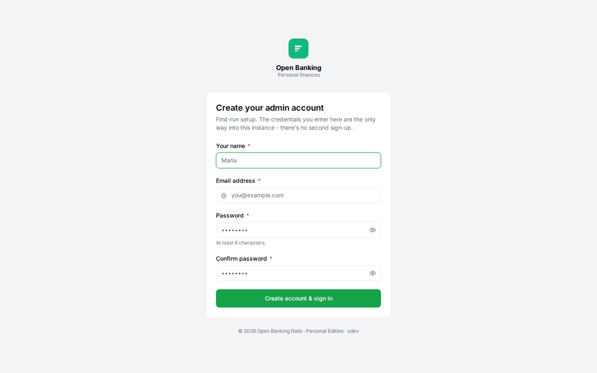 ([html](../oracle/ui/setup_first_run.html)); invalid e-mail blocked by the browser's own validation bubble
  "Please include an '@' in the email address. 'bad' is missing an '@'." 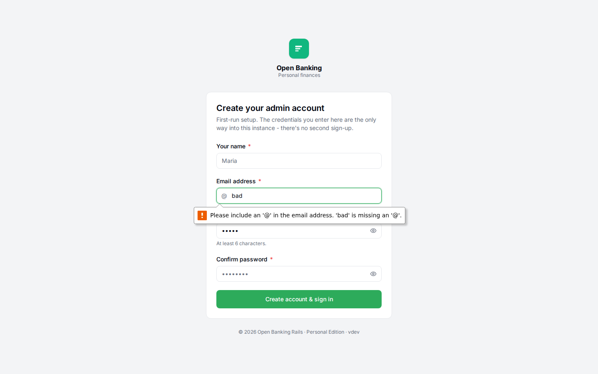 ([html](../oracle/ui/setup_first_run_invalid.html));
  redirect when users exist 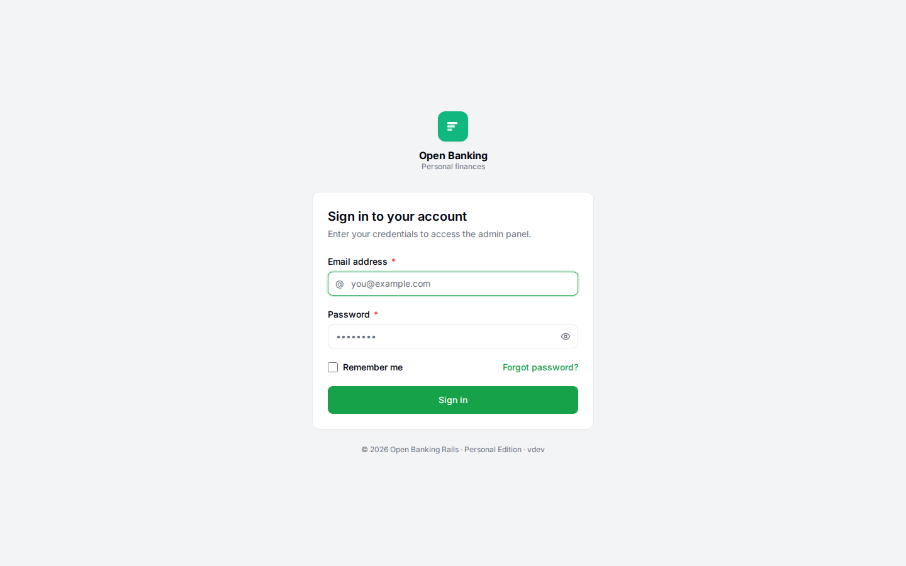. `first_run_after_setup_dashboard.png` shows the sign-in page, not the dashboard (U-706).

#### `admin/sessions/new.html.erb` — Sign in

- **Routes**: `GET /admin/sign_in` (`admin/sessions#new`), `POST /admin/sign_in` (`#create`), `DELETE /admin/sign_out` (`#destroy`, triggered by the sidebar log-out button); layout `admin_auth`; title "Sign in".
- **Content**: H1 "Sign in to your account", "Enter your credentials to access the admin panel.".
- **Form** (`POST /admin/sign_in`, scope `user`) [I] `app/views/admin/sessions/new.html.erb:8-41`: Email address `user[email]` (`type=email`, autofocus,
  `autocomplete=email`, `*`), Password `user[password]` (eye toggle, `autocomplete=current-password`, `*`), checkbox "Remember me" `user[remember_me]`
  (Rails hidden `0` + checkbox `1`), link "Forgot password?" → `/admin/password/new`, button "Sign in".
- **Outcomes**: wrong credentials → 422 re-render with auth flash "Invalid email or password." (password not echoed) [V] `../oracle/ui/admin_sign_in_failed.png`,
  `../oracle/http/POST_admin_sign_in.json` case `wrong_password → 422`, `spec/requests/public_spec.rb:201-206`. Success → 303 to the stored location
  (the page that triggered the sign-in, e.g. `/api/v9/docs` in the oracle) or the root (→ `/admin` → `/admin/analytics`) with notice "Signed in successfully."
  [V] `../oracle/http/POST_admin_sign_in.json` case `valid_credentials → 303`, `spec/system/daily_login_analytics_spec.rb:16-32`.
  Sign-out → session cleared, then protected pages redirect to sign-in [V] `spec/requests/public_spec.rb:208-215`; for non-HTML requests Devise answers 204
  [V] `../oracle/http/DELETE_admin_sign_out.json` case `signed_in → 204`.
- **Captures**:  ([html](../oracle/ui/admin_sign_in.html)), 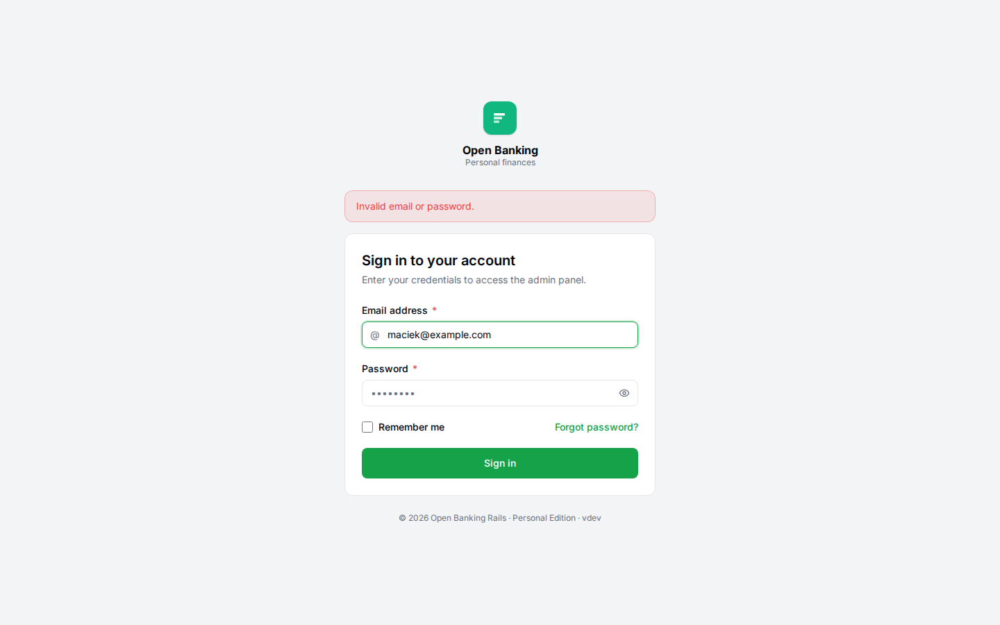.

#### `admin/passwords/new.html.erb` — Forgot password

- **Routes**: `GET /admin/password/new`, `POST /admin/password` (Devise `admin/passwords`); layout `admin_auth`; title "Reset password".
- **Content/form**: H1 "Forgot your password?", "Enter your email address and we'll send you a link to reset your password."; error summary; Email address
  `user[email]` (`type=email`, autofocus, `*`); button "Send reset instructions"; link "Back to sign in" [I] `app/views/admin/passwords/new.html.erb:1-29`.
- **Outcomes**: unknown e-mail → 422 with error summary "Email not found" (Devise is **not** in paranoid mode) [V] `../oracle/http/POST_admin_password.json`
  case `unknown_email → 422`; known e-mail → 303 `/admin/sign_in` with notice "You will receive an email with instructions on how to reset your password in a few minutes."
  [V] case `known_email → 303`, `spec/requests/public_spec.rb:224-230`.
- **Capture**: 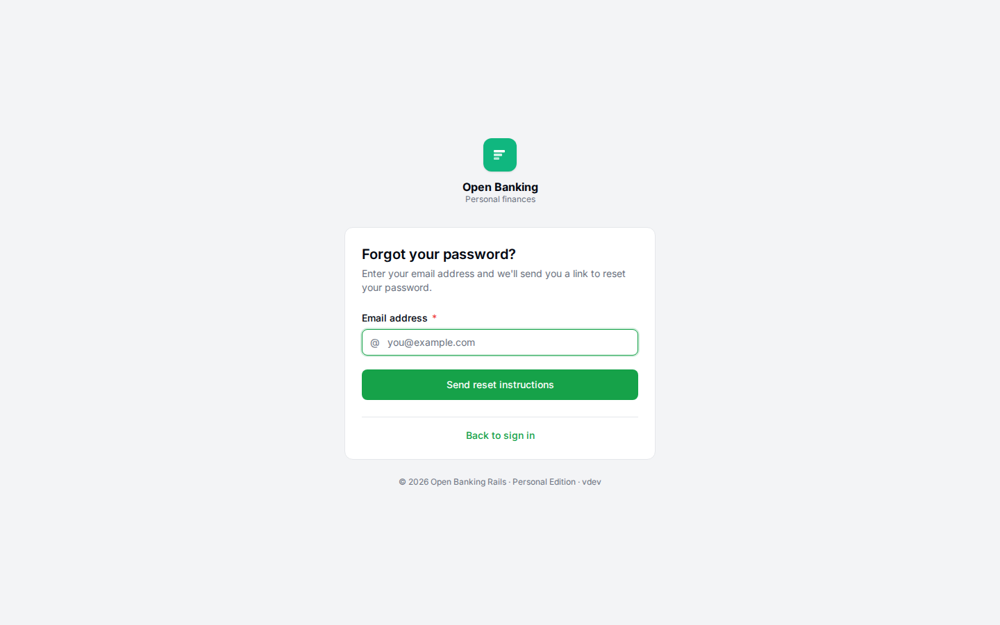 ([html](../oracle/ui/admin_password_new.html)).

#### `admin/passwords/edit.html.erb` — Set a new password (from the e-mailed link)

- **Routes**: `GET /admin/password/edit?reset_password_token=…`, `PATCH|PUT /admin/password`; layout `admin_auth`; title "Set new password".
- **Form** (method PUT) [I] `app/views/admin/passwords/edit.html.erb:8-30`: hidden `user[reset_password_token]`; New password `user[password]`
  (autofocus, hint "Minimum 6 characters."), Confirm new password `user[password_confirmation]`; button "Update password"; link "Back to sign in".
- **Outcomes**: GET without token → 302 `/admin/sign_in` with alert "You can't access this page without coming from a password reset email. If you do come from a password reset email, please make sure you used the full URL provided."
  [V] `../oracle/http/GET_admin_password_edit.json` case `no_token → 302`; bogus token renders the form (200) and submitting it gives 422 with "Reset password token is invalid"
  [V] cases `bogus_token → 200`, `../oracle/http/PATCH_admin_password.json`/`PUT_admin_password.json` `bogus_token → 422`. Valid token → password changed, signed in, notice
  "Your password has been changed successfully. You are now signed in." [I] Devise default (`config/locales/devise.en.yml`). No capture (needs an e-mailed token, see investigator U-005).

#### `swagger/index.html.erb` — API documentation (Swagger UI)

- **Route**: `GET /api/:version/docs` (`version` must match `v\d+`), `SwaggerController#index`, `layout false`, requires a Devise session (anonymous → 302 `/admin/sign_in`)
  [V] `../oracle/http/GET_api__version_docs.json` cases `default`/`unknown_version → 302`; `app/controllers/swagger_controller.rb:1-9`.
- **Content**: standalone HTML (title "Open Banking Rails API") loading `swagger-ui-dist@5` CSS/JS from `unpkg.com`; `SwaggerUIBundle({ url: "/api/<version>/swagger_doc", dom_id: "#swagger-ui", presets: [apis, StandaloneLayout], layout: "BaseLayout", deepLinking: true })`.
  The version segment is passed through unchecked (e.g. `/api/v9/docs` points at `/api/v9/swagger_doc`) [I] `app/views/swagger/index.html.erb:1-22`.
- Linked from Settings → API tokens ("API docs", new tab). **Capture**: 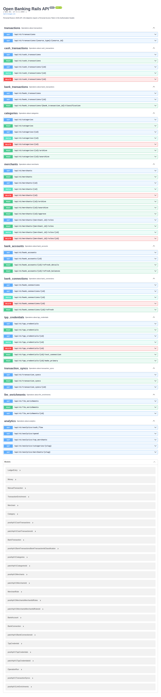 (spec "Open Banking Rails API 0.0.1, OAS 2.0") ([html](../oracle/ui/api_docs_swagger_ui.html)).

#### `pwa/manifest.json.erb` — PWA manifest (not routed)

Rails 8 scaffold: name "OpenBankingRails", icons `/icon.png` 512×512 (plain + maskable), `start_url "/"`, `display "standalone"`, `scope "/"`,
description "OpenBankingRails.", `theme_color`/`background_color` "red" [I] `app/views/pwa/manifest.json.erb:1-22`. The `rails/pwa` routes are not
declared in `config/routes.rb` (absent from `../inventory/routes_development.txt`) and the manifest link in `layouts/application` is commented out,
so the file is never served. Not to be ported.

#### `pwa/service-worker.js` — PWA service worker (not routed)

Only commented-out Web-Push sample code [I] `app/views/pwa/service-worker.js:1-26`; no route serves it. Not to be ported.

### 2.2 Analytics

All three analytics pages share the filter object `Analytics::Filter` built from query params and the `_filter_strip` partial (§3.5).
Query-param contract [I] `app/services/analytics/filter.rb:9-206`:

| Param | Meaning | Default |
|---|---|---|
| `from`, `to` (ISO dates) | Inclusive period; used only when **both** are present; unparsable → today | month-to-date (`Date.current.beginning_of_month` … `Date.current`, UTC) |
| `bucket` = `day`/`week`/`month` | Chart granularity; omitted from URLs unless explicitly chosen | 1–31 days → day, 32–180 → week, > 180 → month |
| `currency` (ISO) | Single reporting currency; accepted only if present in the user's ledger | the user's most frequent ledger currency, else `PLN` |
| `account_ids[]` | Restrict to these owned accounts (foreign ids silently dropped) | all owned bank accounts + cash wallets |
| `accounts=none` | Explicit "no accounts" (all chips off → zero state) | — |
| `under_path` (ltree path) | Drill-down: restrict every widget to that category subtree | none |

Only **booked** ledger rows in the period/currency/accounts are counted. "Previous period" for comparisons: full calendar month → previous calendar month;
month-to-date → same number of days of the previous month (capped at its end); otherwise the equally long window immediately before.

#### `admin/analytics/dashboard/index.html.erb` — Analytics dashboard (landing page)

- **Routes**: `GET /admin/analytics` (`admin/analytics/dashboard#index`); `/` → 301 `/admin` → 301 `/admin/analytics` [V] `../oracle/http/GET_root.json`, `../oracle/http/GET_admin.json`, `../oracle/http/GET_admin_analytics.json` cases `default`, `explicit_range → 200`.
- **Header**: "Analytics" / "Where your money goes - one filter, every view."; header action = Filters trigger (count = number of explicitly selected accounts). If `under_path` resolves to a
  category: line "Drilled into: <name>" + "× Clear" link (removes `under_path`) [V] `spec/system/daily_login_analytics_spec.rb:16-32`; `app/views/admin/analytics/dashboard/index.html.erb:233-254`.
- **Filter strip** (`_filter_strip` with the trigger hoisted into the header).
- **Unmatched banner**: when booked debits without effective category exist in scope → amber `_critical_banner` "<n> transaction(s) awaiting classification",
  description "<amount> · 
% of detected spend - these don't appear in totals below until classified." (share part omitted when 0 %; p = unmatched / (spend + unmatched), rounded),
  button "Classify now" → `/admin/llm_enrichments` [I] `app/views/admin/analytics/dashboard/index.html.erb:258-274`; `app/controllers/admin/analytics/dashboard_controller.rb:65-75`.
- **KPI cards** (5, `_stat_card`, values wrapped sensitive) [V] `../oracle/ui/admin_analytics_dashboard.png` ("zł0 Spend 21 days of Oct", "zł6,500 Income net +zł6,500", "zł0 Run-rate vs zł1,309.95 last month", "-100% Spend change less than Sep 1–21", "100% Savings rate of income kept"):

  | Card | Value | Hint / tone | Rule |
  |---|---|---|---|
  | Spend | spend total (no cents if whole) | "N days of <Mon>" for month-to-date else "N days"; destructive | `app/controllers/admin/analytics/dashboard_controller.rb:11-15` |
  | Income | income total | "net +<net>" / "net <net>"; success | |
  | Run-rate (MTD and ≥ 3 days elapsed) | round(spend × days_in_month / days_elapsed) | "vs <prev full month spend> last month" or "projected end of month"; tone destructive if > +5 % vs previous full month, success if < −5 %, else info | `dashboard_controller.rb:25-34`, view `:286-314` |
  | Avg daily spend (otherwise) | spend ÷ period length in days (integer division in cents) | "per day · N account(s)"; info | `dashboard_controller.rb:20` |
  | Spend change | "+x%"/"x%" (rounded); "-" when previous spend is 0 | "more than / less than / same as <previous label without 'vs '>" or "no prior period to compare"; change pill green for ≥ 0, red for < 0 (see U-710) | `dashboard_controller.rb:80-83` |
  | Savings rate | round((income − spend)/income × 100) % ; "-" when income 0 | "of income kept" (success) / "spent more than earned" (destructive) / "no income in period" (muted) | `dashboard_controller.rb:85-88` |

- **Spend by category** card: subtitle "total <spend> · <n>[ + tail (k)] · hover for Δ vs prev."; horizontal bar chart (Chart.js via `chart` controller) of the leaf-level breakdown,
  first 20 rows + "Other (k)" bucket; tooltip shows amount (pl-PL currency formatting), plus "Transakcji: n", "Δ vs poprz.: ±x%" lines (Polish, U-705); clicking a bar navigates
  (Turbo visit) to the category analytics page (hidden categories show "•••" and are not clickable). Empty states: "Taxonomy not set up" / "<n> transactions awaiting classification"
  (+ CTA "Run AI enrichment" → `/admin/llm_enrichments`; note "1 transactions" is not singularised, U-709) / "No spend" — "No spending in the selected period/accounts."
  [V] empty state visible in `../oracle/ui/admin_analytics_dashboard.png`; [I] `app/views/admin/analytics/dashboard/index.html.erb:361-404`.
- **Spend by domain** (or "Spend in <drill category>"), subtitle "click a bar to narrow the dashboard to that area": top 10 bars at the next depth; click → same page with `under_path=<path>` [I] `app/views/admin/analytics/dashboard/index.html.erb:406-466`.
- **Essentials vs discretionary** (only when spend > 0): subtitle "<x>% of spend covers needs", two-segment bar, amounts and "% · n tx" for each side [V] `spec/system/settings_change_spec.rb:16-53` ("0.0% of spend covers needs" → "100.0% of spend covers needs"); [I] `app/views/admin/analytics/dashboard/index.html.erb:468-488`.
- **Cash flow**: subtitle "income vs spend · per <bucket> · <period hint>"; "Net flow" (+/−, green/red), "Biggest <bucket>" (bucket with largest |net|); grouped bar chart Income (emerald) vs Spend (red), legend top-right; empty state "All quiet" — "No transaction in the selected period changed the balance." [V] screenshot; [I] `app/views/admin/analytics/dashboard/index.html.erb:491-525`.
- **Accounts - share of spend** ("click → filter to this account"): doughnut of spend per account (label "<bank> - <account display name>"), centre "Total <amount> / N account(s)"; click → dashboard with `account_ids[]=<id>`; empty "No data" — "No spend on any of the selected accounts." [I] `app/views/admin/analytics/dashboard/index.html.erb:527-553`.
- **Top merchants** ("click → transactions"): horizontal bars of up to 8 merchants, tooltip count; click → merchant analytics page; empty "No merchants" — "No merchants matched in this period." [I] `app/views/admin/analytics/dashboard/index.html.erb:557-574`.
- **Biggest transactions** (if any spend rows): top 5 spend rows by amount; columns Date ("%-d %b %Y"), Merchant / title, Category ("uncategorised" if none), Account, Amount (+ ISO code);
  whole row clickable (full page load) to the bank transaction page or cash edit page; "See all" → `/admin/bank_transactions?q[booking_date_gteq]=…&q[booking_date_lteq]=…&q[direction_eq]=debit&q[s]=amount_cents desc`
  (bank only — cash rows are not included there) [I] `app/views/admin/analytics/dashboard/index.html.erb:576-638`.
- **Top movers** ("biggest swings · <previous label>"): up to 5 categories; tile tinted red for increases / green for decreases, "+x%" or badge "new", current amount, "±<delta> vs prev" or "new this period"; links to category page [I] `app/views/admin/analytics/dashboard/index.html.erb:640-683`.
- Hidden categories: labels "•••", no drill links.
- **Captures**: 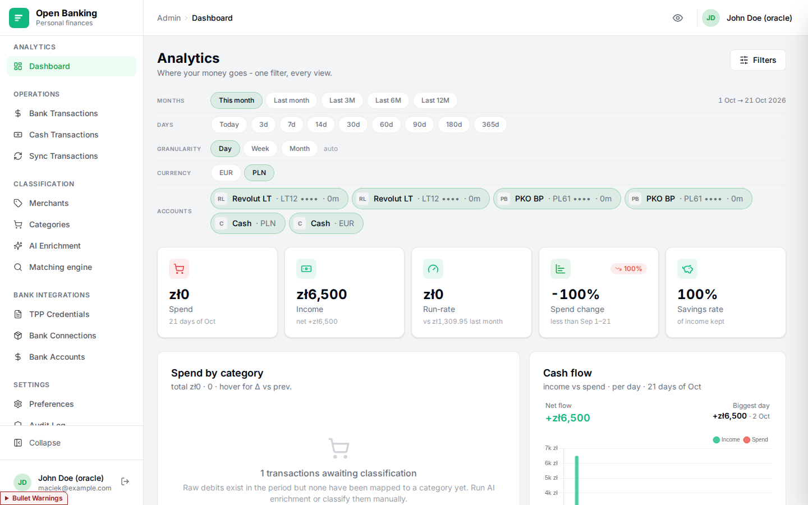 ([html](../oracle/ui/admin_analytics_dashboard.html)); explicit range 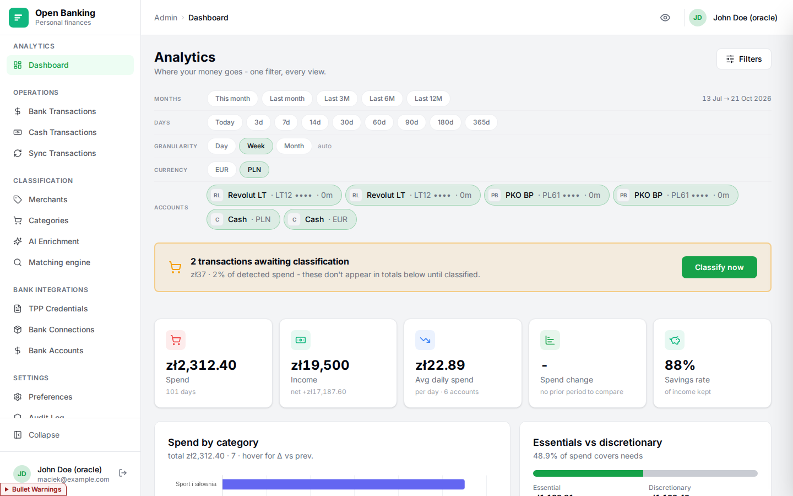 ([html](../oracle/ui/admin_analytics_dashboard_range.html)). The mobile capture `mobile_admin_analytics_dashboard.png` shows the sign-in page (U-706).

#### `admin/analytics/categories/show.html.erb` — Category drill-down

- **Route**: `GET /admin/analytics/categories/:slug` (user's category by slug; unknown/foreign slug → 404) [V] `../oracle/http/GET_admin_analytics_categories__slug.json` cases `default → 200`, `unknown_slug → 404`; `spec/requests/analytics_spec.rb:55-83`.
- Hidden category → 302 to `/admin/analytics` (filter params preserved) with alert "This category is private. Remove it from the hidden list in preferences to open it." [V] `spec/requests/analytics_spec.rb:85-95`; `app/controllers/admin/analytics/categories_controller.rb:10-14`.
- **Breadcrumbs** (custom): "Admin › Analytics › <visible ancestors…> › <category>" (ancestors keep the filter params; hidden ancestors skipped).
- **Header**: category name; "Path: <ltree path>. N day(s) window." Then the filter strip (own `filter-panel` controller).
- **Stat cards**: "Total in subtree" (sum of merchant rows), "Sub-categories" (count of sub-path rows), "Merchants (this leaf)" (count of merchant rows, includes the "No merchant" row).
- **Sub-categories** card (only if any non-zero, visible child rows): `_breakdown_list` rows label/amount/"n tx"/share %, bars proportional to the largest; click → child category page; empty label "No spend in any sub-category.".
- **Merchants** card (title "Merchants in entire subtree" + "Aggregated across all descendants." when sub-categories exist): rows per merchant → merchant analytics page; rows without merchant are labelled "No merchant"
  and link to `/admin/bank_transactions?category_id=<id>&enrichment_state=merchantless&q[booking_date_gteq]=…&q[booking_date_lteq]=…`; empty label "No transactions in this subtree in the selected period."
  [V] `../oracle/ui/admin_analytics_category.html` ("Jedzenie … zł387.45 Total in subtree 2 Sub-categories 3 … W domu 9 tx zł304.96 83%"); [I] `app/views/admin/analytics/categories/show.html.erb:1-98`.
- **Capture**: 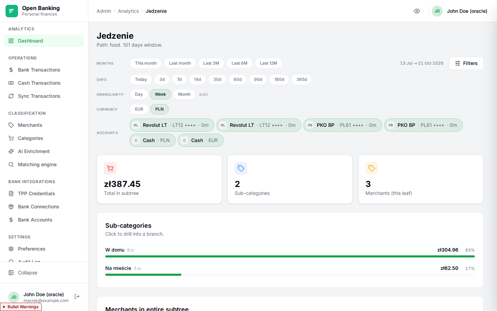 ([html](../oracle/ui/admin_analytics_category.html)).

#### `admin/analytics/merchants/show.html.erb` — Merchant drill-down

- **Route**: `GET /admin/analytics/merchants/:slug` (404 for unknown/foreign slug) [V] `../oracle/http/GET_admin_analytics_merchants__slug.json` case `default → 200`; `spec/requests/analytics_spec.rb:97-125`.
  Merchant whose default category is hidden → 302 `/admin/analytics` with alert "This merchant is in a hidden category. Remove it from the hidden list in preferences to open it." [V] `spec/requests/analytics_spec.rb:127-138`.
- **Breadcrumbs**: "Admin › Analytics › <category of newest transaction or merchant default category> › <merchant (sensitive)>".
- **Header**: merchant name; "N day(s) · N transaction(s)"; filter strip.
- **Stat cards**: "Total in period" (with cents), "Transactions", "Default category" (only if set).
- **Monthly trend - 12 months**: bar chart "Spend (<currency>)" of the merchant's last 12 months (independent of the period filter); empty "No transactions" — "No activity at this merchant in the last year.".
- **Transactions** list ("<n> total · sorted by date desc", paginated 10/page via `page`): date, title (or counterparty), bank logo + bank, account name, IBAN, amount; each row links to the bank transaction page or the cash edit page.
  Empty "No transactions" — "No transactions at this merchant in the selected period.". Amounts render with symbol **and** ISO code ("zł19.99 PLN") [V] `../oracle/ui/admin_analytics_merchant.html`; [I] `app/views/admin/analytics/merchants/show.html.erb:1-142`.
- **Capture**: 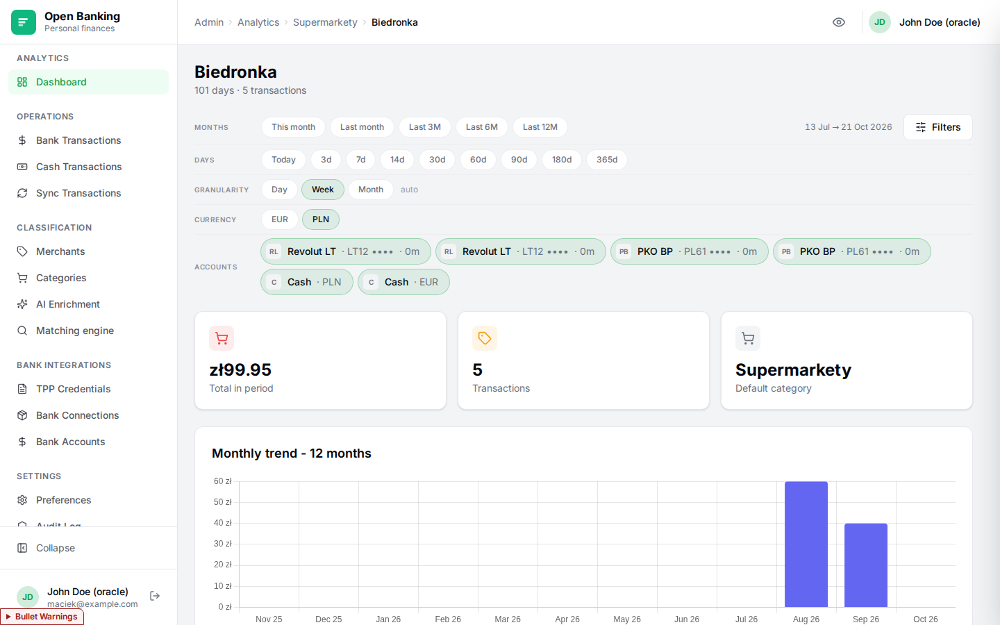 ([html](../oracle/ui/admin_analytics_merchant.html)).

### 2.3 Operations

#### `admin/bank_transactions/index.html.erb` — Bank transactions list

- **Route**: `GET /admin/bank_transactions` (`admin/bank_transactions#index`) [V] `../oracle/http/GET_admin_bank_transactions.json` cases `default`, `filtered → 200`; `spec/requests/banking_spec.rb:354-377`.
- **Header**: "Bank Transactions" / "All transactions pulled from Enable Banking, normalized across PKO / Revolut / mBank quirks."; action "Sync now" (+ icon, outline) → `/admin/transaction_syncs/new`.
- **Search/filter form** (`GET`, Turbo disabled, inside `data-controller="filter-panel"`) [I] `app/views/admin/bank_transactions/index.html.erb:9-232`:

  | Control | Param | Options / behaviour |
  |---|---|---|
  | Search box (placeholder "Search title, counterparty or merchant…") | `q[title_or_counterparty_name_or_enrichment_merchant_name_cont]` | case-insensitive substring (Ransack `cont`) over title, counterparty name, merchant name |
  | Bank account | `q[bank_account_id_eq]` | "All accounts" + user's synced accounts ordered by IBAN, label "<bank> - <account display name>" |
  | Direction | `q[direction_eq]` | All / "Credit (incoming)" `credit` / "Debit (outgoing)" `debit` |
  | Status | `q[status_eq]` | All / Booked / Pending |
  | Currency | `q[currency_eq]` | All + distinct currencies of the user's accounts |
  | Booking date - from / to | `q[booking_date_gteq]`, `q[booking_date_lteq]` | date inputs, inclusive |
  | Merchant | `merchant_id` (outside `q`) | "All merchants" + active merchants by name; a nameless `<select>` copies its value into hidden `#ef_merchant_id` via inline `onchange` |
  | Category | `category_id` | "All categories" + active categories (breadcrumb label "A / B / C"); filters on the enrichment's `category_id` (explicit override), not the merchant default |
  | Payment method | `payment_method` | "All" + Card, Card authorization, BLIK at POS, BLIK to phone, BLIK at ATM, Transfer, Internal transfer, Top-up, Fee, Other |
  | Classification source | `enrichment_source` | All + Unmatched, Auto (`system_rule`), Rule (`user_rule`), AI (`llm_rule`), Pending review (`llm_pending`), Manual, Fallback (`system_fallback`) |
  | Enrichment status | `enrichment_state` | All / "Without a merchant" `merchantless` / "LLM-ready (has signal)" `llm_ready` / "LLM can't help" `no_llm_signal` |
  | hidden | `q[s]` | current sort, preserved |

  Buttons: "Filters" trigger (badge = number of active filters), "Apply" (submit). Panel footer: "Clear all" (→ bare URL; disabled look when 0 filters) and "Apply".
  On submit the `filter-panel` controller disables empty inputs so they are not sent. Active filters are shown as chips ("Account: …", "Direction: Credit", "Status: Booked",
  "Currency: EUR", "Date: <from|…> → <to|…>", 'Search: "…"', "Merchant: …", "Category: …", "Method: …", "Source: …", "State: Without a merchant|LLM-ready|LLM can't help") each with an "x" link removing that filter, plus "Clear all".
  Server semantics of `merchant_id`/`category_id`/`enrichment_source`/`payment_method`/`enrichment_state` [I] `app/controllers/admin/bank_transactions_controller.rb:13-17,55-68`; [V] `spec/system/categorization_workflow_spec.rb:46-50`.
- **Table** (`_data_table`, sortable columns link `q[s]`, default `booking_date desc`, 10 per page) [V] `../oracle/ui/admin_bank_transactions_index.png`:

  | Column | Content |
  |---|---|
  | Date (sortable `booking_date`) | ISO date, monospace |
  | Account | bank logo (small) + bank name, IBAN or EB uid (sensitive) |
  | Merchant / Title | merchant name (sensitive) + source badge (Auto/Rule/AI/Pending review/Manual/Unmatched/Fallback) + title; without merchant: title or "-" + badge ("Unmatched" when no enrichment) + counterparty |
  | Category | `_category_breadcrumb` (ancestors muted) or warning badge "unclassified" |
  | Method | payment-method label or "-" |
  | Status (sortable) | badge `booked` (success) / `pending` (info) |
  | Amount (sortable `amount_cents`, right) | "+"/"−" + amount without symbol (2 decimals, sensitive) + ISO code; credits green |
  | (menu) | "⋯" dropdown: "View" → `/admin/bank_transactions/:id` |

  Rows in a hidden category show bullets instead of merchant/title/counterparty and "•••" instead of the amount.
  Empty: "No transactions" — "No transactions match your filters." (with filters) / "Run a sync above to pull data from your banks.".
  Pagination footer "Showing a–b of n results" + page links (only when > 1 page).
- Category labels currently show duplicated ancestors ("Lifestyle / Lifestyle / Narzędzia cyfrowe / Narzędzia cyfrowe / SaaS / AI") because category ancestry is not tenant-scoped — a bug, see U-700.
- **Captures**: 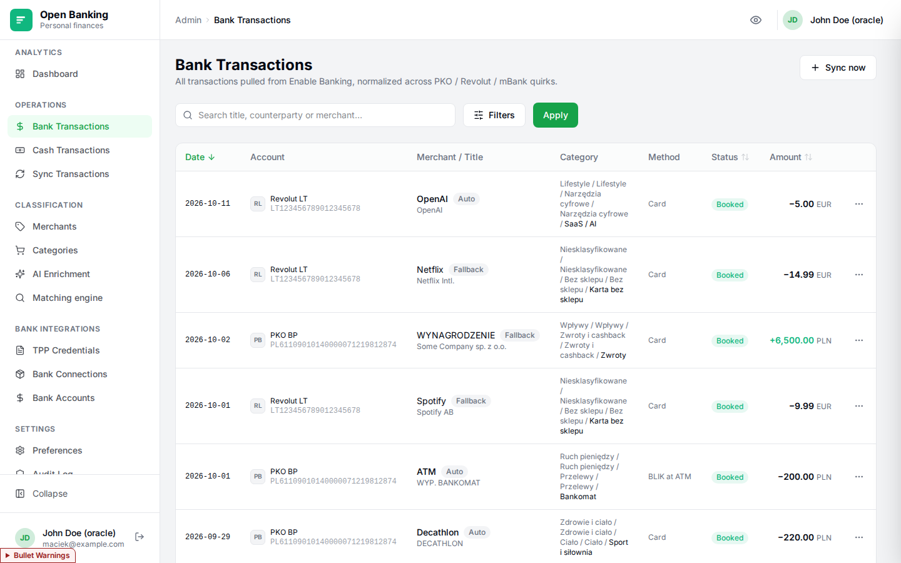 ([html](../oracle/ui/admin_bank_transactions_index.html)); `mobile_admin_bank_transactions_index.png` shows the sign-in page (U-706).

#### `admin/bank_transactions/show.html.erb` — Bank transaction detail + reclassification

- **Route**: `GET /admin/bank_transactions/:id` (user-scoped; foreign id → 404) [V] `../oracle/http/GET_admin_bank_transactions__id.json` cases `default → 200`, `other_tenant_id → 404`.
  Transaction in a hidden category → 302 `/admin/bank_transactions` with alert "This transaction is in a hidden category. Remove it from the hidden list in preferences to open it." [I] `app/controllers/admin/bank_transactions_controller.rb:31-36`.
- **Header**: H1 "+/−<amount> <ISO>" (amount sensitive), subtitle "<title or external id> - <booking date>", browser title "Transaction <external_id>" [V] `../oracle/ui/admin_bank_transactions_show.html` (title "Transaction fake-tx-1", H1 "−19.99 PLN").
- **Badges**: direction (credit success / debit muted), status, payment-method label, bank transaction code, type hint.
- **Cards** [I] `app/views/admin/bank_transactions/show.html.erb:32-113`:
  - "Transaction": Amount (sensitive), Direction, Status, Title (sensitive), Type hint "(remittance_information[1] - bank-specific)", Bank txn code "(Berlin Group, only Revolut populates)", Booking date, Value date, Transaction date, External ID "(transaction_id || entry_reference - Revolut uses entry_reference)".
  - "Counterparty & account": Counterparty, Counterparty IBAN "(mBank: derived from BBAN by prepending 'PL')", Bank account (link to account page), Account IBAN, Bank (link to connection), Fetched at.
  - "Classification" ("Merchant, category, decision source."; action "Edit" opens the modal via inline `onclick`): Merchant (link), Category (full breadcrumb), Source (badge, "Unmatched" when no enrichment), Rule (`<field> <kind> "<pattern>"`), Confidence ("NN%").
  - "Raw payload (from Enable Banking)" — "Source of truth - full transaction object as returned by `GET /accounts/{uid}/transactions`. Encrypted at rest." + `_json_viewer` (strong blur in privacy mode).
- **Classify modal** — see `_classify_modal` (§3.5). Submits `PATCH /admin/bank_transactions/:id/enrichment`; result → 302 back to this page with notice "Applied: this transaction only" / "Applied: all transactions for this merchant" / "Applied: new rule + rebuild"
  or alert "Pick a merchant", "Pick a pattern", "Unknown propagation mode: <mode>" or joined validation messages [V] `../oracle/http/PATCH_admin_bank_transactions__bank_transaction_id_enrichment.json` (302), `PUT_…enrichment.json` case `create_rule_missing_fields → 302`, `spec/requests/categorization_spec.rb:410-477`; `app/services/enrichment/classification_applier.rb:36-50,101-107`.
- **Capture**: 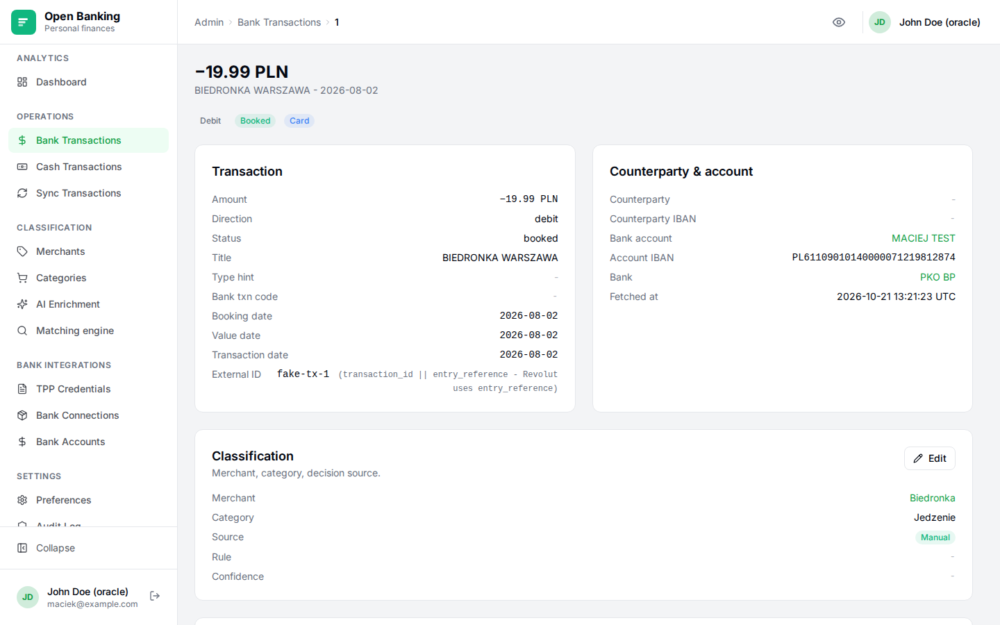 ([html](../oracle/ui/admin_bank_transactions_show.html)).

#### `admin/cash_transactions/index.html.erb` — Cash transactions list

- **Route**: `GET /admin/cash_transactions` [V] `../oracle/http/GET_admin_cash_transactions.json` `default → 200`; `spec/requests/cash_spec.rb:6-59`.
- **Header**: "Cash transactions" / "Off-bank entries you typed in by hand. Same enrichment pipeline as bank rows."; actions "Add expense" (→ `/admin/cash_transactions/new?direction=debit`) and "Add income" (outline, `direction=credit`).
- **Wallet cards** (one per cash wallet, ordered by currency, up to 4 per row): wallet name (sensitive) and balance = Σ credit − Σ debit of **all** manual rows in the wallet (not filtered); negative balance in red with "Negative balance - you've logged more expenses than top-ups. Likely missing a cash income entry."
  Without wallets: info callout "No cash wallet yet - A PLN wallet is created automatically the moment you log your first cash entry - no setup needed. Use **Add expense** or **Add income** above to start." plus, if cash tracking is off, "Want ATM withdrawals auto-mirrored as wallet top-ups? Enable cash tracking in Preferences." (link) [I] `app/views/admin/cash_transactions/index.html.erb:19-60`; `app/controllers/admin/cash_transactions_controller.rb:127-137`.
- **Filters** (`GET`, Turbo off, filter panel): Wallet `wallet_id` ("All wallets" + wallets), Direction `direction` (All / Expenses `debit` / Income `credit`), From `from`, To `to` (inclusive `booking_date` bounds). Buttons "Filters", "Apply"; chips "Wallet: …", "Direction: Expenses|Income", "Date: … → …", "Clear all". Ransack sort `q[s]` (default `booking_date desc`).
- **Table**: Date (sortable), Wallet, Title / Counterparty (title + merchant badge + counterparty), Category (breadcrumb or "unclassified"), Source (badge: "Manual" success / "Atm link" etc. muted), Amount (sortable, ±, ISO), menu "Edit" (only for `source = manual`). Hidden categories masked like bank rows.
  Empty: "No cash transactions" — "Nothing matches your filters." / "Use Add expense or Add income above to log your first cash entry.".
- **Flash on arrival**: "Saved expense zł50.00." / "Saved income …" (create), "Updated expense …" (update), "Transaction deleted.", "This transaction was auto-generated and isn't editable here.", "This transaction is in a hidden category. Remove it from the hidden list in preferences to edit it."
  [V] `spec/system/cash_with_atm_link_spec.rb:16-31` (/Saved expense/), `../oracle/ui/admin_cash_transactions_edit.html` (auto-generated alert); `app/controllers/admin/cash_transactions_controller.rb:48-99,139-143`.
- **Capture**: 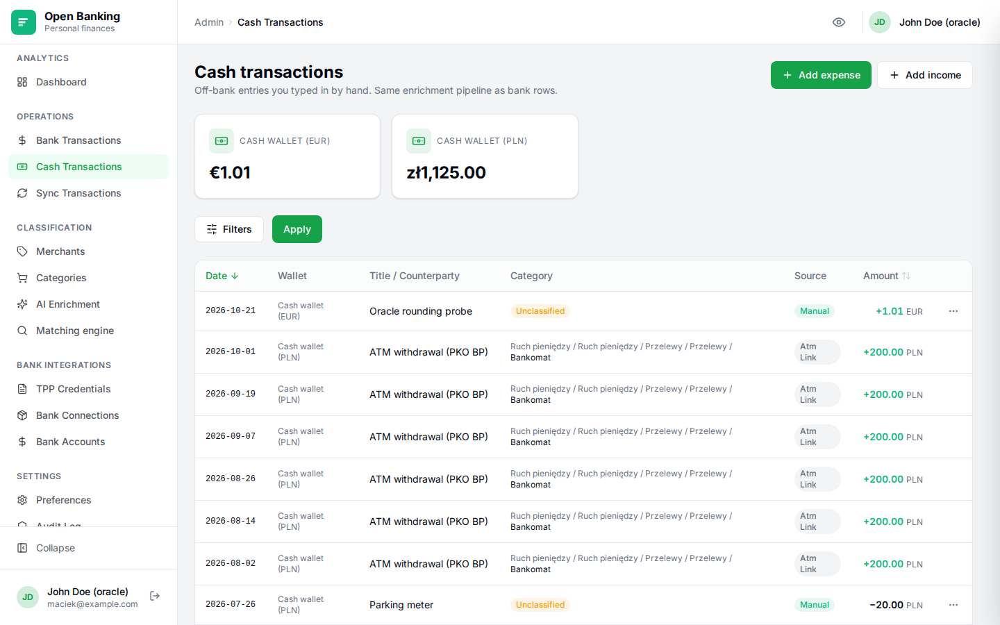 ([html](../oracle/ui/admin_cash_transactions_index.html)).

#### `admin/cash_transactions/new.html.erb` — New cash transaction

- **Routes**: `GET /admin/cash_transactions/new[?direction=credit|debit]`, `POST /admin/cash_transactions` [V] `../oracle/http/GET_admin_cash_transactions_new.json` cases `default`, `credit → 200`; `../oracle/http/POST_admin_cash_transactions.json` cases `default → 302`, `invalid_amount → 422`.
- **Header**: "New cash transaction" / "Manual entries are stored with source: manual and never overwritten by re-syncs.", back arrow → index. Body = `_form` (§3.5 `admin/cash_transactions/_form`).
- Defaults: direction from `?direction` else `debit`; currency = currency of the user's oldest cash wallet else `PLN`; date = today (UTC); payment method `cash` [V] `spec/requests/cash_spec.rb:61-79`; `app/controllers/admin/cash_transactions_controller.rb:32-40,115-117`.
- Outcomes: success → 302 `/admin/cash_transactions` with notice "Saved expense <formatted amount>." or "Saved income <formatted amount>." (amount formatted with symbol, e.g. "zł50.00"); a wallet in that currency is created on first use. Failure → 422 re-render with alert = joined error messages
  (fallback "Could not save the transaction.") and the error summary [V] `spec/requests/cash_spec.rb:96-161`; [I] `app/controllers/admin/cash_transactions_controller.rb:42-56`. Typical messages: "Amount cents can't be blank" (blank/unparsable amount), "Amount cents must be greater than 0", "Currency must match wallet currency (PLN)" [I] `app/models/manual_transaction.rb:63-72,115-121`.
- **Captures**: 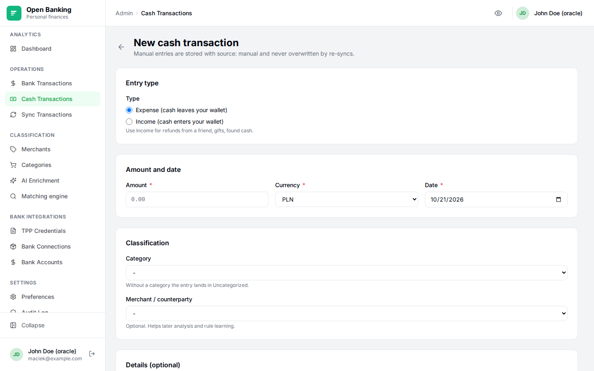 ([html](../oracle/ui/admin_cash_transactions_new.html)); `admin_cash_transactions_new_invalid_submit.png` shows the form filled with "abc" but no error state — the 422 response itself is only in the HTTP oracle (U-706).

#### `admin/cash_transactions/edit.html.erb` — Edit cash transaction

- **Routes**: `GET /admin/cash_transactions/:id/edit`, `PATCH|PUT /admin/cash_transactions/:id`, `DELETE /admin/cash_transactions/:id`; `GET /admin/cash_transactions/:id` only redirects (302) to the edit page (there is no show template)
  [V] `../oracle/http/GET_admin_cash_transactions__id.json` `default → 302 …/1/edit`, `other_tenant_id → 404`; `spec/requests/cash_spec.rb:81-94`.
- Guards: non-manual rows (ATM links etc.) → 302 index with alert "This transaction was auto-generated and isn't editable here." (also for update/destroy); hidden category → alert "This transaction is in a hidden category. Remove it from the hidden list in preferences to edit it."
  [V] `../oracle/http/GET_admin_cash_transactions__id_edit.json` `default → 302`, `spec/requests/cash_spec.rb:173-186,225-268`.
- **Header**: "Edit cash transaction", subtitle "<wallet name (sensitive)> · <booking date>", back arrow. Body = `_form` with currency locked (disabled text + hidden field), "Delete" button (outline destructive, trash icon, confirm "Delete this transaction?") and "Save changes".
- Outcomes: success → 302 index with notice "Updated expense <amount>." / "Updated income <amount>."; failure → 422 with alert (fallback "Could not update the transaction."); delete → "Transaction deleted." [V] `../oracle/http/PATCH_admin_cash_transactions__id.json` `default → 302`, `PUT_…` `invalid_amount → 422`, `DELETE_admin_cash_transactions__id.json` `default → 302`.
  The Delete button is a nested `<form>` inside the edit form (invalid HTML) — see U-703.
- **Captures**: `admin_cash_transactions_edit.png` and `admin_cash_transactions_show.png` show the index with the auto-generated alert, not the form (U-706):  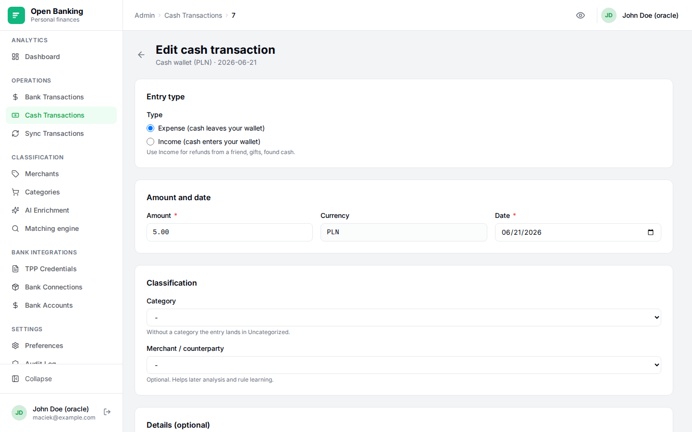.

#### `admin/transaction_syncs/index.html.erb` — Sync Transactions (history + auto-sync schedules)

- **Route**: `GET /admin/transaction_syncs` (runs of kind `transaction_sync` with `triggered_by_user_id = current user`) [V] `../oracle/http/GET_admin_transaction_syncs.json`; `spec/requests/banking_spec.rb:390-402`.
- **Header**: "Sync Transactions" / "Pull transactions from your authorized banks. Each row is a single sync run - manual or scheduled. Live progress streams to the run page."; action "Sync Manually" → `/admin/transaction_syncs/new`.
- **Auto-sync schedules** panel (`_auto_sync_panel`, §3.5): one row per **active** connection (ordered by bank name) with status badge On / Off / Paused and "Edit"/"Set up" → `/admin/bank_connections/:id/sync_schedule/edit` [V] `spec/system/auto_sync_circuit_breaker_spec.rb:17-48` ("Paused").
- **History** card: filter form (`GET`, Turbo off) with Status `q[status_eq]` (All, Queued, Running, Succeeded, Partial, Failed), Trigger `q[trigger_eq]` (All, Manual, Scheduled), Created - from/to `q[created_at_gteq]`/`q[created_at_lteq]`; chips for status and trigger only; "Filters", "Apply".
  Table: ID (sortable, "#n"), Status (sortable badge: succeeded green, running blue, queued grey, partial amber, failed red), Scope ("All my connections" / bank name / account name / "-"), Trigger (sortable), Started (sortable, `l(:short)` or "-"), Duration ("Ns" or "-"), menu "View". Default sort `created_at desc`.
  Empty: "No syncs yet" — "Trigger a sync above to pull transactions from your banks.".
- Flash on arrival: "Auto-sync settings saved." (from schedule save) [V] `../oracle/http/PATCH_admin_bank_connections__bank_connection_id_sync_schedule.json` (302 → this page).
- **Capture**: 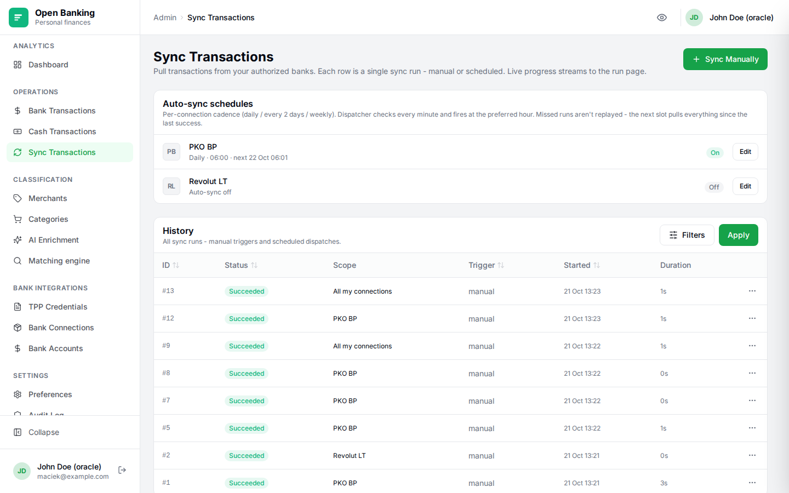 ([html](../oracle/ui/admin_transaction_syncs_index.html)) — PKO BP "Daily · 06:00 · next 22 Oct 06:01 On", Revolut LT "Auto-sync off Off".

#### `admin/transaction_syncs/new.html.erb` — New manual sync

- **Routes**: `GET /admin/transaction_syncs/new`, `POST /admin/transaction_syncs` [V] `../oracle/http/GET_admin_transaction_syncs_new.json`; `spec/requests/banking_spec.rb:415-456`.
- **Header**: "New sync" / "Pulls transactions from Enable Banking in the background. You'll be redirected to the sync page where progress streams live.".
- **Form** [I] `app/views/admin/transaction_syncs/new.html.erb:1-53`:
  - Card "Scope" — "Pick a single bank connection or sync everything you've authorized. Per-bank silent truncation applies: `Revolut 90d`, `PKO ~26mo`, `mBank ~90d`."; select **Bank connection** `bank_connection_id`: "All my connections" (value "") + active connections "<bank name> (<country>)" ordered by bank name; hint "Leave empty to sync all your active connections".
  - Card "Date range" — "Both optional. If left empty, the operation defaults to the bank's max horizon for first-time accounts, otherwise `last_synced − 7d` (incremental with overlap to catch late-bookings)."; **From** `date_from` (date, pre-filled today − 90 days), **To** `date_to` (date, pre-filled today).
  - Buttons "Cancel" → index, "Start sync".
- Outcomes: run created (status queued) and job enqueued → 302 `/admin/transaction_syncs/:id` with notice "Sync #<id> queued."; validation failure → 302 back to `/new` with alert "Could not start sync: <errors>". An empty connection is valid and means all connections
  [V] `../oracle/http/POST_admin_transaction_syncs.json` cases `default → 302 /admin/transaction_syncs/12`, `missing_connection → 302 /admin/transaction_syncs/13` (scope "All my connections" in the index capture); `spec/system/manual_sync_flow_spec.rb:16-69`.
- **Capture**: 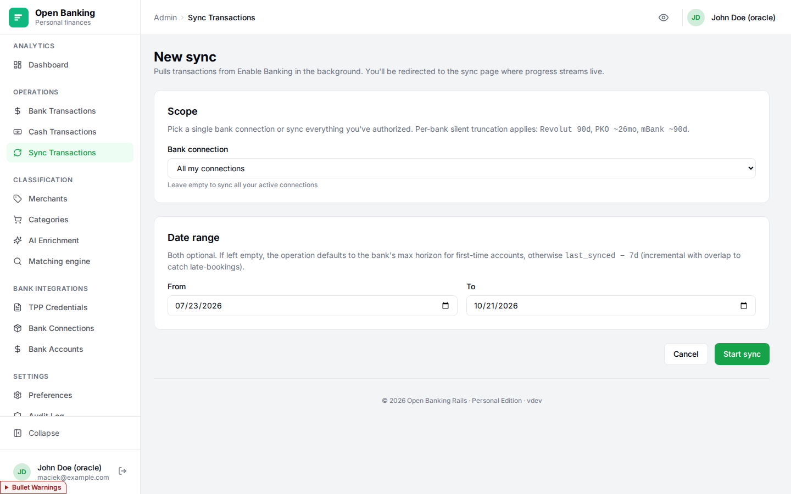 ([html](../oracle/ui/admin_transaction_syncs_new.html)).

#### `admin/transaction_syncs/show.html.erb` — Sync run (live)

- **Route**: `GET /admin/transaction_syncs/:id` (only own runs; other user's → 404) [V] `../oracle/http/GET_admin_transaction_syncs__id.json`; `spec/requests/banking_spec.rb:404-413`.
- **Header**: "Sync #<id>", subtitle "<Manual|Scheduled> sync - <all my connections | bank name | account name>".
- Subscribes to `operation_run_<id>` (§1.3) and renders `_run_progress` (§3.5) which is replaced live on every run update [V] `connected` stream source in `../oracle/ui/admin_transaction_syncs_show.html`.
- **Capture**: 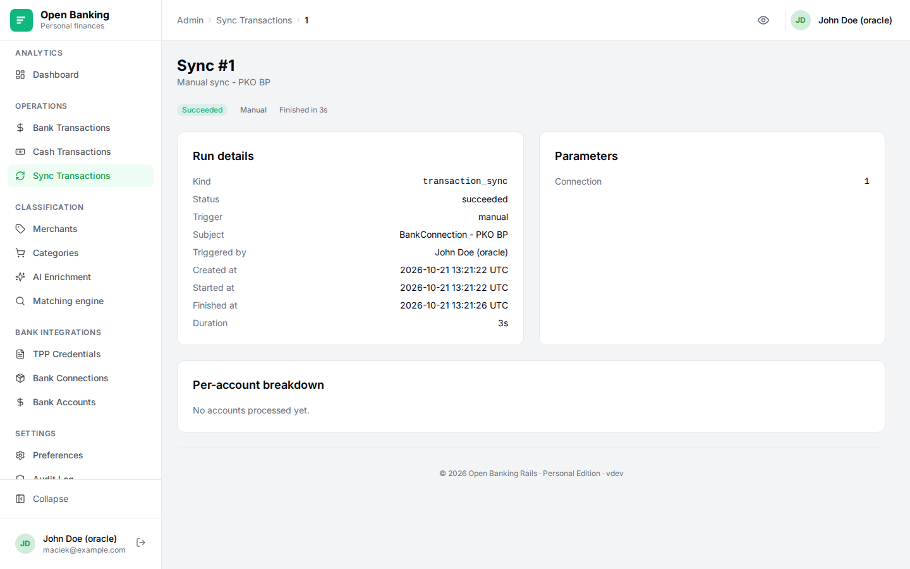 ([html](../oracle/ui/admin_transaction_syncs_show.html)).

#### `admin/sync_schedules/edit.html.erb` — Auto-sync settings for one connection

- **Routes**: `GET /admin/bank_connections/:bank_connection_id/sync_schedule/edit`, `PATCH|PUT /admin/bank_connections/:bank_connection_id/sync_schedule` (connection must be the user's; else 404) [V] `../oracle/http/GET_admin_bank_connections__bank_connection_id_sync_schedule_edit.json` (200), `spec/requests/banking_spec.rb:458-516`.
- **Header**: "Auto-sync settings", subtitle "<bank> - runs in the background on the cadence you pick.", large bank logo.
- Body: `_form` (enabled checkbox, cadence, preferred hour) and `_range_preview` (§3.5). A schedule record is built in memory if none exists.
- Outcomes: success → 302 `/admin/transaction_syncs` with notice "Auto-sync settings saved."; failure → 422 re-render with alert = joined errors (fallback "Could not save.") and error summary, e.g. "Cadence is not included in the list" for `hourly`
  [V] `../oracle/http/PATCH_admin_bank_connections__bank_connection_id_sync_schedule.json` `default → 302`, `../oracle/http/PUT_admin_bank_connections__bank_connection_id_sync_schedule.json` `invalid → 422`; `app/controllers/admin/sync_schedules_controller.rb:11-26`.
- **Capture**: 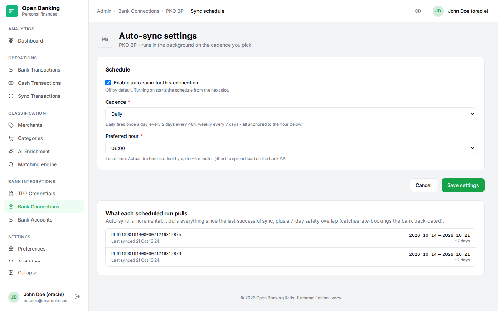 ([html](../oracle/ui/admin_sync_schedules_edit.html)).

### 2.4 Classification

#### `admin/merchants/index.html.erb` — Merchants list

- **Route**: `GET /admin/merchants` [V] `../oracle/http/GET_admin_merchants.json` cases `default`, `filtered → 200`; `spec/requests/categorization_spec.rb:172-208`.
- **Header**: "Merchants" / "Stores and payment recipients. Rules link transactions to merchants; merchants supply a default category."; action "New merchant".
- **Filter bar** (inline form, `GET`, Turbo off; no filter panel) [I] `app/views/admin/merchants/index.html.erb:14-38`; server `app/controllers/admin/merchants_controller.rb:7-18`:
  search `q` (placeholder "Search by name…", case-insensitive `name ILIKE %q%`), `source` ("All sources", System, User, Llm), `category_id` ("All categories" + **root** categories only; filters on the merchant's default category id, so only merchants whose default category is exactly that root match), checkbox "Show archived" `show_archived=1` (default: archived excluded), button "Filter".
- **Table** (ordered by name, 10/page; no sortable headers): Merchant (link to show, sensitive; kind below; hidden-category merchants show "•••" without link), Category (`_category_breadcrumb` or "-"), Rules (count), Source (badge: user = info, llm = default, system = muted), Transactions (count of enrichments pointing at the merchant, bank + cash), menu: View, Edit, divider, then "Restore" (`POST …/unarchive`, refresh icon) for archived or "Archive" (`POST …/archive`, destructive, eye-off icon) — no confirmation. Archived rows at 60 % opacity.
  Empty: "No merchants" — "Add your first merchant, or sync transactions to let system rules pick some up." + "New merchant".
- Flash on arrival: "Merchant archived.", "Merchant restored." (unarchive from the list redirects to the merchant page), "Merchant deleted.", "This merchant is in a hidden category. Remove it from the hidden list in preferences to open it." [V] `../oracle/http/POST_admin_merchants__id_archive.json` (302 → `/admin/merchants`), `spec/requests/categorization_spec.rb:231-242,324-333`.
- **Capture**: 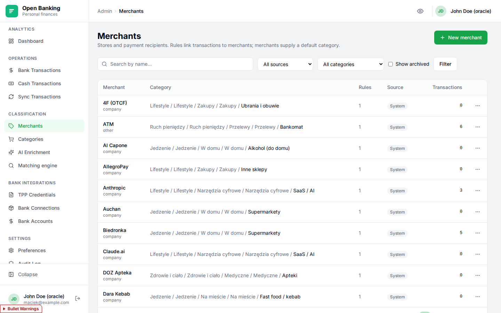 ([html](../oracle/ui/admin_merchants_index.html)).

#### `admin/merchants/show.html.erb` — Merchant detail + rules

- **Route**: `GET /admin/merchants/:id` (foreign → 404; hidden default category → 302 `/admin/merchants` with the hidden-category alert) [V] `../oracle/http/GET_admin_merchants__id.json` `default → 200`, `other_tenant_id → 404`; `spec/requests/categorization_spec.rb:210-242`.
- **Header**: merchant name (sensitive), subtitle = notes, back arrow → list; actions "Edit" (pencil) and either "Restore" (`POST /admin/merchants/:id/unarchive`) or "Archive" (`POST /admin/merchants/:id/archive`, confirm "Archive this merchant? Its rules will stop matching."). Archived → warning callout "Archived - Rules on this merchant only fire if `enabled: true`. Historical matches are preserved." [I] `app/views/admin/merchants/show.html.erb:1-27`.
- **Identity** card: Name, Slug (sensitive), Kind, Default category (full breadcrumb), Source, Confidence (LLM) "NN%", Approved at.
- **Match rules** card ("First match wins. Order: user > llm > system, then higher priority within source."): table Field, Kind, Pattern (sensitive), Source badge, Priority, Enabled (Yes/No) and a delete "x" (`DELETE /admin/merchants/:merchant_id/merchant_rules/:id`, confirm "Delete this rule? Transactions will be re-classified."); empty "No rules" — "Add a rule using the form below.".
  Add-rule form (`POST /admin/merchants/:id/merchant_rules`, scope `merchant_rule`): Field `merchant_rule[field]` (title, counterparty_name, counterparty_iban, payment_method; default title), Kind `merchant_rule[kind]` (contains, regex, exact, prefix, iban; default contains), Pattern `merchant_rule[pattern]` (placeholder "BIEDRONKA, ^kaufland.*, ..."), Priority `merchant_rule[priority]` (number, default 100), button "Add" [I] `:97-115`.
  Results → 302 back here: "Rule added - historical transactions re-classified." / alert "Could not add rule: <errors>" (e.g. "Pattern can't be blank", "Pattern is not a valid regex: …"); update "Rule updated." / "Could not update rule: …"; delete "Rule deleted - transactions re-classified."
  [V] `../oracle/http/POST_admin_merchants__merchant_id_merchant_rules.json` cases `default`, `invalid_regex → 302`, `PUT_admin_merchants__merchant_id_merchant_rules__id.json` `invalid_blank_pattern → 302`, `spec/system/categorization_workflow_spec.rb:16-55`; `app/controllers/admin/merchant_rules_controller.rb:8-29`. There is no UI to edit an existing rule (the PATCH route is API-like).
- **Recent transactions** card: "Last N of M" (M counts bank + cash enrichments; the list shows the 10 newest **bank** transactions only), "View all M" → `/admin/bank_transactions?merchant_id=<id>` when M > shown; rows: title, date · payment method label (or type hint), ±amount + ISO, chevron link to the transaction. Empty "No transactions" — "No transaction has been matched to this merchant yet.".
- **Stats** card: Transactions, Rules, Rules enabled.
- Flash on arrival: "Merchant created.", "Merchant updated.", "Merchant restored.", "Approved - historical transactions re-classified.", "Can't delete - this merchant has linked transactions. Archive it instead." [V] `spec/requests/categorization_spec.rb:244-347`.
- **Capture**: 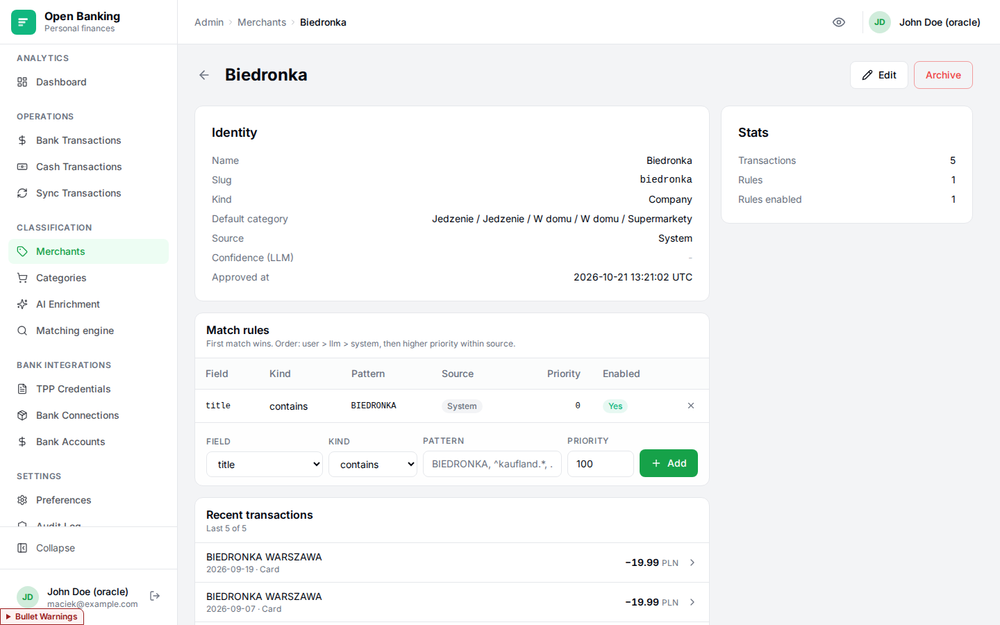 ([html](../oracle/ui/admin_merchants_show.html)).

#### `admin/merchants/new.html.erb` — New merchant

- **Routes**: `GET /admin/merchants/new`, `POST /admin/merchants` [V] `../oracle/http/POST_admin_merchants.json` cases `default → 302 /admin/merchants/60`, `invalid_blank_name → 422`.
- Header "New merchant", back arrow → list; body `admin/merchants/_form` (§3.5) with defaults source `user`, kind `company`; button "Create merchant".
- Success → 302 merchant page, notice "Merchant created."; failure → 422 re-render with error summary ("Name can't be blank") [V] `spec/system/categorization_workflow_spec.rb:28-35`.
- **Capture**: 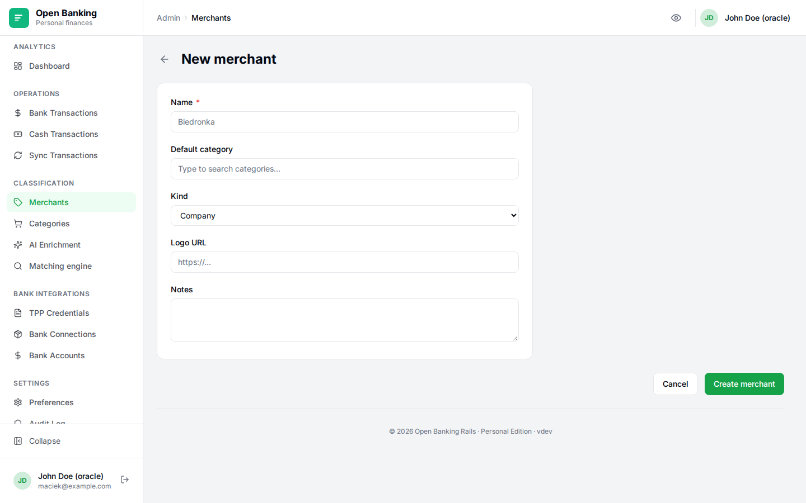 ([html](../oracle/ui/admin_merchants_new.html)).

#### `admin/merchants/edit.html.erb` — Edit merchant

- **Routes**: `GET /admin/merchants/:id/edit`, `PATCH|PUT /admin/merchants/:id` [V] `../oracle/http/GET_admin_merchants__id_edit.json` (200), `PATCH_admin_merchants__id.json` `default → 302 /admin/merchants/60`, `other_tenant_id → 404`, `PUT_admin_merchants__id.json` `invalid_blank_name → 422`.
- Header "Edit: <name (sensitive)>", browser title "Edit: <name>" (on a blank-name re-render the title becomes "Edit: " — the unsaved value is used), back arrow → merchant page; body `_form` with read-only Slug; button "Save changes".
- `return_to` query param (from the AI-review queue) is carried as a hidden field; after save the controller redirects there if it starts with `/admin/` or `/admin?` and contains no `//`, else to the merchant page; "Cancel" links to `return_to` or the merchant page [V] `spec/requests/categorization_spec.rb:273-297`; `app/controllers/admin/base_controller.rb:24-30`.
- Notice "Merchant updated.". The hidden-category guard intended for this page is dead code (duplicate `edit` method) — U-701.
- **Capture**: 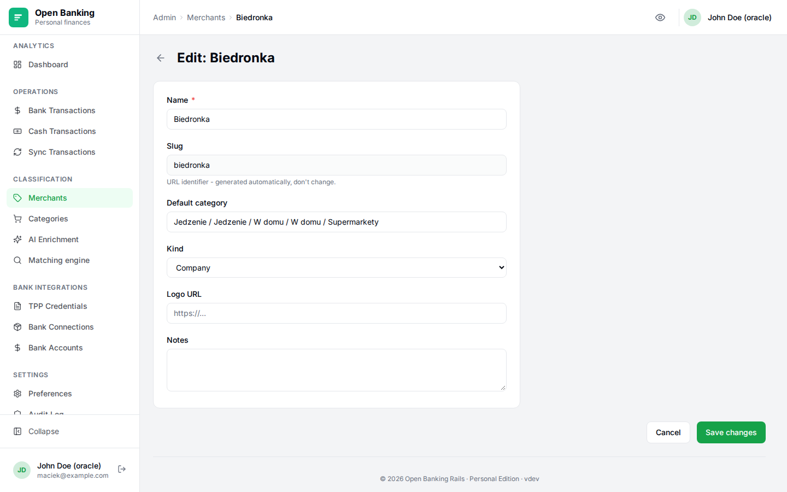 ([html](../oracle/ui/admin_merchants_edit.html)).

#### `admin/categories/index.html.erb` — Categories tree

- **Route**: `GET /admin/categories` [V] `../oracle/http/GET_admin_categories.json`; `spec/requests/categorization_spec.rb:6-18`, `spec/system/cross_user_isolation_spec.rb:68-81`.
- **Header**: "Categories" / "Tree of expense / income / transfer / savings buckets. Sub-categories indent under their parent - depth is unbounded. Renaming doesn't change slugs."; action "New category".
- **Table** (all active categories in tree order, no pagination, no sorting): Name (indented 12 px + 16 px per depth level, "└" marker for children, roots bold on tinted row; hidden categories show bullets), Path (ltree, monospace), Kind (badge; expense = primary, others muted), Essential (badge "essential" when set), menu: "Edit", "Add sub-category" (→ `/admin/categories/new?parent_path=<path>`), divider, "Archive" (`POST /admin/categories/:id/archive`, destructive, **no confirmation**) [I] `app/views/admin/categories/index.html.erb:15-73`.
  Empty: "No categories" — "Add your first category to get started." + "New category".
- **Archived** card ("Hidden from forms; historical links are preserved."): breadcrumb label + "Restore" (`POST …/unarchive`, small outline).
- There is no delete button in the UI although `DELETE /admin/categories/:id` exists ("Category deleted." / alert "Can't delete - this category is in use or has sub-categories. Archive it instead.") [V] `../oracle/http/DELETE_admin_categories__id.json`, `spec/requests/categorization_spec.rb:125-148`.
- Flash on arrival: "Category created.", "Category updated.", "Category archived.", "Category restored.", "This category is private. Remove it from the hidden list in preferences to edit it." [V] `spec/system/settings_change_spec.rb:39-40`; `app/controllers/admin/categories_controller.rb:25-72`.
- **Capture**: 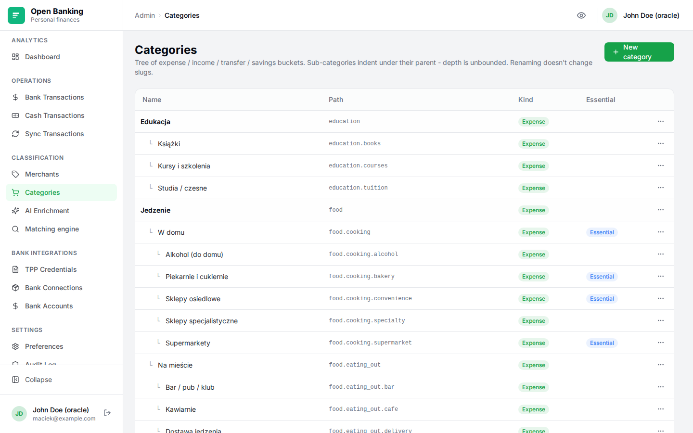 ([html](../oracle/ui/admin_categories_index.html)).

#### `admin/categories/new.html.erb` — New category

- **Routes**: `GET /admin/categories/new[?parent_path=<ltree>]`, `POST /admin/categories` [V] `../oracle/http/GET_admin_categories_new.json`, `POST_admin_categories.json` cases `default → 302`, `invalid_blank_name → 422`; `spec/requests/categorization_spec.rb:20-59`.
- Header "New category", back arrow; body `admin/categories/_form` (§3.5) with kind preset `expense` and Parent path preselected from `?parent_path`; button "Create category". Success → 302 `/admin/categories`, "Category created."; failure → 422 with error summary.
- **Capture**: 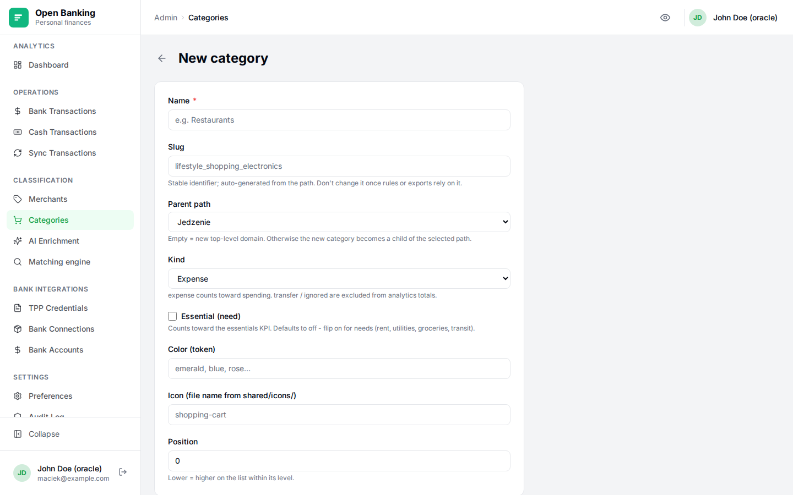 ([html](../oracle/ui/admin_categories_new.html)).

#### `admin/categories/edit.html.erb` — Edit category

- **Routes**: `GET /admin/categories/:id/edit`, `PATCH|PUT /admin/categories/:id` (foreign → 404; hidden → 302 list with "This category is private. Remove it from the hidden list in preferences to edit it.") [V] `../oracle/http/GET_admin_categories__id_edit.json` `default → 200`, `other_tenant_id → 404`; `PATCH_admin_categories__id.json` `default → 302`; `PUT_admin_categories__id.json` `invalid_kind → 422`; `spec/requests/categorization_spec.rb:61-123`.
- Header = category name, subtitle "Top-level domain" (depth 0) or "Path: <path>", back arrow; body `_form`; "Save changes". Success "Category updated."; failure 422 with errors such as "Name can't be blank" and the slug-format message (text contains "lowercase letters") [V] `spec/system/settings_change_spec.rb:86-110`.
- **Capture**: 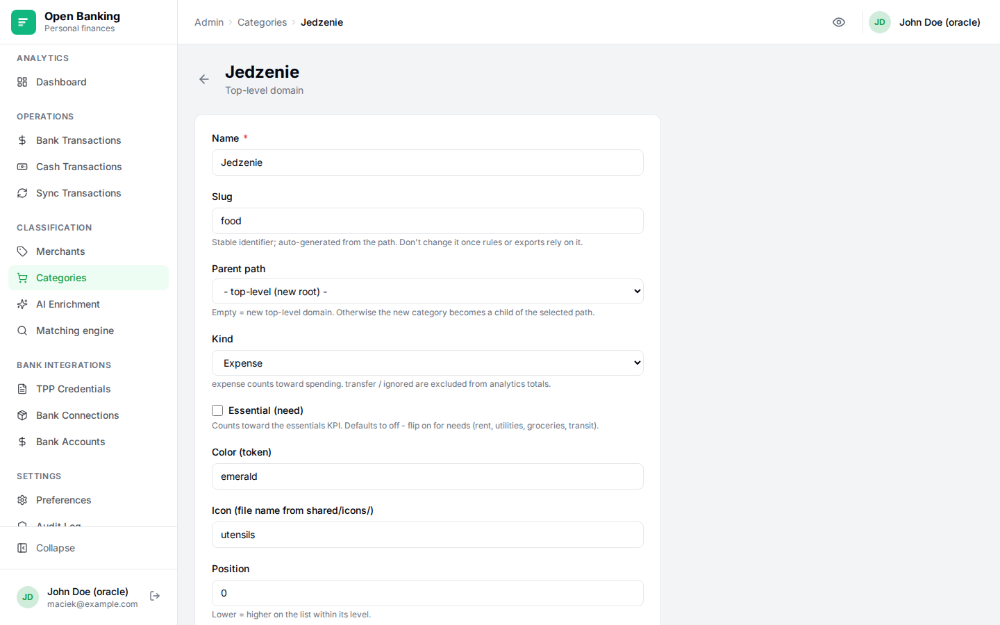 ([html](../oracle/ui/admin_categories_edit.html)).

#### `admin/llm_enrichments/index.html.erb` — AI Enrichment

- **Routes**: `GET /admin/llm_enrichments`, `POST /admin/llm_enrichments` [V] `../oracle/http/GET_admin_llm_enrichments.json`, `POST_admin_llm_enrichments.json` `default → 302 /admin/llm_enrichments/11`; `spec/requests/categorization_spec.rb:479-520`, `spec/system/llm_enrichment_spec.rb`.
- **Header**: "AI Enrichment" / "Identifies merchants for transactions that don't have one yet. Includes both fully unclassified rows and ones that fell back to a generic payment-method category. Progress streams live.".
- No active categories → only empty state "Taxonomy not set up" — "AI enrichment proposes a category path for each transaction - but with no categories defined, there's nothing to map to. Load the baseline first." with button "Load baseline taxonomy" (`POST /admin/onboarding/seed_taxonomy`).
- No configured LLM setting → warning callout "No LLM provider configured - To run enrichment, set a provider and API key in Preferences." (link to Settings → LLM) [V] `spec/system/llm_enrichment_spec.rb:120-130`.
- **What's left** card ("Transactions without a merchant, broken down by what you can do with them."), four rows (value, label, hint; linked when value > 0) [V] `../oracle/ui/admin_llm_enrichments_index.html` (24 / 0 / 3 / 13):
  1. **Without a merchant** = merchantless enrichments of the user → link `/admin/bank_transactions?enrichment_state=merchantless`; hint "Includes unmatched rows AND rows that fell back to a generic payment-method category. The numbers below add up to this." (they do not — row 3 counts groups, U-709).
  2. **Awaiting approval** = LLM-proposed, unapproved merchants → anchor `#awaiting-approval`.
  3. **Ready to send to LLM** = distinct (normalized title, counterparty) groups of enrichable rows **not** already covered by a rule → `?enrichment_state=llm_ready`; hint mentions "Generate proposals" and OpenAI.
  4. **LLM can't help** = merchantless − enrichable rows → `?enrichment_state=no_llm_signal`.
- **New run** card: "<n> new group(s) ready to send - <ceil(n/15)> API call(s) at **15** per batch." (+ "Plus <k> group(s) already proposed - review them below instead of re-sending to the LLM." when k > 0) "Only the normalized `title` and `counterparty_name` are sent - no amounts, IBANs, or dates."
  Form `POST /admin/llm_enrichments`: **Group limit** `limit` (number, min 1, max 200, default min(n, 50)); button "Generate proposals" (refresh icon; outline style when no key). Footnote "Confidence ≥ 0.85 → rule enabled immediately. Below that → goes to the approval queue." (threshold from ENV `LLM_MERCHANT_AUTO_APPROVE_THRESHOLD`, default 0.85) [I] `app/views/admin/llm_enrichments/index.html.erb:73-106`, `app/services/llm/enrichment_runner.rb:9-10`, `app/services/llm/merchant_suggester.rb:7`.
  Outcomes: success → 302 run page, notice "Run #<id> queued."; no LLM configured → 302 Settings → LLM with alert "Configure an LLM provider in Preferences before running enrichment." [V] `spec/requests/categorization_spec.rb:494-520`.
- **Awaiting approval (<n>)** card (`id="awaiting-approval"`): per pending merchant: name (bullets if hidden), badge "AI", "confidence: NN%", rule `<field> <kind> "<pattern>"`, "Category: <breadcrumb>", notes (italic); buttons "Edit" (→ merchant edit with `return_to=/admin/llm_enrichments#awaiting-approval`), "Delete" (`DELETE /admin/merchants/:id?return_to=…`, confirm "Delete proposal <name>?"), "Approve" (`POST /admin/merchants/:id/approve?return_to=…`). Each returns to this page with "Merchant deleted." / "Approved - historical transactions re-classified." [V] `spec/system/llm_enrichment_spec.rb:57-60` ("Awaiting approval (2)").
  Empty: "No proposals to approve" — "Either everything's been approved, or the LLM hasn't generated proposals yet.".
- **Runs table** (own `llm_enrichment` runs, newest first, 10/page): Run "#id", Status badge, Batches (count), Auto (`summary.auto_applied` or "-"), Pending (`summary.pending_review` or "-"), Duration ("Ns"), menu "View". Empty "No runs yet" — "Trigger your first run with the button above.".
- **Capture**: 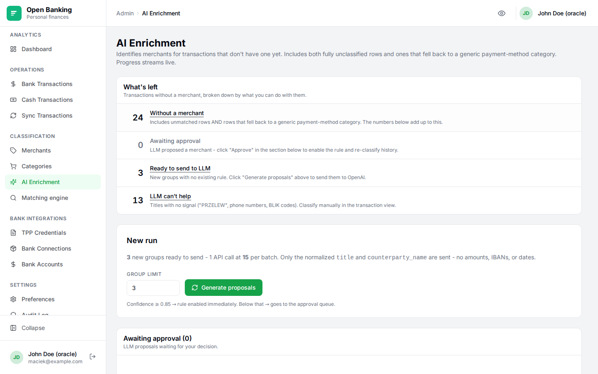 ([html](../oracle/ui/admin_llm_enrichments_index.html)).

#### `admin/llm_enrichments/show.html.erb` — AI enrichment run (live)

- **Route**: `GET /admin/llm_enrichments/:id` (own runs only; else 404) [V] `../oracle/http/GET_admin_llm_enrichments__id.json`; `spec/system/cross_user_isolation_spec.rb:83-95`.
- Header "AI Enrichment Run #<id>", subtitle "Live progress - processing in batches of 15 groups.", action "All runs" (outline, arrow-left) → index. Subscribes to `operation_run_<id>` and renders `admin/llm_enrichments/_run_progress` (§3.5) [V] `spec/system/llm_enrichment_spec.rb:16-66` ("Auto-applied", "Pending review", "failed", /rate limit/).
- **Capture**: 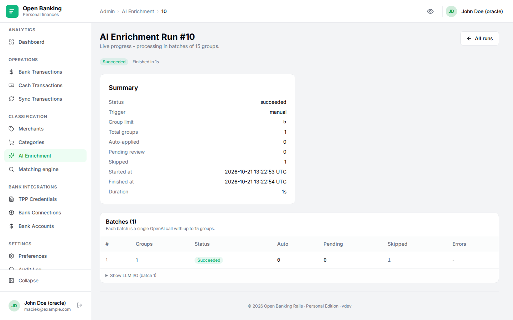 ([html](../oracle/ui/admin_llm_enrichments_show.html)).

#### `admin/matching_engine/show.html.erb` — Matching engine (read-only)

- **Route**: `GET /admin/matching_engine` [V] `../oracle/http/GET_admin_matching_engine.json`; `spec/requests/categorization_spec.rb:522-535`.
- Header "Matching engine" / "Every transaction flows through this cascade top-to-bottom. The first matching rule wins, the rest are skipped.". Without categories: empty state "Taxonomy not set up yet" — "Categories haven't been seeded - the matching engine has nothing to map transactions to. Load the baseline taxonomy to get started." + "Load baseline taxonomy" (POST).
- **1. Match rules (<total>)** — "Sorted by: source (user → LLM → system) → priority → id. First match wins. Numbering is global across pages." Table (10/page, `page` param): # (global position), Source badge (user default, llm info, system muted), Rule (`field kind "pattern"`), Merchant (link; hidden → bullets), Category (breadcrumb of merchant default), State (enabled/disabled; disabled rows at 50 % opacity), Matches (enrichments pointing at the rule) [I] `app/views/admin/matching_engine/show.html.erb:16-79`; ordering `app/controllers/admin/matching_engine_controller.rb:8-12`.
- **2. Payment-method fallback (<n>)** — "When no rule matches - we look at `payment_method` and assign a generic category." Table: Direction badge, Payment method, → Category (breadcrumb or red "missing category: <path>"), Kind badge, Matches (bank + cash enrichments with source `system_fallback` grouped by direction/payment method). Rows come from the fixed map `Enrichment::TransactionEnricher::PAYMENT_METHOD_FALLBACK` (19 entries) [I] `app/services/enrichment/transaction_enricher.rb:20-41`.
- **Summary**: All transactions, Classified by rule, Classified by fallback, Unmatched.
- **Capture**: 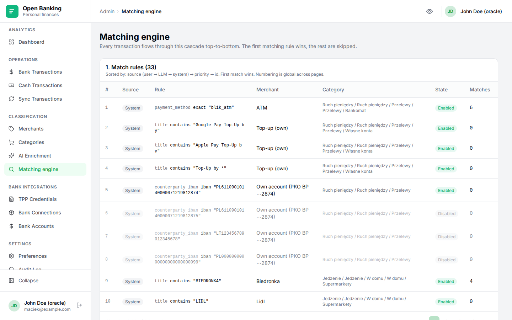 ([html](../oracle/ui/admin_matching_engine.html)).

### 2.5 Bank integrations

#### `admin/tpp_credentials/index.html.erb` — TPP credentials list

- **Route**: `GET /admin/tpp_credentials` (own credentials, Ransack sort default `created_at desc`, 10/page) [V] `../oracle/http/GET_admin_tpp_credentials.json`; `spec/requests/banking_spec.rb:6-23`.
- Header "TPP Credentials" / "Your application identities for accessing Open Banking providers (e.g. Enable Banking)."; action "New credential".
- Table: Name (sortable; link + badge "primary"), Provider (sortable), Environment (sortable), Cert expires (sortable; date + "(<time ago in words>[ ago])", red when expired, amber when expiring soon, "-" without cert), Status (sortable badge: active success, error destructive, pending info), menu View / Edit [I] `app/views/admin/tpp_credentials/index.html.erb:23-66`.
- Empty: "No credentials yet" — "Add a TPP credential to start connecting banks. You'll need a private key, application ID, and certificate from your provider's Control Panel." + "Add credential".
- Flash on arrival: "Credential deleted.", "Configure a primary TPP credential before connecting banks." (redirect from Add bank) [V] `spec/requests/banking_spec.rb:100-109,172-180`.
- **Capture**: 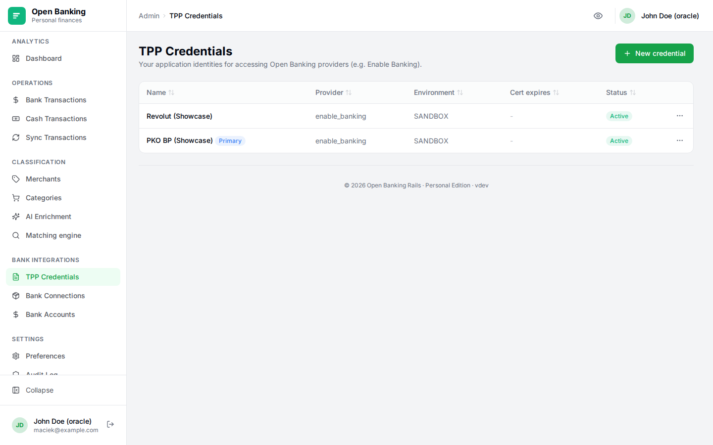 ([html](../oracle/ui/admin_tpp_credentials_index.html)).

#### `admin/tpp_credentials/show.html.erb` — TPP credential detail

- **Route**: `GET /admin/tpp_credentials/:id` (foreign → 404) [V] `../oracle/http/GET_admin_tpp_credentials__id.json` cases `default → 200`, `other_tenant_id → 404`.
- Header = name, subtitle "TPP credential - <provider> (<environment or 'environment not set'>)". If `last_verification_error` present: destructive callout "Last verification failed - <error (strong blur)>".
- Badges: status, "primary", "cert expired" / "cert expiring soon".
- Actions [I] `app/views/admin/tpp_credentials/show.html.erb:28-52`: "Test connection" (`POST …/test_connection`), "Make primary" (`POST …/make_primary`, only when not primary), "Edit", "Delete" (`DELETE`, confirm "Permanently delete this credential?", only when the credential has no bank connections).
- Cards: **Identity** (Provider, Environment, Application ID (kid) `redact`, "Redirect URL (sent in /auth)" + hint "⚠ not in EB allowed list" when the URL is missing from the provider-registered list, "Registered in EB", "Last verified" "<x> ago"/"never"; mismatch note "Your local `redirect_url` isn't in EB's registered URL list. `POST /auth` will be rejected. Edit the credential to use one of the registered URLs, or add your URL in EB Control Panel."),
  **Certificate metadata** (Subject, Issuer, Valid from, Valid until "(N days)", Key size "N bits", Signature; or "No certificate uploaded - paste the public cert (PEM) to see metadata here."),
  **Provider metadata (cached from GET /application)** (JSON viewer, not masked; or 'Run "Test connection" to fetch live metadata from the provider.'),
  **Bank connections (n)** (link rows: bank, "<psu type> · valid until <date|->", status badge; or "No bank connections yet.").
- Flash on arrival: 'TPP credential created. Run "Test connection" to verify it works.', "Updated.", "<name> is now the primary credential.", "Connection verified - metadata refreshed." [+ " Local redirect_url updated to match EB: <url>"], "Test failed: <error>", "Configuration error: <message>", "Cannot delete - credential has bank connections. Remove them first."
  [V] `../oracle/http/POST_admin_tpp_credentials__id_test_connection.json` (302), `POST_admin_tpp_credentials__id_make_primary.json` (302), `spec/requests/banking_spec.rb:87-151`; `app/services/enable_banking/operations/verify_credential.rb:32-38,79-81`.
- **Capture**: 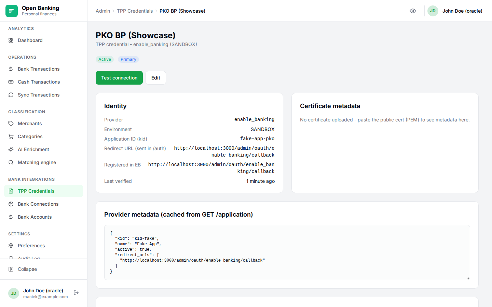 ([html](../oracle/ui/admin_tpp_credentials_show.html)).

#### `admin/tpp_credentials/new.html.erb` — New TPP credential

- **Routes**: `GET /admin/tpp_credentials/new`, `POST /admin/tpp_credentials` [V] `../oracle/http/POST_admin_tpp_credentials.json` cases `default → 302 /admin/tpp_credentials/6`, `invalid_blank_name → 422`.
- Header "New TPP credential" / "Provide your provider's application identity (e.g. from Enable Banking Control Panel)."; body `admin/tpp_credentials/_form` (defaults provider `enable_banking`, environment `PRODUCTION`); button "Create credential". The user's first credential automatically becomes primary [V] `spec/requests/banking_spec.rb:35-73`.
- **Capture**: 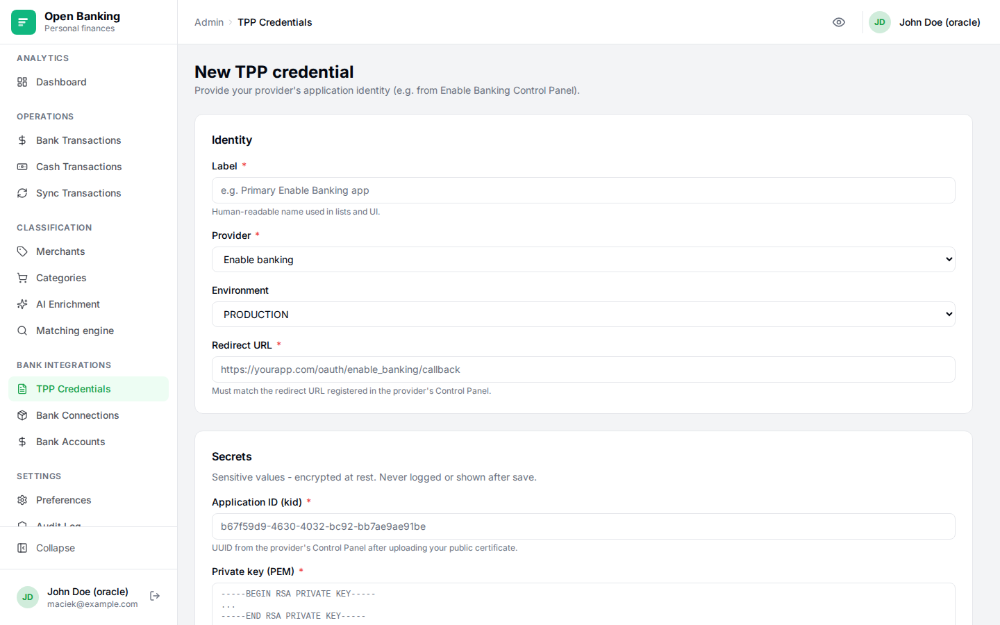 ([html](../oracle/ui/admin_tpp_credentials_new.html)).

#### `admin/tpp_credentials/edit.html.erb` — Edit TPP credential

- **Routes**: `GET /admin/tpp_credentials/:id/edit`, `PATCH|PUT /admin/tpp_credentials/:id` [V] `../oracle/http/GET_admin_tpp_credentials__id_edit.json` (200), `PATCH_admin_tpp_credentials__id.json` `default → 302`, `PUT_admin_tpp_credentials__id.json` `invalid_environment → 422`.
- Header "Edit credential", subtitle = name; body `_form`; "Save changes" → "Updated."; 422 re-render with errors (e.g. "Environment is not included in the list"). Whether the stored private key is re-rendered into the textarea is open (U-711).
- **Capture**: 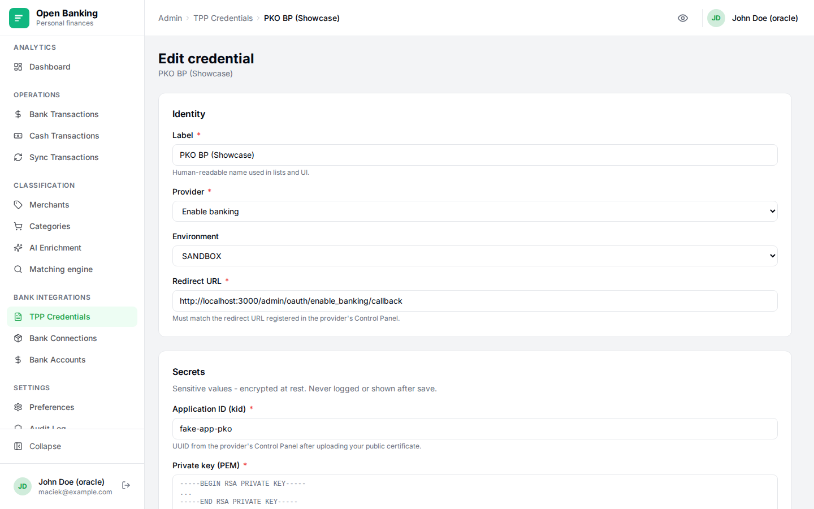 ([html](../oracle/ui/admin_tpp_credentials_edit.html)).

#### `admin/bank_connections/index.html.erb` — Bank connections list

- **Route**: `GET /admin/bank_connections` (own connections, default sort `valid_until asc`, 10/page) [V] `../oracle/http/GET_admin_bank_connections.json`; `spec/requests/banking_spec.rb:153-170`.
- Header "Bank Connections" / "Authorized sessions per bank. Each connection has its own validity period - keep them refreshed before they expire."; action "Add bank" (+).
- Table: Bank (sortable `bank_name`; logo + link + country code), Credential (name), PSU type (sortable), Valid until (sortable; date + "(Nd)" days until expiry; red when expired, amber when expiring soon; "-"), Status (sortable badge with model tone), menu View / Edit [I] `app/views/admin/bank_connections/index.html.erb:22-72`.
- Empty: "No bank connections yet" — "Click below to authorize a bank - you'll log in on the bank's site and approve the consent." + "Add bank".
- Flash on arrival: "Connection closed.", OAuth callback alerts "Authorization was cancelled or failed at the bank.", "Invalid or expired state. Start the flow again.", "State user mismatch.", "Authorization code missing.", "TPP credential no longer exists." or the connection-creation error, and "Couldn't load bank list: <error>" [V] `../oracle/http/GET_callback.json` cases `bank_error_param`, `invalid_state`, `missing_state → 302 /admin/bank_connections`; `spec/system/oauth_callback_error_spec.rb:16-111`, `spec/requests/banking_spec.rb:199-210`; `app/controllers/oauth_callbacks_controller.rb:10-36`.
- **Capture**: 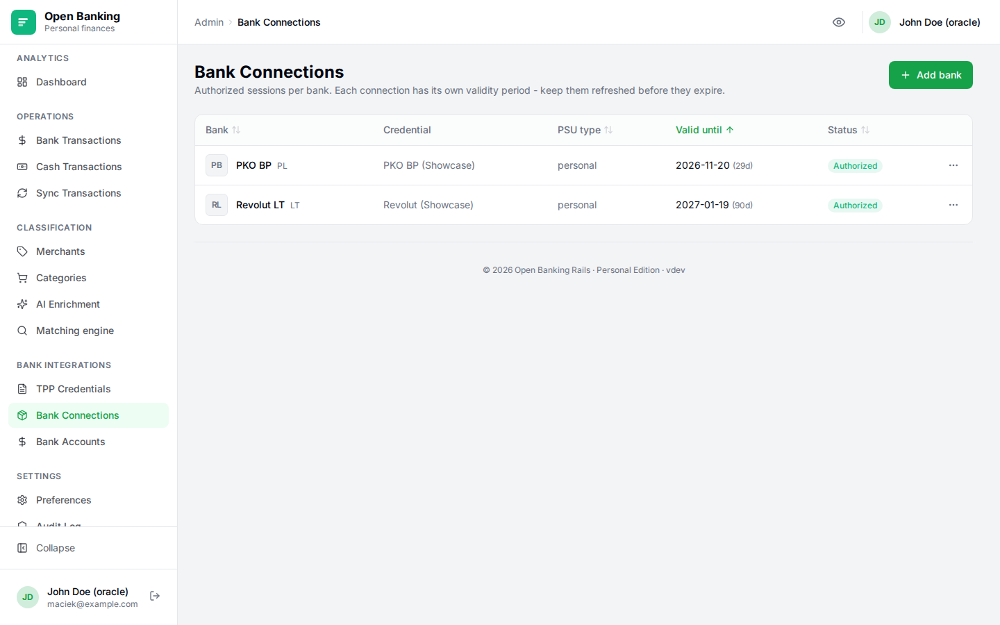 ([html](../oracle/ui/admin_bank_connections_index.html)).

#### `admin/bank_connections/new.html.erb` — Add / re-authorize bank connection

- **Routes**: `GET /admin/bank_connections/new[?aspsp_name=&aspsp_country=&psu_type=&replaces=<id>]`, `POST /admin/bank_connections` [V] `../oracle/http/GET_admin_bank_connections_new.json` cases `default`, `with_aspsp → 200`; `POST_admin_bank_connections.json`.
- Preconditions: a **primary** TPP credential is required, else 302 `/admin/tpp_credentials` with alert "Configure a primary TPP credential before connecting banks."; the bank list is fetched live from Enable Banking (`ListAspsps` for the country, default `PL`), sorted by name case-insensitively; on API failure 302 `/admin/bank_connections` with alert "Couldn't load bank list: <error>". `replaces` is honoured only if it is one of the user's connections [V] `spec/requests/banking_spec.rb:172-225`; `app/controllers/admin/bank_connections_controller.rb:26-41,92-97`.
- Header: "Add bank connection" / "Pick a bank and authorize via the bank's login (SCA). You'll be redirected back when done." — or in re-auth mode "Re-authorize bank connection" / "Renewing existing consent. Old connection will be marked as replaced when the new one is approved." plus info callout "Re-auth flow: linked accounts (matched by EB UID) will be re-attached to the new connection automatically. The old connection stays as a historical record (status: replaced)." [V] `spec/system/connection_expiry_reauth_spec.rb:36-40`.
- **Form** (`POST /admin/bank_connections`, scope `bank_connection_request_form`, **Turbo disabled** — full-page submit so the browser can follow the cross-origin 303 to the bank) [I] `app/views/admin/bank_connections/new.html.erb:16-82`:

  | Field | Name | Input | Notes |
  |---|---|---|---|
  | Bank (ASPSP) `*` | `bank_connection_request_form[aspsp_name]` | select, blank "Choose a bank", options "<name>[ (beta)]" → value name | preselected from `?aspsp_name` |
  | (hidden) | `bank_connection_request_form[aspsp_country]` | always `PL` | |
  | PSU type `*` | `bank_connection_request_form[psu_type]` | select Personal `personal` / Business `business` | default personal |
  | Consent validity (days) | `bank_connection_request_form[valid_days]` | number, placeholder "180", hint "Default 180 days. Some banks cap this lower (mBank → 90)." | |
  | (hidden, re-auth only) | `replaces_connection_id` | id | |

  "Pre-flight check" section: Credential, "Redirect URL (sent to bank)" (+ "⚠ not in EB allowed list - bank will reject" when not in the credential's registered list), "EB-registered URLs"; on mismatch a warning callout "⚠ Your local `redirect_url` doesn't match anything in EB's allowed list. Edit credential and set it to: `<first registered url>`".
  Buttons "Cancel" → list, "Continue to bank →".
- Outcomes: valid → **303** to the bank's authorization URL (off-host, carries a signed `state`) [V] `../oracle/http/POST_admin_bank_connections.json` case `default → 303 https://fake.enablebanking.test/auth?state=…`, `spec/requests/banking_spec.rb:227-241`; start failure → 302 back to `/new` with the error as alert [V] `spec/requests/banking_spec.rb:243-260`.
  Invalid form (e.g. blank bank) → **204 No Content with empty body**: the browser stays on the page and the intended alert is lost — BUG, U-702 [V] case `invalid_blank_aspsp → 204`.
- Re-auth entry: `POST /admin/bank_connections/:id/reauth` → 302 here with the bank params and notice "Re-authorize via the bank - the old connection will be marked as replaced when the new one is approved." [V] `../oracle/http/POST_admin_bank_connections__id_reauth.json`, `spec/requests/banking_spec.rb:288-301`.
- After the bank redirects to `/callback`: success → 302 connection page with notice "Bank connected - <bank name>, <n> account(s)." [V] `spec/requests/public_spec.rb:150-168`, `spec/system/oauth_callback_success_spec.rb:16-49`.
- **Capture**: 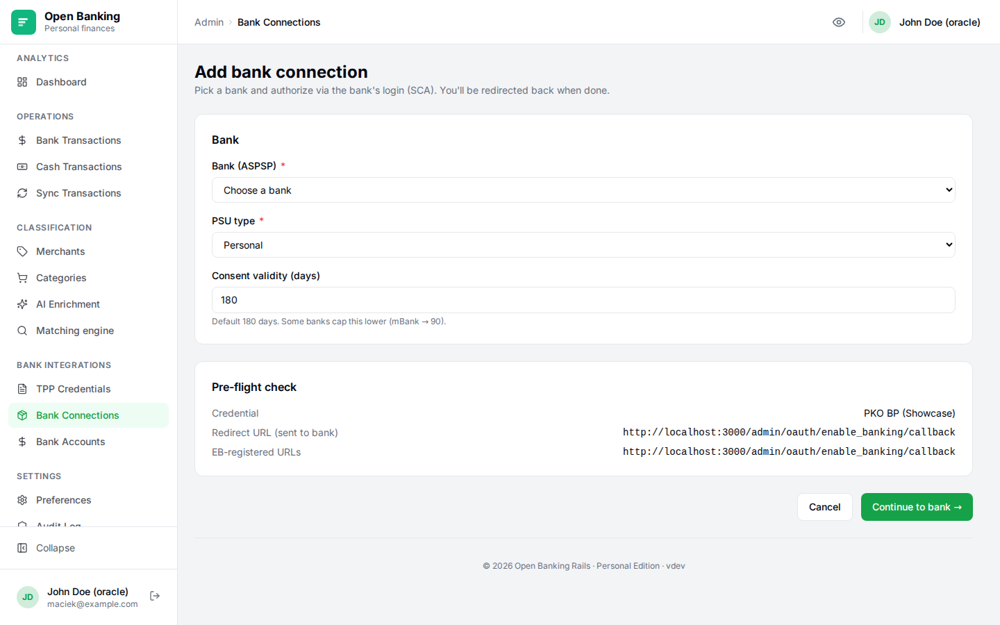 ([html](../oracle/ui/admin_bank_connections_new.html)).

#### `admin/bank_connections/show.html.erb` — Bank connection detail

- **Route**: `GET /admin/bank_connections/:id` (foreign → 404) [V] `../oracle/http/GET_admin_bank_connections__id.json` cases `default → 200`, `other_tenant_id → 404`; `spec/system/cross_user_isolation_spec.rb:28-36`.
- Header: bank name (or slug), subtitle "Bank connection - credential: <credential name>", XL bank logo. Badges: status (tone), "expired" (destructive) or "expiring soon" (warning) [V] `spec/system/connection_expiry_reauth_spec.rb:16-34`.
- Toolbar [I] `app/views/admin/bank_connections/show.html.erb:21-47`: left "Refresh from API" (`POST …/refresh`, outline), "Reauth (re-link with bank)" (`POST …/reauth`), "Close connection" (`DELETE`, destructive, confirm "Mark this connection as closed?"); right "Edit".
- Cards: **Connection** (Bank slug, Bank country, PSU type, Session ID `redact`, Access scope "balances + transactions"), **Lifecycle** (Authorized at, Valid until "(Nd)", Last refreshed, Last synced, Closed at), **Bank accounts (n)** (link rows: IBAN/uid, name · currency, cash-account-type badge; or "No accounts currently linked to this connection."), **Raw session payload (encrypted at rest)** (JSON viewer, strong blur; "null" when unparsable), **Last error** (only when present; red pre, strong blur).
- Flash on arrival: "Refreshed - status: <status>, valid until <YYYY-MM-DD>." / "Refresh failed: <error>", "Updated.", "Bank connected - …" [V] `../oracle/http/POST_admin_bank_connections__id_refresh.json` (302), `spec/requests/banking_spec.rb:275-286`.
- **Capture**: 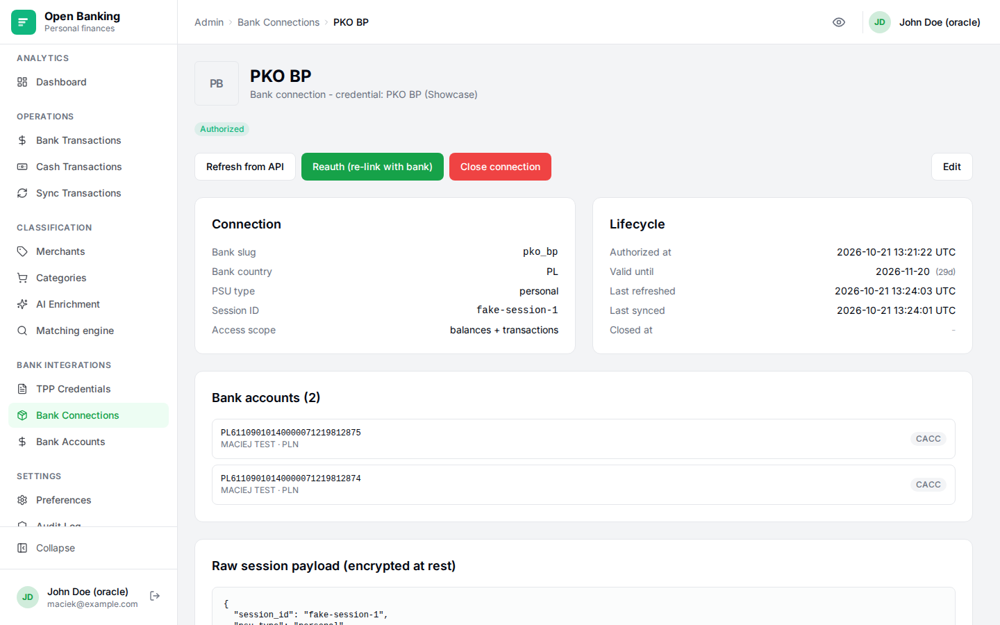 ([html](../oracle/ui/admin_bank_connections_show.html)).

#### `admin/bank_connections/edit.html.erb` — Lifecycle override

- **Routes**: `GET /admin/bank_connections/:id/edit`, `PATCH|PUT /admin/bank_connections/:id` [V] `../oracle/http/GET_admin_bank_connections__id_edit.json` (200), `PATCH_admin_bank_connections__id.json` `default → 422` (value "AUTHORIZED" — statuses are lower-case), `PUT_admin_bank_connections__id.json` `invalid_status → 422`.
- Header "Edit connection", subtitle bank. Section "Lifecycle override": 'Local fields only - they don't change the consent on the bank side, just the alerts and views in this app. "Refresh from API" will overwrite them with the bank's values.'
  Fields: **Valid until** `bank_connection[valid_until]` (`datetime-local`, prefilled ISO 8601; hint "Bank currently returns: <iso>. Shorten manually if you know the bank will force re-SCA earlier (e.g. mBank, where API says 180d but the bank's UI showed 90d during SCA).") and **Status** `bank_connection[status]` (Pending, Authorized, Expired, Revoked, Replaced, Error, Closed → lower-case values). Buttons "Cancel", "Save changes" [I] `app/views/admin/bank_connections/edit.html.erb:1-44`.
- Success → 302 show with "Updated."; invalid → 422 with error summary ("Status is not included in the list").
- **Capture**: 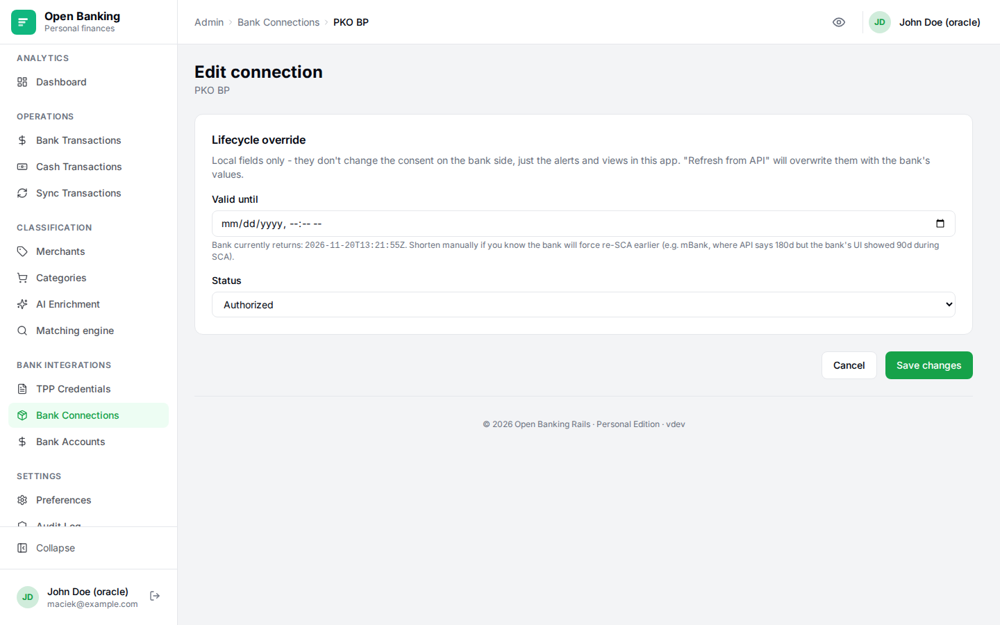 ([html](../oracle/ui/admin_bank_connections_edit.html)).

#### `admin/bank_accounts/index.html.erb` — Bank accounts list

- **Route**: `GET /admin/bank_accounts` (accounts under the user's TPP credentials; cash wallets are not listed; default sort `created_at desc`, 10/page) [V] `../oracle/http/GET_admin_bank_accounts.json`; `spec/requests/banking_spec.rb:303-315`.
- Header "Bank Accounts" / "Per-IBAN entities. Each account has a stable Enable Banking UID and persists across session renewals.".
- Table: IBAN (sortable; IBAN or uid, link, sensitive), Holder / Product (display name, "+N" alternate IBANs), Currency (sortable), Type (sortable `cash_account_type`), Connection (logo + link, or "-"), Status (sortable badge: active success, inactive muted, revoked destructive), menu View.
- Empty: "No bank accounts yet" — "Bank accounts are populated automatically when you authorize a bank connection." + "Manage connections" → `/admin/bank_connections`.
- **Capture**: 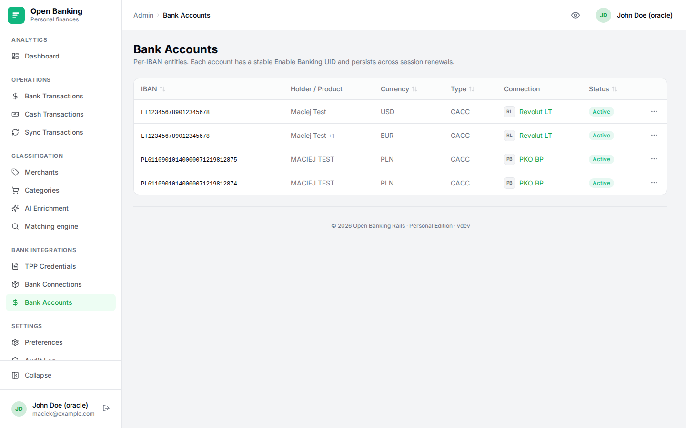 ([html](../oracle/ui/admin_bank_accounts_index.html)).

#### `admin/bank_accounts/show.html.erb` — Bank account detail

- **Route**: `GET /admin/bank_accounts/:id` (foreign → 404) [V] `../oracle/http/GET_admin_bank_accounts__id.json`; `spec/requests/banking_spec.rb:317-326`.
- Header: display name (sensitive), subtitle "Bank account - <IBAN or uid>", browser title "Bank account <uid>", XL bank logo [V] `../oracle/ui/admin_bank_accounts_show.html` (title "Bank account fake-account-fake-session-1-1", H1 "MACIEJ TEST").
- Badges status / cash account type / usage. Buttons "Refresh details" (`POST …/refresh_details`, outline) and "Refresh balances" (`POST …/refresh_balances`) → flash "Account details refreshed." / "Balances refreshed." / "Refresh failed: <error>" [V] `../oracle/http/POST_admin_bank_accounts__id_refresh_details.json`, `POST_admin_bank_accounts__id_refresh_balances.json` (302), `spec/requests/banking_spec.rb:328-352`.
- Cards: **Identity** (IBAN, BBAN, EB UID, Holder — sensitive; Currency, Product, Description, Type, Usage; alternate IBANs list under the Polish label "Alternate IBAN-y (np. Revolut PL+LT):" — U-705), **Servicer & connection** (BIC, Bank, Credential link, Active connection link, Connection valid until "(Nd)"),
  **Balances (synced <x> ago)** (only when balances exist: Type, Name, Amount (decimal string from the bank converted to Money, sensitive) + ISO, Reference date / last change), **Sync state** (Details fetched, Balances synced, Transactions synced), **Raw account resource (from POST /sessions)** and **Raw account details (from GET /accounts/{uid}/details)** JSON viewers [I] `app/views/admin/bank_accounts/show.html.erb:1-133`.
- **Capture**: 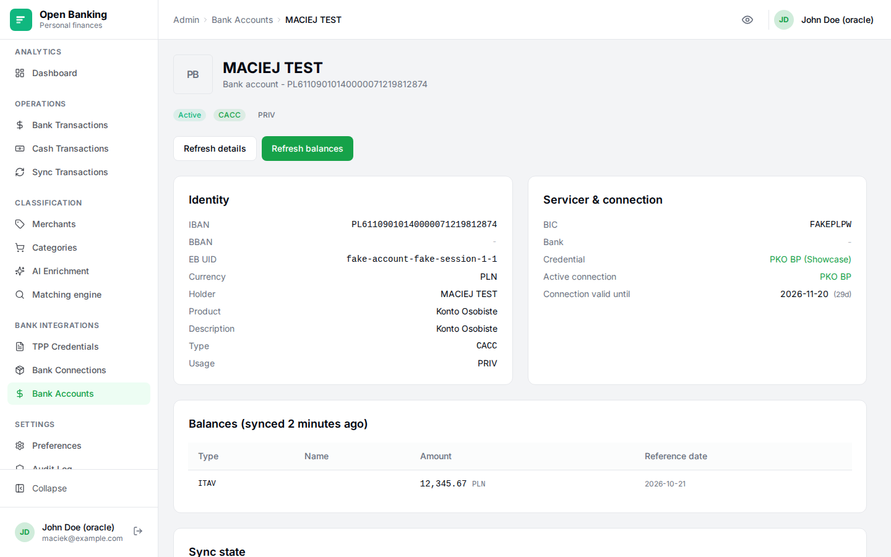 ([html](../oracle/ui/admin_bank_accounts_show.html)).

### 2.6 Settings (Preferences)

All preference pages render inside `admin/settings/preferences/_layout` (§3.5): header "Preferences" / "Personal settings, app behavior, and integrations." and a section nav
Profile · App · LLM · Data exchange · API tokens. `/admin/settings` → 301 `/admin/settings/preferences` → 301 `/admin/settings/preferences/profile`
[V] `../oracle/http/GET_admin_settings.json`, `../oracle/http/GET_admin_settings_preferences.json`. The browser title of every section is "Preferences · Open Banking".

#### `admin/settings/preferences/profile.html.erb` — Profile + password

- **Routes**: `GET /admin/settings/preferences/profile`; `PATCH /admin/settings/preferences/profile`; `PATCH /admin/settings/preferences/password` [V] `../oracle/http/GET_admin_settings_preferences_profile.json`, `PATCH_admin_settings_preferences_profile.json` cases `default → 302`, `invalid_blank_name → 422`; `PATCH_admin_settings_preferences_password.json` cases `wrong_current_password`, `too_short → 422`.
- **Profile form** (scope `user`): Name `user[name]` (text, `*`, placeholder "Your full name"); Email (read-only, sensitive, hint "Contact support to change this - it's tied to your sign-in."; not submitted to the allow-list); button "Save profile" → "Profile saved." [I] `app/views/admin/settings/preferences/profile.html.erb:3-36`; `app/controllers/admin/settings/preferences_controller.rb:10-17,100-102`.
- **Password form** (scope `user`): Current password, New password, Confirm new password (all password + eye toggle, `*`); text "Confirm your current password to set a new one. You'll stay signed in on this device after the change."; button "Change password" → "Password changed." (session kept via `bypass_sign_in`).
- Failures re-render the page with 422 and alert = joined full messages, e.g. "Name can't be blank", "Current password is invalid", "Password is too short (minimum is 6 characters)" [V] `spec/requests/settings_spec.rb:6-68`.
- **Capture**: 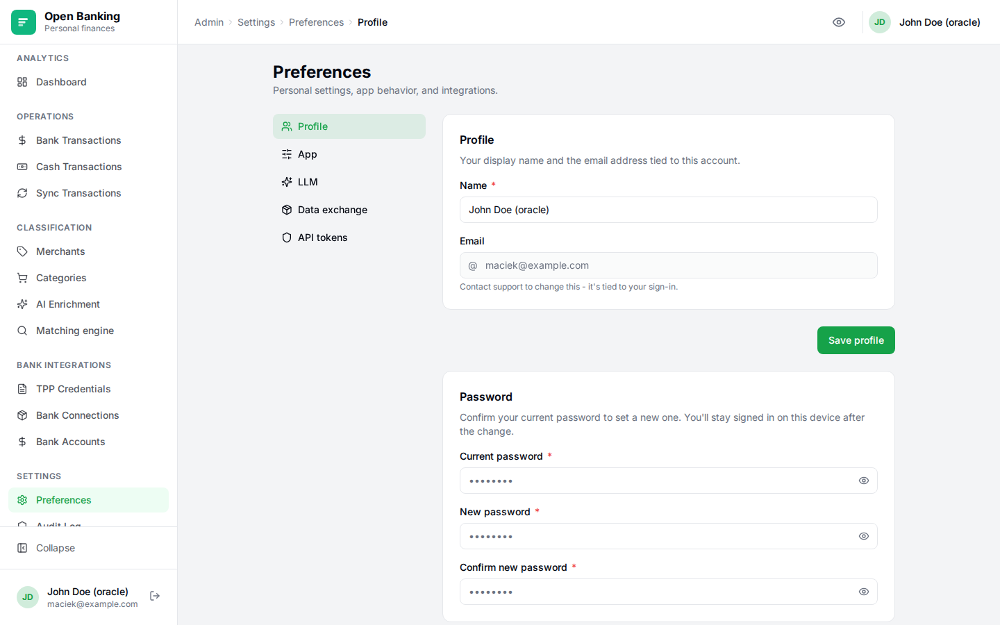 ([html](../oracle/ui/admin_settings_profile.html)).

#### `admin/settings/preferences/app.html.erb` — App settings (cash tracking, hidden categories)

- **Routes**: `GET|PATCH /admin/settings/preferences/app` [V] `../oracle/http/GET_admin_settings_preferences_app.json`, `PATCH_admin_settings_preferences_app.json` `default → 302`; `spec/requests/settings_spec.rb:70-125`.
- **Cash tracking** section: explanation ("When enabled, every BLIK ATM withdrawal is mirrored as a top-up in your cash wallet, and both rows are classified as transfers (excluded from spend). You're then expected to log cash spending manually under Cash Transactions."), toggle **Track cash spending** `user[track_cash]` (labels "Tracking on"/"Tracking off"; hint "Existing ATM withdrawals stay as-is until you run the backfill task (cash:backfill_atm_links).").
- **Hidden categories** section: text about masking ("Transactions in the selected categories are always masked (••• instead of title, merchant, category, and amount). Analytics totals stay accurate. Drill-down into these categories / transactions is blocked - to open one, remove the category from this list."),
  `_multi_select` **Categories to hide** `user[hidden_category_ids][]` (searchable, cloaked chips, placeholder "Choose categories…", options = active categories with depth dashes and breadcrumb labels, hint "Hiding a parent hides every descendant in the dashboard."), toggle **Temporarily reveal** `user[reveal_hidden_categories]` ("Revealed"/"Hidden"; hint "When on, the categories above are visible and editable everywhere - masking and drill-down blocks are bypassed. Turn back off when you're done.").
- Button "Save app settings". When nothing is selected the multi-select sends no param; the server treats that as "clear all".
- Success → 302 back with "App settings saved."; if tracking was just switched on, Cash::Tracking runs and the notice gets " Created a <CUR> wallet and linked <n> historical ATM withdrawal(s)." Failure → 422 with alert [V] `spec/requests/settings_spec.rb:90-104`; `app/controllers/admin/settings/preferences_controller.rb:33-47`.
- **Capture**: 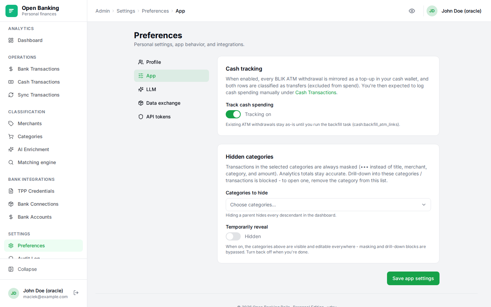 ([html](../oracle/ui/admin_settings_app.html)).

#### `admin/settings/preferences/llm.html.erb` — LLM provider settings + connection test

- **Routes**: `GET|PATCH /admin/settings/preferences/llm`, `POST /admin/settings/preferences/llm/test` [V] `../oracle/http/GET_admin_settings_preferences_llm.json`, `PATCH_admin_settings_preferences_llm.json` cases `default → 302`, `invalid_provider → 500`, `POST_admin_settings_preferences_llm_test.json` (302); `spec/requests/settings_spec.rb:127-211`.
- **Form** (scope `llm_setting`, `data-controller="llm-provider"` with JSON values models-by-provider and defaults) [I] `app/views/admin/settings/preferences/llm.html.erb:4-61`:

  | Field | Name | Options / behaviour |
  |---|---|---|
  | Provider | `llm_setting[provider]` | "OpenAI" `openai`, "Google Gemini" `gemini`; changing it rebuilds the Model options client-side and selects that provider's default model |
  | Model | `llm_setting[model]` | OpenAI: gpt-5-mini (default), gpt-5-nano, gpt-5.4-mini, gpt-5.4-nano, gpt-4.1-mini, gpt-4o-mini; Gemini: gemini-2.5-flash (default), gemini-2.5-pro, gemini-2.0-flash. Hint (HTML): "Default if blank. For OpenAI: `gpt-5-mini` is the sweet spot for merchant classification - modern structured output, ~$0.004 per 15-item batch. `gpt-5-nano` is the cheapest option (slight accuracy hit). Escalate to `gpt-5.4-mini` if you see misclassifications." |
  | API key | `llm_setting[api_key]` | password + eye toggle, `autocomplete=off`; required (`*`) only before first save; placeholder "••• key saved" / "sk-…"; hint "A key is saved. Leave blank to keep it, or type a new one to replace." / "Paste the key from the selected provider. Stored encrypted." Blank on an existing setting keeps the stored key |

  Button "Save LLM settings" → "LLM settings saved."; validation failure → 422 + alert (e.g. "Model is not supported by OpenAI", "Api key can't be blank"). An unknown provider value crashes the re-render with 500 ("Unknown LLM provider: \"martian\"") — known finding.
- **Connection test** card (only when a configured setting is saved): "Sends a tiny structured-output ping to <provider label> (<effective model>) using your saved key. No transaction data is included."; last test (newest `llm_connection_test` run) as success callout "Last test: OK - <x> ago (<short time>)" with "<provider> (<model>)", or destructive callout "Last test failed - <when>" with the error (sensitive); expandable "Show LLM I/O - exactly what was sent and what came back" with two JSON viewers ("Sent (input)", "LLM response"); or "Not tested yet - run the test below. The exact request and response will be shown here."; button "Test connection" (`POST …/llm/test`).
  Results: "Connection OK - <provider label> (<model>)." / "Test failed: <message>" / "Save a provider and API key first." [V] `../oracle/ui/admin_settings_llm.html` ("Last test failed - 2 minutes ago (21 Oct 12:52)"), `spec/requests/settings_spec.rb:176-211`; `app/controllers/admin/settings/preferences_controller.rb:70-83`.
- **Capture**: 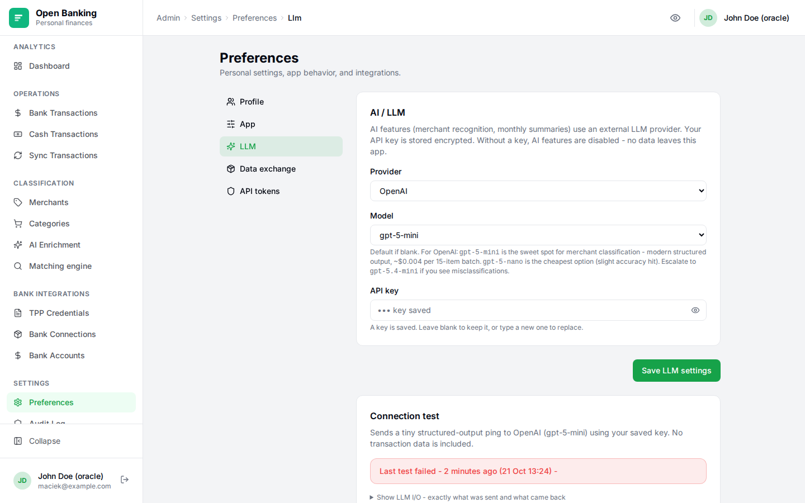 ([html](../oracle/ui/admin_settings_llm.html)).

#### `admin/settings/data_exchange/show.html.erb` — Data exchange (export / import bundles)

- **Routes**: `GET /admin/settings/preferences/data_exchange`, `POST …/data_exchange/export`, `POST …/data_exchange/import` [V] `../oracle/http/GET_admin_settings_preferences_data_exchange.json`, `POST_admin_settings_preferences_data_exchange_export.json` cases `default → 200` (binary), `blank_passphrase → 302`, `POST_admin_settings_preferences_data_exchange_import.json` cases `missing_bundle`, `garbage_bundle → 302`; `spec/system/data_exchange_round_trip_spec.rb`, `spec/requests/settings_spec.rb:213-297`.
- **Export** section: text ("Bundle your data into a passphrase-encrypted file you can re-import on another instance. Bundle holds plaintext secrets - encryption on the wire comes from the passphrase, not from this server's keys."), list "Will be exported" with one row per registry resource "<Key humanized>" + "<n> record(s)" (e.g. "Tpp credentials 2 records", "Bank connections 2 records", "Bank accounts 6 records"), or info callout "Nothing to export yet - add a TPP credential or bank connection first.";
  **Passphrase** `passphrase` (password, HTML `required`, `autocomplete=new-password`, hint "You'll need this exact passphrase on the destination to import."); button "Download bundle" → response `application/octet-stream`, attachment `obr-export-<UTC yyyymmdd-HHMMSS>.obrbundle`; failure → 302 back with "Export failed: <message>" [V] `spec/system/data_exchange_round_trip_spec.rb:29-49`. Browser behaviour under Turbo is open (U-704).
- **Import** section (multipart): **Bundle file** `bundle` (file, `accept=".obrbundle,application/octet-stream"`, `required`), **Passphrase** `passphrase` (required), radio **If a record already exists on this instance** `strategy`: `skip_existing` "Skip - keep the destination record unchanged. (Default, safest.)" (checked), `overwrite_existing` "Overwrite - apply the bundle's attributes to the existing record.", `fail_on_conflict` "Fail - abort the entire import on the first conflict."; button "Import bundle".
  Results (302 back): "Import done - <i> imported, <u> updated, <s> skipped." / "Bundle file is required." / "Import failed: <message>" [V] `spec/system/data_exchange_round_trip_spec.rb:51-141`; `app/controllers/admin/settings/data_exchange_controller.rb:13-49`.
- **Capture**: 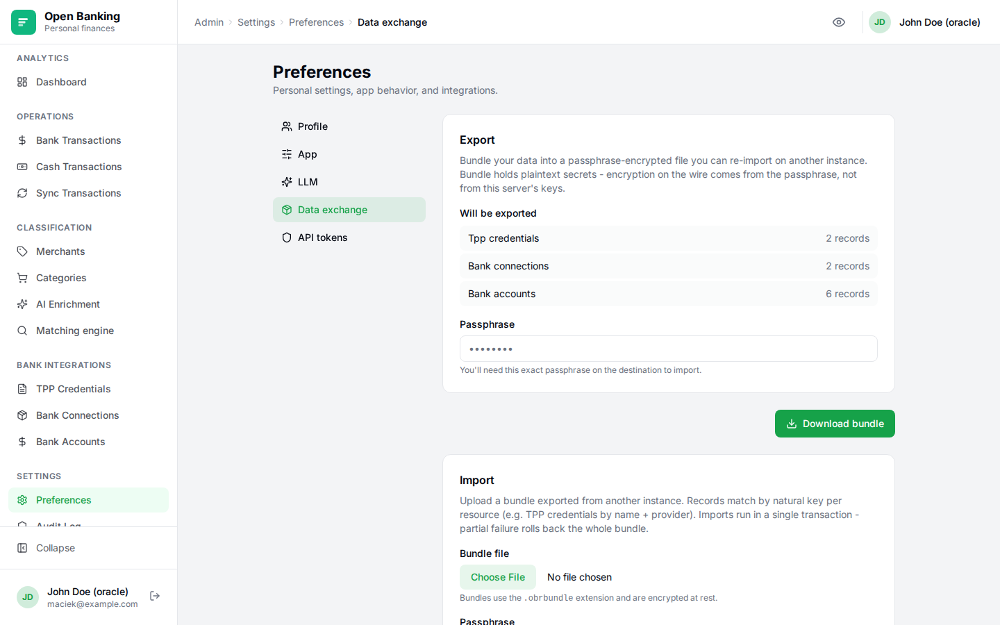 ([html](../oracle/ui/admin_settings_data_exchange.html)).

#### `admin/settings/api_tokens/index.html.erb` — Personal access tokens

- **Routes**: `GET|POST /admin/settings/preferences/api_tokens`, `DELETE /admin/settings/preferences/api_tokens/:id` [V] `../oracle/http/GET_admin_settings_preferences_api_tokens.json`, `POST_…api_tokens.json` cases `default → 302`, `invalid_blank_name → 422`, `DELETE_…api_tokens__id.json` cases `first_delete_revokes`, `second_delete_destroys_revoked → 302`; `spec/system/personal_access_token_lifecycle_spec.rb`.
- Section "API tokens": "Personal access tokens authorize calls to the JSON API and the MCP server. Each token belongs to your account; revoke any you no longer recognize."; link "API docs" → `/api/v1/docs` (new tab).
  Form (scope `personal_access_token`): **Token name** `personal_access_token[name]` (`*`, placeholder "e.g. claude-desktop, macbook-cli"; note "Used to identify this token in the list. Must be unique per account."); button "Generate token".
- After a successful generate (302 back, notice 'Token "<name>" generated. Copy it now - it won't be shown again.'), the raw token travels in the flash for exactly one request and is shown once in a highlighted box: "Copy this token now - it won't be shown again." / "Store it in your password manager or your client's config file. If you lose it, generate a new one." + `<code>` (sensitive) + "Copy" button (`clipboard` controller; label changes to "Copied!" for 1.5 s). Reloading hides it
  [V] `spec/system/personal_access_token_lifecycle_spec.rb:16-46`, `spec/requests/settings_spec.rb:325-346`.
- **Active tokens** list (order `revoked_at desc, created_at desc`: active tokens first because PostgreSQL sorts NULL first in DESC order, then revoked ones by most recent revocation): name (sensitive), "…<last four>" (mask kind), badge "Active"/"Revoked", "Created <short> · Last used <short | never>"; action "Revoke" (`DELETE`, confirm "Revoke <name>? Calls using this token will start failing immediately.") or for revoked tokens "Delete" (`DELETE`, confirm "Delete <name>? This removes the record permanently.").
  Results: 'Token "<name>" revoked.' / 'Token "<name>" deleted.'. Empty: "No tokens yet" — "Generate your first token above to start using the API or connect an MCP client." [V] `spec/system/personal_access_token_lifecycle_spec.rb:66-81`, `spec/requests/settings_spec.rb:308-323,384-412`.
- Failure (blank or duplicate name) → 422 re-render with alert = joined errors (e.g. "Name can't be blank", "Name has already been taken"; fallback "Could not generate the token.") [V] `spec/system/personal_access_token_lifecycle_spec.rb:151-171`, `spec/requests/settings_spec.rb:348-361`.
- **Capture**: 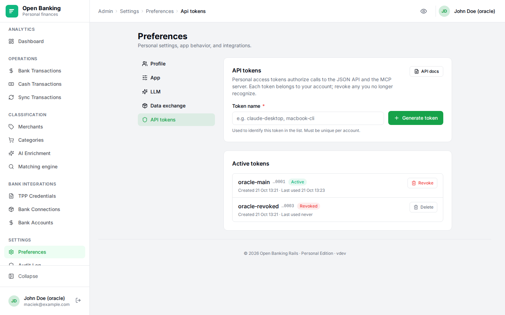 ([html](../oracle/ui/admin_settings_api_tokens.html)).

### 2.7 Audit log

#### `admin/versions/index.html.erb` — Audit Log

- **Route**: `GET /admin/versions` — lists **all** `PaperTrail::Version` rows of the instance, not only the current user's (known finding; another tenant sees them) [V] `../oracle/http/GET_admin_versions.json` case `other_tenant_sees_all_versions → 200`; `app/controllers/admin/versions_controller.rb:5-7`.
- Header "Audit Log" / "Read-only history of all changes across the system.". Filter form (Ransack, Turbo off, panel only — there is no inline Apply button; Apply lives in the panel): Event `q[event_eq]` (All events / Create / Update / Destroy), Resource `q[item_type_eq]` ("All resources" + distinct item types); chips "Event: …", "Resource: …".
- Table (sortable: ID, Event, Resource, Item ID, By (`whodunnit` or "-"), At (`l(:short)`), default `created_at desc`, 10/page): event badge create success / update info / destroy destructive; menu "View". Empty: "No versions found" — "No changes have been recorded yet." [V] `spec/requests/meta_spec.rb:21-28`.
- **Capture**: 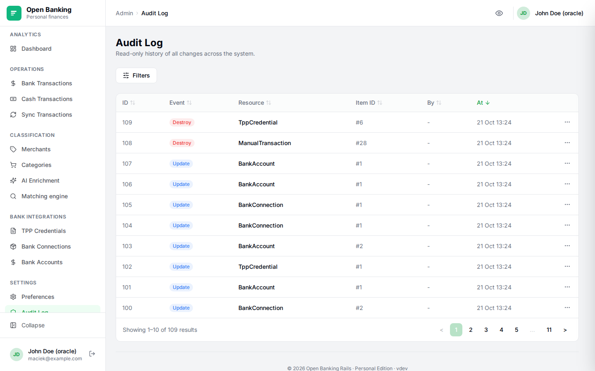 ([html](../oracle/ui/admin_versions_index.html)) ("Showing 1–10 of 109 results").

#### `admin/versions/show.html.erb` — Version detail

- **Route**: `GET /admin/versions/:id` (unscoped; unknown id → 404) [V] `../oracle/http/GET_admin_versions__id.json` cases `default`, `other_tenant_reads_main_version → 200`; `spec/requests/meta_spec.rb:30-53`.
- Header "Version #<id>" + event badge, subtitle "<item type> #<item id> - <created_at long>", back arrow. Facts grid: Resource, Item ID, Event, Changed by, Timestamp.
- "Created with" (create) / "Changed fields" (update) table: Attribute, Before (update only; red, Ruby `inspect` form, JSON viewer for hashes/arrays), After/Value (green). "Full previous state" (update) and "Deleted object snapshot" (destroy) JSON viewers from the YAML `object` column. Values are not wrapped as sensitive (except JSON viewers, strong blur) [I] `app/views/admin/versions/show.html.erb:1-101`.
- **Capture**: 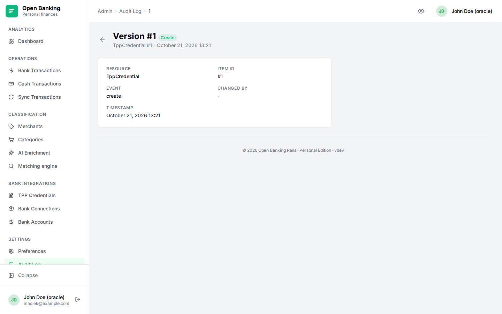 ([html](../oracle/ui/admin_versions_show.html)).

### 2.8 Development-only and reference pages

#### `admin/styleguide/index.html.erb` — Component styleguide

- **Route**: `GET /admin/styleguide` (exists in **all** environments; only the sidebar link is development-only) [V] `../oracle/http/GET_admin_styleguide.json`; `spec/requests/meta_spec.rb:6-19`; `config/routes.rb:49`.
- Purpose per repo rules: "renders every reusable component with its variants … Each partial's API is in its first line as `<%# locals: (...) %>`" [I] `AGENTS.md` "Source of truth". Sections in order: Badges, Buttons, Page Header (5 variants), Stat Cards (incl. Polish demo labels "Saldo", "Wydatki", "Wpływy", "Top sprzedawca", "Δ vs poprz.", U-705), Cards, Empty State, Tabs, Callout, Critical Banner, Toast, Skeletons, Modal (sm/default/lg/xl opened via inline onclick), Filter Trigger & Chip, Filter Panel, Sortable Table Headers, Data Table, Breakdown List (empty label "Brak transakcji w tym okresie"), Bulk Action Bar, Pagination, Dropdown Menu, JSON Viewer, Confirm Dialog, Icons (43 names - every icon except `logo_mark`), Form Components (text/email/password/number, textarea/select, date/time/date-range, checkbox/toggle/radio/checkbox group/color, tags/searchable/multi select/file upload, Ajax Select with mock options, Category Picker, Form Group, Error State), Form Footer, Action Toolbar, Definition List, Bank Logo, Breadcrumbs, Category Breadcrumb, Command Palette [I] `app/views/admin/styleguide/index.html.erb:1-929`.
- Because several `_page_header` demos each append to `content_for :title`, the `<title>` becomes "Styleguide · Open BankingTitle only · Open BankingWith subtitle · …" (U-708) [V] `../oracle/ui/admin_styleguide.html`.
- **Capture**: 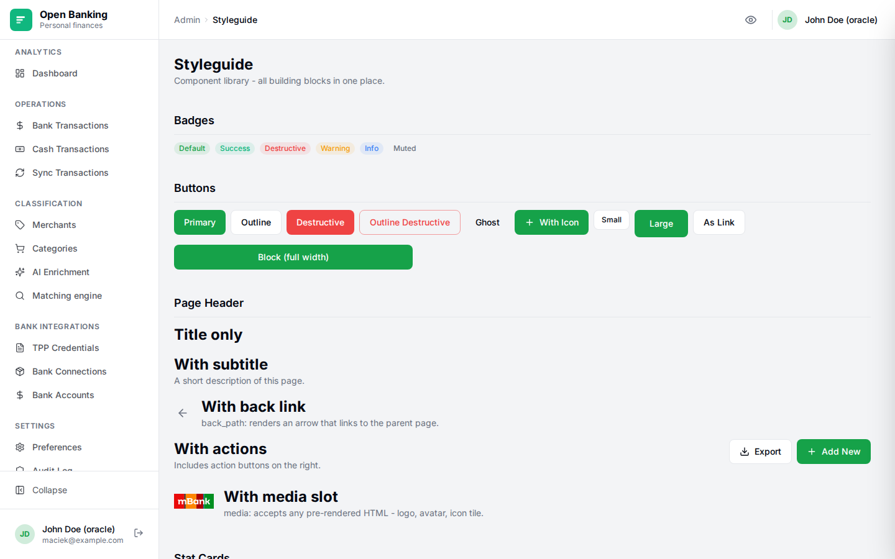 ([html](../oracle/ui/admin_styleguide.html)).

#### `admin/debug/index.html.erb` — Debug (development only)

- **Routes** (only when `Rails.env.development?`): `GET /admin/debug`; `GET /admin/debug/runtime_error|zero_division|argument_error|nested_error` (raise → 500); `POST /admin/debug/enqueue_failing_job?error_type=runtime|argument|zero_division` (enqueues `FailingJob`, responds 204 so the page stays) [V] `../oracle/http/GET_admin_debug.json` (200), `GET_admin_debug_runtime_error.json` (500), `POST_admin_debug_enqueue_failing_job.json` (204); `config/routes.rb:33-42`.
- Content: header "Debug" / "Trigger errors and jobs to test observability pipeline."; "HTTP Exceptions" grid (RuntimeError `raise RuntimeError`, ZeroDivisionError `1 / 0`, ArgumentError `Integer("not_a_number")`, Nested Error "StandardError wrapping RuntimeError as cause") with "Raise" link buttons; "Background Jobs" grid (FailingJob "always raises and retries 3 times with a 3s delay") with "Enqueue" POST buttons [I] `app/views/admin/debug/index.html.erb:1-62`.
- **Captures**: 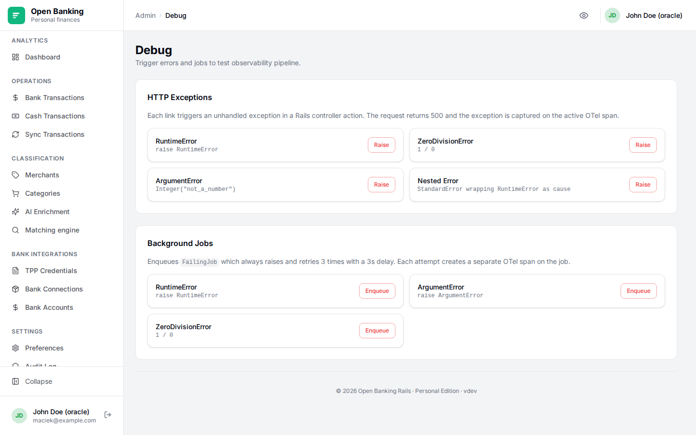 ([html](../oracle/ui/admin_debug.html)); dev exception page 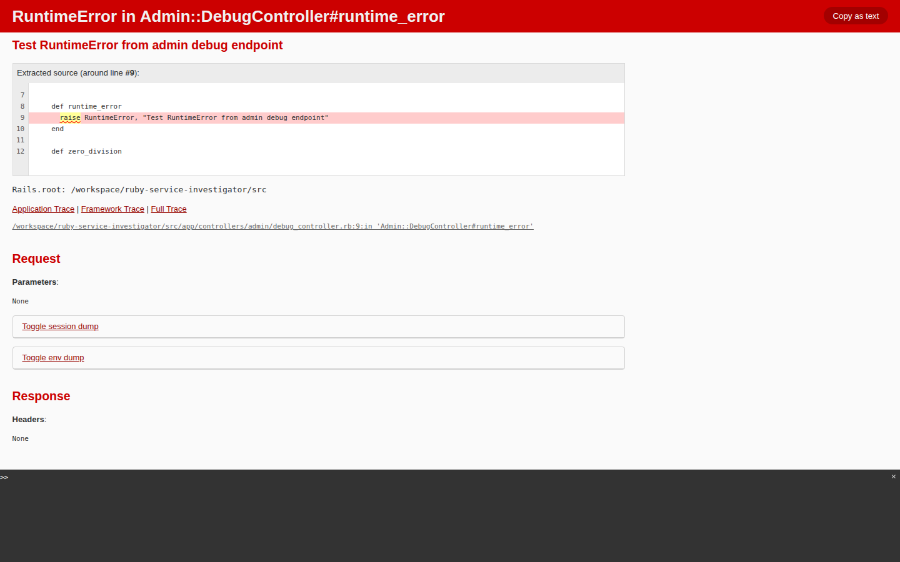. Not part of the product; port only if an equivalent observability test page is wanted.

Other captured non-template screens: Sidekiq Web UI `/sidekiq` (gem-provided, any signed-in user) 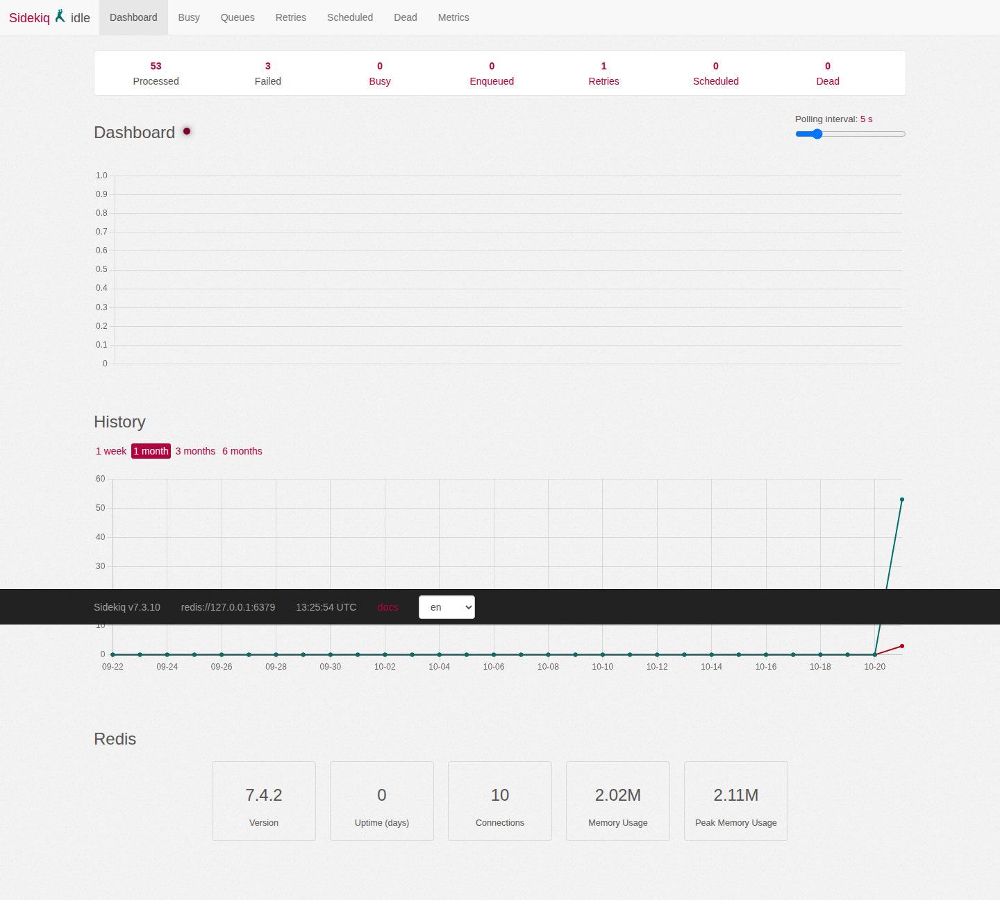; 404 dev page .

## 3. Component library (partials)

Conventions [I] `AGENTS.md` "Admin UI": reusable primitives live in `app/views/admin/shared/components/`, form wrappers in `…/shared/form/`, inline SVG icons in `…/shared/icons/`
(one per file). The first line of each partial declares its strict locals `<%# locals: (...) %>` (Rails strict locals: unknown locals raise). Rules: use an existing component instead of
hand-written markup, use design tokens, wrap sensitive values, extract a component only when the same markup appears 3+ times, and add every component to the styleguide.
Components marked **(styleguide only)** are not used by any real page (U-707).

### 3.1 Shell partials (`admin/shared/`)

#### `admin/shared/_sidebar.html.erb`
Renders `_sidebar_content` twice: a desktop `<aside>` (`hidden lg:flex`, width 256 px, 64 px when `sidebar-collapsed`, 300 ms width transition) and a mobile off-canvas `<aside data-sidebar-target="mobile">` (fixed, z-50, `-translate-x-full` until opened) [I] `app/views/admin/shared/_sidebar.html.erb:1-10`.

#### `admin/shared/_sidebar_content.html.erb` — `locals: (nav_sections:)`
Logo block ("Open Banking" / "Personal finances"); one block per nav section (uppercase title + `_sidebar_item` per item); desktop-only "Collapse" button (`sidebar#toggleCollapse`, icon `panel_left_close` ↔ `panel_left`); user footer: initials avatar (`sensitive-avatar`), display name and e-mail (sensitive) linking to Profile (title "Profile settings"), and a log-out icon button (`button_to DELETE /admin/sign_out`, `title`/`aria-label` "Sign out") [I] `app/views/admin/shared/_sidebar_content.html.erb:1-61`. Initials = first letters of the first two words of the name, upper-cased, "?" when no name [I] `app/models/user.rb:96-100`.

#### `admin/shared/_sidebar_item.html.erb` — `locals: (item:, depth: 0)`
Item hash `{name:, path:, icon:, badge:, children:}`. Leaf → link with icon + label (+ optional pill badge), active styling per `nav_item_active?`; with `children` → a toggle button (`sidebar-item#toggle`) with chevron rotating −90° when closed and a nested list (indent `ml-7`, 13 px). Nested items are supported but no current nav item has children [I] `app/views/admin/shared/_sidebar_item.html.erb:1-37`.

#### `admin/shared/_topbar.html.erb`
Sticky 64 px header: mobile menu button (`sidebar#openMobile`, `aria-label="Open navigation"`), breadcrumb `<nav>`, privacy toggle (eye/eye-off, `aria-pressed`), and on ≥ 640 px avatar + display name link to Profile [V] `../oracle/ui/admin_analytics_dashboard.png`; [I] `app/views/admin/shared/_topbar.html.erb:1-30`.

#### `admin/shared/_breadcrumbs.html.erb` — `locals: (items: [])`
Items `{label:, path:, sensitive:}`; rendering rules in §1.6 [I] `app/views/admin/shared/_breadcrumbs.html.erb:1-26`.

#### `admin/shared/_flash.html.erb`
Dismissible notice/alert/warning boxes for the admin layout (§1.8) [I] `app/views/admin/shared/_flash.html.erb:1-31`.

#### `admin/shared/_auth_flash.html.erb`
Non-dismissible notice/alert/warning boxes for the auth layout (§1.8) [V] `../oracle/ui/admin_sign_in_failed.png`; [I] `app/views/admin/shared/_auth_flash.html.erb:1-19`.

#### `admin/shared/_footer.html.erb`
"© <current year> Open Banking Rails · <edition> Edition · v<version>" centred under the page content [V] footer text in every admin capture; [I] `app/views/admin/shared/_footer.html.erb:1-9`.

#### `admin/shared/_setup_banner.html.erb`
Missing-taxonomy banner described in §1.9 (renders nothing when the user has any active category) [I] `app/views/admin/shared/_setup_banner.html.erb:1-18`.

### 3.2 Components (`admin/shared/components/`)

#### `admin/shared/components/_action_toolbar.html.erb` — `locals: (left: nil, right: nil)`
Two flex-wrapping button groups, left and right aligned; slots are pre-captured HTML. Used on the bank-connection page [I] `app/views/admin/shared/components/_action_toolbar.html.erb:1-9`.

#### `admin/shared/components/_badge.html.erb` — `locals: (label:, variant: :default)`
Rounded pill, `text-xs font-medium` and CSS `capitalize` (so "booked" displays "Booked"). Variants: `default` (primary/10 + primary), `success`, `destructive`, `warning`, `info` (token/10 background + token text), `muted` (muted bg + muted-foreground); unknown → default [V] "Booked" badges in `../oracle/ui/admin_bank_transactions_index.png`; [I] `_badge.html.erb:1-13`.

#### `admin/shared/components/_bank_logo.html.erb` — `locals: (slug:, name: nil, size: :md)`
Square tile `sm` 24 px / `md` 32 px / `lg` 48 px / `xl` 64 px. If `app/assets/images/banks/<slug>.svg` exists (present: `mbank`, `pko_bank_polski`, `revolut`) it shows the image (`alt`/`title` = name); otherwise a bordered muted tile with up to 3 initials of the name (or of the slug with `_`→space), "?" if empty [V] "PB"/"RL"/"C" tiles in `../oracle/ui/admin_analytics_dashboard.png` (showcase slugs do not match the SVG names); [I] `_bank_logo.html.erb:1-22`, `app/helpers/admin/base_helper.rb:100-104`.

#### `admin/shared/components/_breakdown_list.html.erb` — `locals: (rows:, total_cents: nil, max_cents: nil, sensitive_amounts: true, empty_label: "No data", currency: "PLN")`
List of rows responding to `label`, `amount_cents`, optional `count`, `href`, `secondary`, `secondary_tone` (`:success`/`:destructive`). Each row: label (+ "N tx"), amount formatted without cents when whole, share % = round(amount/total×100) when `total_cents > 0`, and a bar whose width = amount / max × 100 % clamped to 2–100 % (max = `max_cents` or the first row, list assumed sorted descending; 0 → 1). Rows with `href` are links. Empty → centred `empty_label` [V] `../oracle/ui/admin_analytics_category.html`; [I] `_breakdown_list.html.erb:1-62`.

#### `admin/shared/components/_bulk_action_bar.html.erb` — `locals: (count:, actions:)` (styleguide only)
Tinted bar "<count> selected" + action buttons/links (`{label:, href:, icon:, variant: :destructive}`); buttons without `href` do nothing. Intended to pair with `bulk_select_controller.js` [I] `_bulk_action_bar.html.erb:1-18`.

#### `admin/shared/components/_button.html.erb` — `locals: (label:, href: nil, variant: :default, size: :default, icon: nil, method: nil, data: {}, type: nil, block: false, name: nil, value: nil)`
Variants `default` (primary), `outline`, `destructive`, `outline_destructive` (also accepts `outline-destructive`), `ghost`; sizes `default` (h-10), `sm` (h-8, text-xs), `lg` (h-11); `block` → full width; optional leading icon. Rendering: `href` + `method` → a one-button `<form>` (`button_to`, with CSRF token and hidden `_method`; `data` goes on the button, e.g. `turbo_confirm`); `href` only → `<a>`; neither → `<button type="button">` (or given `type`, e.g. `submit`) [I] `_button.html.erb:1-36`.

#### `admin/shared/components/_callout.html.erb` — `locals: (variant: :info, title: nil, message: nil)`
Inline message box; variants `info`, `warning`, `destructive`, `success`; renders "<b>title</b> - message-or-block" in a single paragraph [I] `_callout.html.erb:1-19`.

#### `admin/shared/components/_card.html.erb` — `locals: (title: nil, subtitle: nil, padding: true, actions: nil)`
`.admin-section` container; with `padding` and `title` renders an H2 + subtitle + right-aligned `actions`; `padding: false` removes padding (`overflow-hidden`) and callers hand-roll a header [I] `_card.html.erb:1-18`.

#### `admin/shared/components/_category_breadcrumb.html.erb` — `locals: (category:, link: false, separator: " / ", muted_ancestors: true)`
Full path label "Ancestor / … / Leaf" (ancestors muted); hidden category → "•••"; `link: true` (and not hidden) links to the analytics category page. Ancestor lookup is currently not tenant-scoped, producing duplicated segments (U-700) [V] `../oracle/ui/admin_bank_transactions_index.png`; [I] `_category_breadcrumb.html.erb:1-20`.

#### `admin/shared/components/_category_picker.html.erb` — `locals: (form:, field: :category_id, label: "Category", user:, selected: nil, allow_blank: true, blank_label: "-")` (styleguide only)
Native `<select>` of the user's active categories in ltree order, labels "<dashes per depth> A / B / C", hidden categories omitted. Its description claims use by the cash form and classify modal, but both build their own selects [I] `_category_picker.html.erb:1-16`.

#### `admin/shared/components/_command_palette.html.erb` — `locals: ()`
Hidden full-screen overlay (`id="command-palette"`, `data-controller="command-palette"`): dark backdrop (click closes), card with search input (placeholder "Type a command or search...") and one group per sidebar section listing its items as links with icons. Behaviour in §4 [I] `_command_palette.html.erb:1-33`. Not captured (U-706).

#### `admin/shared/components/_confirm_dialog.html.erb` — `locals: (id:, title:, message:, confirm_label: "Confirm", variant: :destructive)` (styleguide only)
Modal-controller dialog with title, message, "Cancel" (closes) and a confirm button that has **no action wired**. Pages use native `data-turbo-confirm` instead [I] `_confirm_dialog.html.erb:1-21`.

#### `admin/shared/components/_critical_banner.html.erb` — `locals: (title:, description:, action_label: nil, action_path: nil, action_method: :get, variant: :destructive, icon: "shopping_cart")`
Prominent 2 px-bordered banner (variants destructive/warning/info) with icon, bold title, description and an optional CTA (`button_to` for `:post`, link otherwise; full width on phones). Used by the setup banner and the dashboard's unmatched-transactions banner [I] `_critical_banner.html.erb:1-32`.

#### `admin/shared/components/_data_table.html.erb` — `locals: (columns:, rows: nil)`
`<table>` with min width 640 px in a horizontal scroller; header cells from `columns` (`label:`, `sortable:` String/Symbol → `sort_link` toggling `q[s]` between `<col> asc` and `<col> desc` (first click asc; active column shows ↑/↓, others a faded ↕), `sortable: true` → decorative arrow only, `align: :right`, `width:`); body = the caller's block. `rows:` is unused [I] `_data_table.html.erb:1-29`, `app/helpers/admin/base_helper.rb:84-97`.

#### `admin/shared/components/_definition_list.html.erb` — `locals: (pairs:)`
`<dl>` of `{label:, value:, mono:, wrap:, hint:, sensitive:}`; blank value → muted "-"; `sensitive` wraps the value; `hint` in small muted text after the value; label/value side-by-side ≥ 640 px, stacked below [I] `_definition_list.html.erb:1-25`.

#### `admin/shared/components/_dropdown_menu.html.erb` — `locals: (items:, trigger_label: nil)`
"⋯" (or custom label) trigger with a 144 px menu (`dropdown` controller). Items: `{divider: true}`, `{label:, href:, method:, data:, icon:, variant: :destructive}` → `button_to` form when `method` given (data on the form), link when only `href`, inert button otherwise [I] `_dropdown_menu.html.erb:1-45`.

#### `admin/shared/components/_empty_state.html.erb` — `locals: (title:, description:, action_label: nil, action_path: nil, action_method: :get, icon: "users")`
Centred icon, title, description and optional "+"-prefixed primary CTA (POST via `button_to` when `action_method: :post`) [I] `_empty_state.html.erb:1-21`.

#### `admin/shared/components/_filter_chip.html.erb` — `locals: (label: nil, remove_path: nil)`
Primary-tinted pill showing `label` (or the block content) with an optional "x" link to `remove_path` [I] `_filter_chip.html.erb:1-14`.

#### `admin/shared/components/_filter_panel.html.erb` — `locals: (clear_url:, active_count: 0)`
Must be inside the filter `<form>` and inside an element with `data-controller="filter-panel"`. Renders a backdrop and a right-side drawer (max 384 px, slides in) with header "Filters" + count badge + close "x", the block's fields, and a footer "Clear all" (link to `clear_url`, dimmed and non-clickable when count = 0) + "Apply" (submit) [I] `_filter_panel.html.erb:1-39`.

#### `admin/shared/components/_filter_trigger.html.erb` — `locals: (active_count: 0)`
Button "Filters" with sliders icon and a count badge; highlighted border when count > 0; opens the panel (`filter-panel#open`) [I] `_filter_trigger.html.erb:1-12`.

#### `admin/shared/components/_json_viewer.html.erb` — locals `json`, optional `sensitive` (default `true` → `:strong`)
`<pre>` with `JSON.pretty_generate(json)` ("null" when blank), monospace 12 px, resizable vertically, 96 px – 512 px tall. `sensitive: false` disables masking [I] `_json_viewer.html.erb:1-6`.

#### `admin/shared/components/_modal.html.erb` — `locals: (id:, title:, size: :default)`
Hidden overlay (`data-controller="modal"`) with backdrop (click closes), header (title + "x" `aria-label="Close"`) and scrollable body; widths `sm` 384 / `default` 512 / `lg` 672 / `xl` 896 px; bottom sheet on phones; Escape closes [I] `_modal.html.erb:1-29`.

#### `admin/shared/components/_page_header.html.erb` — `locals: (title:, subtitle: nil, actions: nil, browser_title: nil, back_path: nil, media: nil)`
Sets `content_for :title` to "<browser_title || title> · Open Banking" (appends — multiple headers concatenate, U-708); optional back arrow link, media slot (e.g. bank logo), H1 (`text-xl`/`sm:text-2xl`), subtitle, right-aligned wrapping actions [I] `_page_header.html.erb:1-27`.

#### `admin/shared/components/_pagination.html.erb` — `locals: (pagy:)`
Only when more than one page: "Showing <from>–<to> of <count> results" + Pagy series nav (`‹ 1 2 … ›`, links carry `page` and `limit`) [V] `../oracle/ui/admin_versions_index.html`; [I] `_pagination.html.erb:1-11`.

#### `admin/shared/components/_skeleton.html.erb` — `locals: (type: :table)` (styleguide only)
Pulsing placeholders: `:table` (header + 5 rows), `:card`, `:form` (4 fields) [I] `_skeleton.html.erb:1-33`.

#### `admin/shared/components/_stat_card.html.erb` — `locals: (label:, value:, icon:, change: nil, trend: nil, value_class: nil, tone: :primary, hint: nil)`
KPI tile: tinted icon (tones primary/success/destructive/warning/info/muted), optional change pill ("|change|%", green with trending-up icon for `trend: :up`, red with trending-down for anything else), big value (truncated, tabular), label, hint. `value_class` is used to pass `sensitive` classes [V] `../oracle/ui/admin_analytics_dashboard.png`; [I] `_stat_card.html.erb:1-37`.

#### `admin/shared/components/_tabs.html.erb` — `locals: (tabs:, current:)` (styleguide only)
Client-side tabs (`tabs` controller): buttons with `data-tab-id`, panels with `data-panel-id`; content from `tab[:content]` [I] `_tabs.html.erb:1-22`.

#### `admin/shared/components/_toast.html.erb` — `locals: (message:, type: :default)` (styleguide only)
Slide-in toast (types default/success/error/warning) that auto-dismisses after 4000 ms (`dismissible` timeout) or on "x" [I] `_toast.html.erb:1-19`.

### 3.3 Form wrappers (`admin/shared/form/`)

All wrappers bind to a Rails form builder (`form:`) and read the first error of `field` from `form.object.errors`; the field then gets a destructive border and the error text replaces the hint
(`_form_group`). A `required: true` local only draws a red "*" — it does **not** add the HTML `required` attribute. `html:` passes extra attributes (`class` is appended) [I] `app/views/admin/shared/form/_form_group.html.erb:1-16`.

#### `admin/shared/form/_form_group.html.erb` — `locals: (label:, hint: nil, error: nil, required: false)`
Label (+ "*"), the block, then hint (only when no error) or the error in red [I] `_form_group.html.erb:1-16`.

#### `admin/shared/form/_text_field.html.erb` — `locals: (form:, field:, label:, placeholder: nil, hint: nil, required: false, html: {})`
`<input type="text" class="form-input">` in a form group [I] `_text_field.html.erb:1-9`.

#### `admin/shared/form/_email_field.html.erb` — `locals: (form:, field:, label:, placeholder: nil, hint: nil, required: false, html: {})`
`<input type="email">` with an "@" adornment; default placeholder "user@example.com" (browser-native e-mail validation applies) [V] `../oracle/ui/setup_first_run_invalid.png`; [I] `_email_field.html.erb:1-12`.

#### `admin/shared/form/_password_field.html.erb` — `locals: (form:, field:, label: "Password", hint: nil, required: false, html: {})`
Password input (placeholder "••••••••") with an eye button toggling `type` password↔text (`toggle` controller, icons eye/eye_off). Rails never re-fills password values [I] `_password_field.html.erb:1-23`.

#### `admin/shared/form/_number_field.html.erb` — `locals: (form:, field:, label:, placeholder: nil, min: nil, max: nil, step: nil, hint: nil, required: false, html: {})`
`<input type="number">` [I] `_number_field.html.erb:1-9`.

#### `admin/shared/form/_textarea.html.erb` — `locals: (form:, field:, label:, placeholder: nil, rows: 4, hint: nil, required: false, value: nil, html: {})`
Vertically resizable textarea; renders the object's current value unless `value:` is given [I] `_textarea.html.erb:1-9`.

#### `admin/shared/form/_select.html.erb` — `locals: (form:, field:, label:, options:, include_blank: nil, hint: nil, required: false, html: {})`
Native `<select>` from `[[label, value], …]`, selected = current object value; `include_blank` text as first empty option [I] `_select.html.erb:1-10`.

#### `admin/shared/form/_checkbox.html.erb` — `locals: (form:, field:, label:, hint: nil, html: {})`
Rails checkbox (hidden "0" + checkbox "1") with inline label, error or hint below [I] `_checkbox.html.erb:1-14`.

#### `admin/shared/form/_toggle.html.erb` — `locals: (form:, field:, label:, on_label: "Enabled", off_label: "Disabled", hint: nil)`
Visually a switch (44×24 px) backed by an `sr-only` Rails checkbox; the text next to it is set by the `toggle` controller to `on_label`/`off_label` on connect and on change [I] `_toggle.html.erb:1-14`.

#### `admin/shared/form/_radio_group.html.erb` — `locals: (form:, field:, label:, options:, hint: nil)`
Vertical radio list from `[{value:, label:}]`, checked = object value [I] `_radio_group.html.erb:1-15`.

#### `admin/shared/form/_date_picker.html.erb` — `locals: (form:, field:, label:, hint: nil, required: false, html: {})`
Native `<input type="date">` (value ISO `YYYY-MM-DD`) [I] `_date_picker.html.erb:1-9`.

#### `admin/shared/form/_multi_select.html.erb` — `locals: (form:, field:, label:, options:, placeholder: "Select options...", hint: nil, cloak_selected: false, searchable: false)`
Custom multi-select (`multi-select` controller): trigger box with chips, dropdown list with ✓ marks, optional search box, hidden inputs `<object>[<field>][]` generated per selected value; initial selection = the object's current array. `cloak_selected` shows chip labels as bullets (max 24) [I] `_multi_select.html.erb:1-29`.

#### `admin/shared/form/_searchable_select.html.erb` — `locals: (form:, field:, label:, options:, placeholder: "Search...", hint: nil, required: false)`
Single-choice combobox over a client-side option list `[{value:, label:}]` with a hidden field holding the id (`searchable-select` controller). Used for the merchant's default category [I] `_searchable_select.html.erb:1-16`.

#### `admin/shared/form/_error_summary.html.erb` — `locals: (object:)`
When the object has errors: red box "Please fix the following errors:" + bullet list of full messages [I] `_error_summary.html.erb:1-13`.

#### `admin/shared/form/_ajax_select.html.erb` — `locals: (form:, field:, label:, search_url:, selected_label: nil, hint: nil, required: false, min_chars: 1, sort_by: nil, mock_options: nil)` (styleguide only)
Remote-search combobox (`ajax-select` controller): text input + clear button + dropdown + hidden id field. With `mock_options` it filters locally; otherwise it fetches `GET <search_url>?q=<text>` expecting `[{id:, label:}]`. No such search endpoint exists in the app; the classify modal inlines the same markup with mock options. This wrapper wires only `input->search` (no keyboard navigation) [I] `_ajax_select.html.erb:1-29`.

#### `admin/shared/form/_checkbox_group.html.erb` — `locals: (label:, options:, hint: nil)` (styleguide only)
Plain checkboxes from `[{name:, value:, label:, checked:}]` (not bound to a form builder) [I] `_checkbox_group.html.erb:1-17`.

#### `admin/shared/form/_color_picker.html.erb` — `locals: (form:, field:, label:, hint: nil, required: false, html: {})` (styleguide only)
Native `<input type="color">` plus an empty `data-color-value` span (never filled — no controller) [I] `_color_picker.html.erb:1-18`.

#### `admin/shared/form/_date_range_picker.html.erb` — `locals: (form:, from_field:, to_field:, label:, hint: nil)` (styleguide only)
Two date inputs "From" "to" "To" with per-field errors [I] `_date_range_picker.html.erb:1-22`.

#### `admin/shared/form/_file_upload.html.erb` — `locals: (form:, field:, label:, hint: nil, accept: nil)` (styleguide only)
Dashed drop zone "Click to upload or drag and drop" with hidden file input and file-name line (`file-upload` controller). Data exchange uses a plain file input instead [I] `_file_upload.html.erb:1-18`.

#### `admin/shared/form/_tags_input.html.erb` — `locals: (form:, field:, label:, placeholder: "Add a tag and press Enter", hint: nil)` (styleguide only)
Text input + "+" button; tags rendered as removable chips; stored comma-joined in a hidden field (`tags-input` controller) [I] `_tags_input.html.erb:1-24`.

#### `admin/shared/form/_time_picker.html.erb` — `locals: (form:, field:, label:, hint: nil, required: false, html: {})` (styleguide only)
Native `<input type="time">` [I] `_time_picker.html.erb:1-9`.

### 3.4 Icons (`admin/shared/icons/`)

Every icon partial is an inline 24×24 Lucide-style SVG (`fill="none" stroke="currentColor" stroke-width="2"`, round caps/joins) with the single strict local `classes:` (default `"h-4 w-4"`, `menu` defaults to `"h-5 w-5"`) applied to the `<svg>` [I] e.g. `app/views/admin/shared/icons/_x.html.erb:1-5`. Icons are referenced by file name (e.g. `icon: "refresh_cw"` → `_refresh_cw.html.erb`); an unknown name raises a missing-template error. In Kotlin these can be ported 1:1 as SVG fragments.

- `admin/shared/icons/_arrow_down.html.erb` (`arrow_down`) — used for: active descending sort indicator (`sort_link`).

- `admin/shared/icons/_arrow_left.html.erb` (`arrow_left`) — used for: back arrow in `_page_header`; "All runs" button on the AI run page.

- `admin/shared/icons/_arrow_up.html.erb` (`arrow_up`) — used for: active ascending sort indicator (`sort_link`).

- `admin/shared/icons/_arrow_up_down.html.erb` (`arrow_up_down`) — used for: inactive sortable column indicator (`sort_link`, `_data_table`).

- `admin/shared/icons/_banknote.html.erb` (`banknote`) — used for: sidebar "Cash Transactions"; cash wallet cards; dashboard Income card.

- `admin/shared/icons/_bar_chart_3.html.erb` (`bar_chart_3`) — used for: dashboard "Spend change" card and cash-flow empty state; merchant analytics trend empty state.

- `admin/shared/icons/_bell.html.erb` (`bell`) — used for: styleguide only.

- `admin/shared/icons/_chevron_down.html.erb` (`chevron_down`) — used for: sidebar group toggle; multi-select trigger.

- `admin/shared/icons/_chevron_right.html.erb` (`chevron_right`) — used for: breadcrumb separator; row links (merchant page, merchant analytics).

- `admin/shared/icons/_clock.html.erb` (`clock`) — used for: styleguide only.

- `admin/shared/icons/_columns_3.html.erb` (`columns_3`) — used for: styleguide only.

- `admin/shared/icons/_dollar_sign.html.erb` (`dollar_sign`) — used for: sidebar "Bank Transactions" and "Bank Accounts"; transaction empty states.

- `admin/shared/icons/_download.html.erb` (`download`) — used for: "Download bundle" button.

- `admin/shared/icons/_eye.html.erb` (`eye`) — used for: privacy toggle (off state); password reveal; "View" menu items.

- `admin/shared/icons/_eye_off.html.erb` (`eye_off`) — used for: privacy toggle (on state); password hide; "Archive" menu items.

- `admin/shared/icons/_file_text.html.erb` (`file_text`) — used for: sidebar "TPP Credentials"; "API docs" link; credentials empty state.

- `admin/shared/icons/_gauge.html.erb` (`gauge`) — used for: dashboard "Run-rate" card.

- `admin/shared/icons/_layout_dashboard.html.erb` (`layout_dashboard`) — used for: sidebar "Dashboard".

- `admin/shared/icons/_log_out.html.erb` (`log_out`) — used for: sidebar sign-out button.

- `admin/shared/icons/_logo_mark.html.erb` (`logo_mark`) — used for: brand mark (filled bars) in sidebar and auth layout; the only icon with `fill="currentColor"`.

- `admin/shared/icons/_mail.html.erb` (`mail`) — used for: styleguide only.

- `admin/shared/icons/_map.html.erb` (`map`) — used for: styleguide only.

- `admin/shared/icons/_menu.html.erb` (`menu`) — used for: top-bar hamburger (default classes `h-5 w-5`).

- `admin/shared/icons/_more_horizontal.html.erb` (`more_horizontal`) — used for: `_dropdown_menu` trigger.

- `admin/shared/icons/_package.html.erb` (`package`) — used for: sidebar "Bank Connections"; Data exchange nav; empty states.

- `admin/shared/icons/_panel_left.html.erb` (`panel_left`) — used for: "Collapse" button when collapsed.

- `admin/shared/icons/_panel_left_close.html.erb` (`panel_left_close`) — used for: "Collapse" button when expanded.

- `admin/shared/icons/_pencil.html.erb` (`pencil`) — used for: "Edit" actions.

- `admin/shared/icons/_piggy_bank.html.erb` (`piggy_bank`) — used for: dashboard "Savings rate" card.

- `admin/shared/icons/_plus.html.erb` (`plus`) — used for: "New …"/"Add …" buttons, empty-state CTAs, tags input.

- `admin/shared/icons/_refresh_cw.html.erb` (`refresh_cw`) — used for: sidebar "Sync Transactions"; "Generate proposals", "Test connection", "Restore" menu item.

- `admin/shared/icons/_search.html.erb` (`search`) — used for: sidebar "Matching engine"; search inputs; command palette.

- `admin/shared/icons/_settings.html.erb` (`settings`) — used for: sidebar "Preferences" and "Styleguide".

- `admin/shared/icons/_shield.html.erb` (`shield`) — used for: sidebar "Audit Log"; API tokens box/empty state; sync empty states.

- `admin/shared/icons/_shopping_cart.html.erb` (`shopping_cart`) — used for: sidebar "Categories"; Spend cards; taxonomy banners (default icon of `_critical_banner`).

- `admin/shared/icons/_sliders_horizontal.html.erb` (`sliders_horizontal`) — used for: filter trigger/panel; sidebar "Debug"; App preferences nav.

- `admin/shared/icons/_sparkles.html.erb` (`sparkles`) — used for: sidebar "AI Enrichment"; LLM preferences nav.

- `admin/shared/icons/_tag.html.erb` (`tag`) — used for: sidebar "Merchants"; merchant/category stat cards and empty states.

- `admin/shared/icons/_trash_2.html.erb` (`trash_2`) — used for: "Delete"/"Revoke" buttons.

- `admin/shared/icons/_trending_down.html.erb` (`trending_down`) — used for: stat-card negative change pill; "Avg daily spend" card.

- `admin/shared/icons/_trending_up.html.erb` (`trending_up`) — used for: stat-card positive change pill.

- `admin/shared/icons/_upload.html.erb` (`upload`) — used for: "Import bundle" button; file-upload drop zone.

- `admin/shared/icons/_users.html.erb` (`users`) — used for: default `_empty_state` icon; Profile preferences nav.

- `admin/shared/icons/_x.html.erb` (`x`) — used for: close buttons (flash, modal, filter panel), chip removal, rule delete, ajax-select clear.

### 3.5 Page-specific partials

#### `admin/settings/preferences/_layout.html.erb` — `locals: (current:)`
Wrapper used with `render layout:` by all five preference pages: centred max-width 896 px, page header "Preferences" / "Personal settings, app behavior, and integrations.", left nav (sticky on ≥ 1024 px, horizontal scroll row on smaller screens) built from `preferences_sections` — Profile (`users`, "Display name, password."), App (`sliders_horizontal`, "Cash tracking, hidden categories."), LLM (`sparkles`, "AI provider, API key, connection test."), Data exchange (`package`, "Export and import bundles between instances."), API tokens (`shield`, "Personal access tokens for the JSON API and MCP server."); the `desc` texts are not rendered. Active section highlighted `bg-primary/10 text-primary`. Content goes in a nested `<main>` (second `<main>` in the document, a11y note §5) [V] `../oracle/ui/admin_settings_profile.png`; [I] `app/views/admin/settings/preferences/_layout.html.erb:1-26`, `app/helpers/admin/base_helper.rb:13-31`.

#### `admin/bank_transactions/_classify_modal.html.erb` — `locals: (transaction:, merchant_options:)`
Modal `id="classify-modal"` "Edit classification" (size lg), opened by the "Edit" button on the transaction page (inline `onclick` removing `hidden`), closed by backdrop, "x", Escape or "Cancel" [I] `app/views/admin/bank_transactions/_classify_modal.html.erb:1-135`.
Form `PATCH /admin/bank_transactions/:id/enrichment`:

| Field | Name | Behaviour |
|---|---|---|
| Merchant | `enrichment[merchant_id]` (hidden) | `ajax-select` combobox over a **client-side** list of the user's active merchants, label "<name> (<default category name>)" or "•••" for hidden ones, sorted case-insensitively; `min-chars 0` so focusing shows all; ArrowUp/Down/Enter/Escape navigation; "x" clears; prefilled with the current enrichment merchant. Note "Missing merchant? Add new" (opens `/admin/merchants/new` in a new tab) |
| Category (override) | `enrichment[category_id]` (hidden) | same combobox over active categories (full breadcrumb label, "•••" if hidden), placeholder "Use merchant's default, or search..."; prefilled with the enrichment category or the merchant default |
| Apply to | `enrichment[mode]` radio | `only_this` (default) "This transaction only — Override on this one transaction. Marked manual - won't be overwritten by future rules."; `all_for_merchant` "All transactions for this merchant — Updates the merchant's default category. Applies retroactively and going forward."; `create_rule` "Create a new rule for this pattern — A user-source rule will match every existing and future transaction matching this pattern." |
| Rule fields (visible only for `create_rule`, `propagation` controller) | `enrichment[rule_field]` (select of MerchantRule fields, default `title`), `enrichment[rule_kind]` (contains/regex/exact/prefix/iban, default `contains`), `enrichment[rule_pattern]` (text, prefilled with the upper-cased trimmed title) | |

Buttons "Cancel" (`modal#close`) and "Apply" (submit). Server messages listed on the page section. The server ignores a merchant/category id that is not the user's (treated as none) [V] `spec/requests/categorization_spec.rb:432-449`.

#### `admin/llm_enrichments/_run_progress.html.erb` — `locals: (run:, **)`
Root element id `progress_operation_run_<id>` (Turbo Stream target). Status badge; while running a pulsing dot + "Batch <n> done…"; when terminal "Finished in <s>s". Cards: **Summary** (Status, Trigger, Group limit, Total groups, Auto-applied, Pending review, Skipped, Started at, Finished at, Duration "Ns"), **Error** (if any, red pre-wrap), **Batches (n)** ("Each batch is a single OpenAI call with up to 15 groups.") table #, Groups, Status (succeeded green else red), Auto, Pending, Skipped, Errors (`
` "N error(s)" listing "<title>: <error truncated to 120 chars>" or "-"), plus an expandable row "Show LLM I/O (batch n)" with "Sent (input)" / "LLM response" JSON viewers (not masked). Empty: "Run is queued - waiting for the worker to pick it up." or "Processing hasn't started yet." [V] `spec/system/llm_enrichment_spec.rb:43-46,84-87`; [I] `app/views/admin/llm_enrichments/_run_progress.html.erb:1-114`.

#### `admin/transaction_syncs/_run_progress.html.erb` — `locals: (run:, **)`
Root id `progress_operation_run_<id>`. Badges status + trigger; running → "Running - <n> account(s) processed"; terminal → "Finished in <s>s". Cards **Run details** (Kind, Status, Trigger, Subject "<type> - <label>" (sensitive), Triggered by (sensitive), Created/Started/Finished at, Duration), **Parameters** (each run param humanized, monospace; or "No parameters."), **Error** (strong blur), **Per-account breakdown** table Bank, Account (IBAN or "uid <id>", sensitive), Range "<from> → <to>" (+ amber "(truncated)"), Status (succeeded green else red; failed rows show the error), Inserted, Updated, Skipped, Pages; empty "Run is queued - waiting for the worker to pick it up." / "No accounts processed yet." The `**` absorbs the extra `operation_run` local injected by Turbo broadcasts [V] `spec/system/manual_sync_flow_spec.rb:71-112`; [I] `app/views/admin/transaction_syncs/_run_progress.html.erb:1-100`.

#### `admin/transaction_syncs/_auto_sync_panel.html.erb` — `locals: (schedule_rows:)`
Card "Auto-sync schedules" ("Per-connection cadence (daily / every 2 days / weekly). Dispatcher checks every minute and fires at the preferred hour. Missed runs aren't replayed - the next slot pulls everything since the last success."). Row per active connection: logo, bank name, line "<Cadence> · HH:00 · resumes <paused_until short>" (paused) or "· next <next_run_at short>", or "Auto-sync off"; badge Paused (warning) / On (success) / Off (muted); button "Edit" (schedule persisted) or "Set up". Empty: "No authorized connections" — "Add one in Settings → Bank connections to enable auto-sync." (the copy points at an old navigation location; connections live under Bank Integrations) [V] `../oracle/ui/admin_transaction_syncs_index.html`; [I] `app/views/admin/transaction_syncs/_auto_sync_panel.html.erb:1-63`.

#### `admin/analytics/shared/_filter_strip.html.erb` — `locals: (filter:, user_accounts:, wrap_controller: true, with_trigger: true)`
Analytics filter UI (GET form to the current path, Turbo off) [V] `../oracle/ui/admin_analytics_dashboard.png`; [I] `app/views/admin/analytics/shared/_filter_strip.html.erb:1-238`:
- **Months** chips: "This month" (1st of month → today), "Last month", "Last 3M", "Last 6M", "Last 12M" (each ends at the end of the previous month); active when the period matches exactly. Right side: "<d Mon> → <d Mon yyyy>" and (if `with_trigger`) the Filters button.
- **Days** chips: Today, 3d, 7d, 14d, 30d, 60d, 90d, 180d, 365d = window of N days ending today; active when no month chip is active and the period length equals N.
- Period chip links drop `bucket` (so the automatic granularity re-applies) and keep currency/accounts/`under_path`.
- **Granularity** chips Day / Week / Month (`bucket=`), with "auto" hint when not explicit.
- **Currency** chips (only when the user has > 1 currency).
- **Accounts** chips (all owned bank accounts + cash wallets): logo, "<bank or 'Cash'/'Account'> · <first 4 IBAN chars> ••••" or "· <currency>", "· <sync age>" (minutes "Nm" < 1 h, hours "Nh" < 24 h, else days "Nd", "never"). Active chips tinted; clicking toggles that account: from the default (all) state it removes the account; when the resulting set equals all owned accounts the params are dropped, when empty `accounts=none` is used, otherwise `account_ids[]=…`. "Reset" link when narrowed or none.
- **Filter panel**: account checkboxes `account_ids[]`, From `from`, To `to` (date inputs); "Clear all" drops account params; "Apply" submits (empty inputs disabled by the controller).

#### `admin/cash_transactions/_form.html.erb` — `locals: ()` (reads `@cash_transaction`, `@category_options`, `@merchant_options`, `@currency_options`)
Form scope `cash_transaction`, POST (new) or PATCH (edit) [I] `app/views/admin/cash_transactions/_form.html.erb:1-145`:

| Section | Field | Name | Input / options | Default / rules |
|---|---|---|---|---|
| Entry type | Type | `cash_transaction[direction]` | radio "Expense (cash leaves your wallet)" `debit` / "Income (cash enters your wallet)" `credit`; hint "Use Income for refunds from a friend, gifts, found cash." | `?direction` or debit |
| Amount and date | Amount `*` | `cash_transaction[amount]` | text, `inputmode=decimal`, placeholder "0.00", monospace, sensitive wrapper; shows existing value as `%.2f` of cents/100 | comma accepted as decimal separator; blank/unparsable → "Amount cents can't be blank"; must be > 0 |
| | Currency `*` | `cash_transaction[currency]` | select of "PLN" + currencies of the user's wallets and bank accounts (upper-cased, unique, sorted); **locked on edit** (disabled text + hidden field; update ignores currency) | oldest wallet currency or PLN |
| | Date `*` | `cash_transaction[booking_date]` | date input | today (UTC); unparsable → today |
| Classification | Category | `cash_transaction[category_id]` | select, blank "-", active categories ordered by `position, name` with depth dashes and breadcrumb labels; hint "Without a category the entry lands in Uncategorized." | current enrichment category |
| | Merchant / counterparty | `cash_transaction[merchant_id]` | select, blank "-", up to 500 active merchants by name; hint "Optional. Helps later analysis and rule learning." | |
| Details (optional) | Short description | `cash_transaction[title]` | text, placeholder "e.g. Coffee after the gym" | |
| | Place / person | `cash_transaction[counterparty_name]` | text, placeholder "e.g. Costa Coffee, Marek" | |
| | Note | `cash_transaction[note]` | textarea 3 rows, placeholder "Private note - only visible to you." | |
| (hidden) | | `cash_transaction[payment_method]` | | `cash` |

Footer: on edit "Delete" (DELETE, confirm "Delete this transaction?") on the left; "Cancel" → index and submit "Save transaction" (new) / "Save changes" (edit). The Delete `button_to` renders a `<form>` nested inside this form (U-703). `transaction_date` is permitted but has no field.

#### `admin/categories/_form.html.erb` — `locals: (category:)`
Scope `category`; POST `/admin/categories` or PATCH `/admin/categories/:id` [I] `app/views/admin/categories/_form.html.erb:1-68`:

| Field | Name | Input | Notes |
|---|---|---|---|
| Name `*` | `category[name]` | text, placeholder "e.g. Restaurants" | presence |
| Slug | `category[slug]` | text, placeholder "lifestyle_shopping_electronics", hint "Stable identifier; auto-generated from the path. Don't change it once rules or exports rely on it." | format `[a-z0-9_-]+`, message "Slug must be lowercase letters, digits, underscores, dashes"; unique per user [V] `spec/system/settings_change_spec.rb:99-110`; `app/models/category.rb:53-54` |
| Parent path | `category[parent_path]` | select, blank "- top-level (new root) -", options = active visible categories except the category itself and its descendants, label "<dashes> A / B", value = ltree path; preselected `?parent_path` or the current parent; hint "Empty = new top-level domain. Otherwise the new category becomes a child of the selected path." | |
| Kind | `category[kind]` | select Expense/Income/Transfer/Savings/Ignored; hint "expense counts toward spending. transfer / ignored are excluded from analytics totals." | inclusion |
| Essential (need) | `category[essential]` | checkbox; hint "Counts toward the essentials KPI. Defaults to off - flip on for needs (rent, utilities, groceries, transit)." | |
| Color (token) | `category[color]` | text, placeholder "emerald, blue, rose..." | free text |
| Icon (file name from shared/icons/) | `category[icon]` | text, placeholder "shopping-cart" | free text, not rendered anywhere in the admin UI |
| Position | `category[position]` | number; hint "Lower = higher on the list within its level." | |

Buttons "Cancel" → list, "Create category" / "Save changes".

#### `admin/merchants/_form.html.erb` — `locals: (merchant:)`
Scope `merchant`; hidden `return_to` when present [I] `app/views/admin/merchants/_form.html.erb:1-52`:

| Field | Name | Input |
|---|---|---|
| Name `*` | `merchant[name]` | text, placeholder "Biedronka" |
| Slug (edit only) | `merchant[slug]` | read-only text, hint "URL identifier - generated automatically, don't change." |
| Default category | `merchant[default_category_id]` | `_searchable_select` over active categories (label "A / B / C"), placeholder "Type to search categories…" |
| Kind | `merchant[kind]` | select "-", Company, Person, Charity, Government, Platform, Other |
| Logo URL | `merchant[logo_url]` | text, placeholder "https://..." |
| Notes | `merchant[notes]` | textarea 3 rows |

Buttons "Cancel" (→ `return_to`, merchant page or list) and "Create merchant" / "Save changes".

#### `admin/sync_schedules/_form.html.erb` — `locals: (connection:, schedule:)`
PATCH `/admin/bank_connections/:id/sync_schedule`, scope `sync_schedule`: error summary; section "Schedule": checkbox "Enable auto-sync for this connection" `sync_schedule[enabled]` (hint "Off by default. Turning on starts the schedule from the next slot."), select **Cadence** `*` `sync_schedule[cadence]` (Daily `daily`, Every 2 days `every_2_days`, Weekly `weekly`; hint "Daily fires once a day, every 2 days every 48h, weekly every 7 days - all anchored to the hour below."), select **Preferred hour** `*` `sync_schedule[preferred_hour]` ("00:00" … "23:00" → 0…23; hint "Local time. Actual fire time is offset by up to ~5 minutes (jitter) to spread load on the bank API." — note the server has no time zone configured, see §1.2); buttons "Cancel" → syncs index, "Save settings" [I] `app/views/admin/sync_schedules/_form.html.erb:1-38`.

#### `admin/sync_schedules/_range_preview.html.erb` — `locals: (connection:)`
Read-only "What each scheduled run pulls": "Auto-sync is incremental: it pulls everything since the last successful sync, plus a 7-day safety overlap (catches late-bookings the bank back-dated)." Per current account of the connection: IBAN/uid (sensitive); if never synced → badge "First sync" + "No prior sync recorded." and range today − bank horizon days → today; else "Last synced <short>." and range (last sync − 7 days) → today; "~N days" [I] `app/views/admin/sync_schedules/_range_preview.html.erb:1-55`; overlap `app/services/enable_banking/operations/sync_account_transactions.rb:16`. Empty "No active accounts on this connection.".

#### `admin/tpp_credentials/_form.html.erb` — locals `form_url` (implicit)
Scope `tpp_credential` [I] `app/views/admin/tpp_credentials/_form.html.erb:1-68`:

| Section | Field | Name | Input / notes |
|---|---|---|---|
| Identity | Label `*` | `tpp_credential[name]` | text, placeholder "e.g. Primary Enable Banking app", hint "Human-readable name used in lists and UI." |
| | Provider `*` | `tpp_credential[provider]` | select "Enable banking" `enable_banking` (only option) |
| | Environment | `tpp_credential[environment]` | select "-", PRODUCTION, SANDBOX |
| | Redirect URL `*` | `tpp_credential[redirect_url]` | text, placeholder "https://yourapp.com/oauth/enable_banking/callback", hint "Must match the redirect URL registered in the provider's Control Panel." |
| Secrets ("Sensitive values - encrypted at rest. Never logged or shown after save.") | Application ID (kid) `*` | `tpp_credential[application_id]` | text (blur), placeholder UUID, hint "UUID from the provider's Control Panel after uploading your public certificate." |
| | Private key (PEM) `*` | `tpp_credential[private_key_pem]` | textarea 10 rows, monospace (strong blur), hint "RSA key used to sign JWTs. Must be 2048+ bits." (U-711) |
| | Public certificate (PEM) | `tpp_credential[public_cert_pem]` | textarea 8 rows, hint "Optional. If pasted, the app shows certificate metadata (subject, expiry) without an API call." |

Buttons "Cancel" (→ show or list) and "Create credential" / "Save changes". Validation: presence of name, provider, application id, private key and redirect URL; provider/status/environment inclusion ("Environment is not included in the list") [V] `../oracle/http/PUT_admin_tpp_credentials__id.json` `invalid_environment → 422`; `app/models/tpp_credential.rb:37-52`.

## 4. Stimulus controllers (`app/javascript/controllers/`)

All controllers are registered by file name (`foo_bar_controller.js` → `data-controller="foo-bar"`). None of them performs network requests except `ajax_select` (only when no mock options) and `chart` navigation; persistence is limited to the `privacy_mode` cookie and `localStorage["sidebar-collapsed"]`.

### `ajax_select_controller.js` (`ajax-select`)
- **Targets** `input`, `dropdown`, `hidden`; **values** `url` (String), `mockOptions` (Array of `{id,label}`), `minChars` (Number, default 1 when absent), `sortBy` (String field name).
- **Actions**: `search` (on input/focus): trims the query; shorter than `minChars` → close; with `mockOptions` filters labels by case-insensitive substring; otherwise debounces 250 ms and `fetch(url + "?q=" + encodeURIComponent(q), {Accept: application/json, X-Requested-With: XMLHttpRequest})` expecting `[{id,label}]`. Results are optionally sorted by `sortBy` (`localeCompare`), rendered as buttons (`data-id`, `data-label`), or "No results found.".
  `navigate` (keydown): ArrowDown opens/moves, ArrowUp moves, Enter clicks the highlighted item (prevents form submit), Escape closes; highlight wraps around and scrolls into view. `select` writes id → hidden field and label → input; `clear` empties both. Outside clicks (capture-phase document listener) close the list.
- **Used by**: classify modal (mock options only, so no requests) and `_ajax_select` (styleguide). Labels are injected as raw HTML (no escaping) [I] `app/javascript/controllers/ajax_select_controller.js:1-141`.

### `bulk_select_controller.js` (`bulk-select`)
Targets `checkbox`, `all`, `bar`, `count`. `toggleAll` sets every checkbox to the "all" state; `toggle` updates and sets "all" when every box is checked; `update` shows `bar` only when ≥ 1 selected and writes "<n> selected" into `count`. **Not referenced by any view** (U-707) [I] `bulk_select_controller.js:1-28`.

### `chart_controller.js` (`chart`)
- **Values** `config` (Object — a Chart.js config built server-side as JSON), `urls` (Array, per data index).
- On connect: finds the `<canvas>` (the element or a child), converts declarative flags into JS callbacks, applies the responsive legend rule, installs click navigation, creates `new Chart(canvas, config)`; on disconnect destroys the chart (prevents canvas leaks across Turbo visits). Registers all Chart.js registerables + `chartjs-plugin-datalabels` with datalabels disabled by default.
- **Flags**: `options.currency` (default "PLN"); axis `ticks.tickFormat: "money"` (legacy `"pln"`) → compact ticks: |v| ≥ 1000 → one decimal thousands "1.2k" + symbol (trailing ".0" dropped), else rounded integer + symbol; symbols " zł" (PLN), " €", " $", " £", otherwise " <ISO>". Datalabel formatters `money`/`pln`, `money_with_delta`/`pln_with_delta` ("<money>  +x%"), `delta_pct`; colours `delta_sign`/`delta_sign_inverse` (green rgb(22,163,74) / red rgb(220,38,38) / slate when no delta).
- **Tooltips** when `options.metadata` (array per index) is present: label "<dataset label>: " + `Intl.NumberFormat("pl-PL", currency, 0 decimals)`; extra lines for the first dataset only: "Udział: <share>%", "Transakcji: <count>", "Δ vs poprz.: ±<delta>%" (Polish developer copy, U-705).
- **Click**: if `urls[index]` is non-null → `Turbo.visit(url)`; cursor pointer when `urls` given.
- **Responsive**: legend `position: "right"` becomes bottom/centre when the viewport is ≤ 639 px wide at connect time.
- [I] `app/javascript/controllers/chart_controller.js:1-199`; ADR `docs/adr/0007-chart-library.md`; [V] charts render without console errors (`../oracle/ui_console_errors.txt` lists only HTTP 422/500/404 responses).

### `clipboard_controller.js` (`clipboard`)
Values `source` (text to copy), `copiedLabel` (default "Copied!"); target `button`. `copy` uses `navigator.clipboard.writeText` in secure contexts, otherwise a hidden `<textarea>` + `document.execCommand("copy")`; then swaps the button text to the copied label for 1500 ms. Used for the one-time API token [I] `clipboard_controller.js:1-34`.

### `command_palette_controller.js` (`command-palette`)
Targets `input`, `results`, `item`, `group`. Global keydown: **Cmd+K / Ctrl+K** toggles (prevents the browser default). `open` shows the overlay, locks body scroll (`overflow-hidden`), clears and focuses the input after 50 ms, shows all items. `filter` hides items whose text does not contain the query (case-insensitive) and groups with no visible items. `navigate`: Escape closes; ArrowDown/ArrowUp move a highlight (`bg-primary/10 text-primary`, clamped, no wrap); Enter clicks the highlighted link (Turbo navigation) and closes. Backdrop click closes [I] `command_palette_controller.js:1-75`.

### `dismissible_controller.js` (`dismissible`)
Value `timeout` (ms, default 0 = never). `dismiss` fades the **controller element** to opacity 0 over 300 ms and removes it. Note: in `_flash` the controller sits on the wrapper of all flash boxes, so closing one box removes all of them [I] `dismissible_controller.js:1-22`, `app/views/admin/shared/_flash.html.erb:2`.

### `dropdown_controller.js` (`dropdown`)
Target `menu`. `toggle` opens/closes. Open: moves the menu node to `<body>` (escapes `overflow-hidden` tables), shows it, positions it `fixed` below-right of the trigger (right edges aligned, 4 px gap), clamps 8 px inside the viewport horizontally and flips above the trigger when it would overflow the bottom; re-positions on scroll/resize; closes on outside click. Close moves the menu back into the component [I] `dropdown_controller.js:1-72`.

### `file_upload_controller.js` (`file-upload`)
Targets `input`, `dropzone`, `filename`. `open` clicks the hidden input; `fileSelected` shows the chosen file name; drag-over highlights the zone; `drop` puts the first dropped file into the input via `DataTransfer` and shows its name. Styleguide only [I] `file_upload_controller.js:1-37`.

### `filter_panel_controller.js` (`filter-panel`)
Targets `panel`, `overlay`. `open` slides the panel in (`translate-x-0`), shows the overlay and sets `body.style.overflow = "hidden"`; `close` reverses. On connect it attaches a submit listener to the **first `<form>` inside the controller element** that, just before submission, disables: every empty non-checkbox/non-radio input and single select (so blank params and an empty `q[s]` are not sent); Rails' hidden "0" companion of every checkbox and every unchecked checkbox; multi-selects with nothing selected (and their hidden companion). Result: filter URLs contain only active filters [I] `filter_panel_controller.js:1-60`.

### `llm_provider_controller.js` (`llm-provider`)
Values `models` ({provider: [model…]}), `defaults` ({provider: default model}); targets `provider`, `model`. `change` rebuilds the model `<option>`s for the chosen provider and selects that provider's default (or first) model. No server call [I] `llm_provider_controller.js:1-35`.

### `modal_controller.js` (`modal`)
`open` removes `hidden` and adds `overflow-hidden` to `<body>`; `close` reverses; a document keydown listener closes on Escape (every modal on the page listens). The classify modal is opened by inline JS that only removes `hidden` (body scroll is not locked in that case) [I] `modal_controller.js:1-26`.

### `multi_select_controller.js` (`multi-select`)
Targets `trigger`, `selected`, `dropdown`, `hidden`, `search`; values `options` ([{value,label}]), `selected` (initial values), `fieldName` (e.g. `user[hidden_category_ids][]`), `cloakSelected`, `searchable`. Keeps a Set of selected values; renders chips (label or "•" × min(len, 24) when cloaked) each with a "×" remove button, or the placeholder (`data-placeholder`, default "Select options..."); regenerates one hidden input per selected value; dropdown items toggle selection and show "✓"; optional sticky search box (placeholder "Szukaj…") filters by substring; empty states "Brak wyników" (no match) / "No options available." (Polish strings, U-705). Opens on trigger click, closes on outside click (clearing the search) [I] `multi_select_controller.js:1-130`.

### `preference_toggle_controller.js` (`preference-toggle`)
Values `name` (cookie name), `class` (CSS class), `scope` (selector, default `:root` = `<html>`), `maxAge` (default 31 536 000 s); targets `iconOn`, `iconOff`, `label` (optional `data-on-label`/`data-off-label`). `toggle` flips the class on the scope element and writes `<name>=1; path=/; max-age=<maxAge>; SameSite=Lax` or deletes it (`max-age=0`); `sync` updates `aria-pressed` and icon visibility. The active state is styled globally (`button[data-controller~="preference-toggle"][aria-pressed="true"]` → primary colour). Only instance: privacy mode (§1.7) [I] `preference_toggle_controller.js:1-78`, `app/assets/tailwind/application.css:171-175`.

### `propagation_controller.js` (`propagation`)
Targets `ruleFields`, `createRule` (also `onlyThis`/`allMerchant` targets are set in the markup but unused). On connect and on radio change: shows the rule-field grid only when the "create_rule" radio is checked [I] `propagation_controller.js:1-24`.

### `searchable_select_controller.js` (`searchable-select`)
Targets `search`, `dropdown`, `hidden`; value `options` ([{value,label}]). On connect renders all options and shows the label of the current hidden value. Focus clears the visible text and opens the full list; typing filters (case-insensitive substring); clicking an option sets hidden value + label; clicking outside restores the label of the stored value (so an abandoned search does not change the selection). Empty → "No results". There is no keyboard navigation and no way to clear except the controller's unused `clear` action [I] `searchable_select_controller.js:1-86`.

### `sensitive_mask_controller.js` (`sensitive-mask`)
Mounted once on `<body>` of the admin layout. Masks/unmasks `.sensitive:not(.sensitive--strong)` elements as described in §1.7 (bullet replacement of own text nodes, original cached on the node, `data-masked="1"`; `data-mask-format` hook with only a default formatter); observes `<body>` subtree insertions and `<html>` class changes [I] `sensitive_mask_controller.js:1-104`.

### `sidebar_controller.js` (`sidebar`)
Targets `mobile`, `overlay`. `toggleCollapse` toggles `sidebar-collapsed` on `<html>` and stores `"true"`/`"false"` in `localStorage["sidebar-collapsed"]` (read by the inline head script on the next load); `openMobile`/`closeMobile` slide the mobile drawer and show/hide the overlay [I] `sidebar_controller.js:1-29`.

### `sidebar_item_controller.js` (`sidebar-item`)
Target `submenu`, `chevron`; value `open` (Boolean, initialised to "has children"). `toggle` flips `open`; the change callback shows/hides the submenu and rotates the chevron (−90° when closed). State is not persisted [I] `sidebar_item_controller.js:1-35`.

### `tabs_controller.js` (`tabs`)
Targets `tab`, `panel`; value `current`. `switch` sets `current` from the clicked tab's `data-tab-id`; the change callback restyles tabs (primary border/text for active) and shows only the panel whose `data-panel-id` matches. Styleguide only [I] `tabs_controller.js:1-24`.

### `tags_input_controller.js` (`tags-input`)
Targets `input`, `tags`, `hidden`. Initial tags = hidden value split by ",". Enter (prevented) or "+" adds the trimmed value if non-empty and not duplicate; "×" removes; hidden value = tags joined by ",". Tag text is injected unescaped. Styleguide only [I] `tags_input_controller.js:1-49`.

### `toggle_controller.js` (`toggle`)
Targets `field`, `show`, `hide`, `label`; values `onLabel`/`offLabel` (unused — labels come from the label target's `data-on-label`/`data-off-label`, default "Enabled"/"Disabled"). `switch` flips a password/text input type and swaps the eye icons (password fields); `update`/connect writes the on/off label for checkbox switches (`_toggle`) [I] `toggle_controller.js:1-33`.

## 5. Accessibility and i18n notes

- **Language**: `<html lang="en">` on admin and auth layouts (missing on the unused application layout and the Swagger page has `lang="en"`) [I] layouts. No i18n of UI copy: strings are hard-coded English in templates; `config/locales/en.yml` is the empty Rails stub and `config/locales/devise.en.yml` holds Devise's English messages; no other locale exists, `I18n.default_locale` is `:en` [I] `config/locales/`. Validation messages are Rails' English defaults with humanized attribute names (e.g. "Amount cents can't be blank"); custom messages exist for category slug/path format, merchant-rule regex, LLM model support and manual-transaction wallet/currency checks [I] `app/models/category.rb:53-57`, `app/models/merchant_rule.rb:95`, `app/models/llm_setting.rb:73`, `app/models/manual_transaction.rb:115-121`. Dates/times use Rails English default formats in UTC (§1.2); chart tooltips use `pl-PL` number formatting (U-705).
- **Labels**: most `<label>` elements produced by the wrappers are **not associated** with their inputs (no `for` attribute and the input is a sibling, not a child) — screen readers and click-to-focus do not work for text/select/date/password fields; exceptions are checkboxes/radios wrapped inside their label and the data-exchange inputs (`for=` set). Filter-panel labels are likewise unassociated [I] `app/views/admin/shared/form/_form_group.html.erb:3-8`, `app/views/admin/settings/data_exchange/show.html.erb:34,67,78`.
- **Icon-only buttons**: some have `aria-label` (mobile menu "Open navigation", modal "Close", sign-out "Sign out", breadcrumb back link "Back to <parent>"); others do not (flash close "x", dropdown "⋯" trigger, filter-panel close, ajax-select clear, rule delete "x", password eye toggle, privacy toggle has only `title` + `aria-pressed`) [I] partials cited in §3.
- **Required fields**: the red "*" is visual only; no `required`/`aria-required` attributes except the data-exchange passphrase/file inputs and browser-native `type=email` checks [V] `../oracle/ui/setup_first_run_invalid.png`.
- **Errors**: field errors are plain text under the field without `aria-describedby`/`aria-invalid`; the error summary is not focused or announced.
- **Landmarks**: one `<main>` per admin page, but preference pages nest a second `<main>` inside it; the top bar is a `<header>`, breadcrumbs a `<nav>` without label; the sidebar `<nav>` exists twice (desktop and mobile copies).
- **Keyboard**: command palette (Cmd/Ctrl+K, arrows, Enter, Escape), classify-modal comboboxes (arrows/Enter/Escape) and modals (Escape) are keyboard operable; dropdown menus, multi-select, searchable select and the filter panel have no keyboard handling or focus management, and modals do not trap focus. Clickable table rows on the dashboard use `onclick` on `<tr>` (not focusable).
- **Colour**: status relies on colour plus text labels (badges always carry text). Privacy mode replaces text with bullets, so masked values are unreadable to assistive tech too (intended).
- **Motion**: transitions (sidebar 300 ms, drawers, fades) do not respect `prefers-reduced-motion`.
